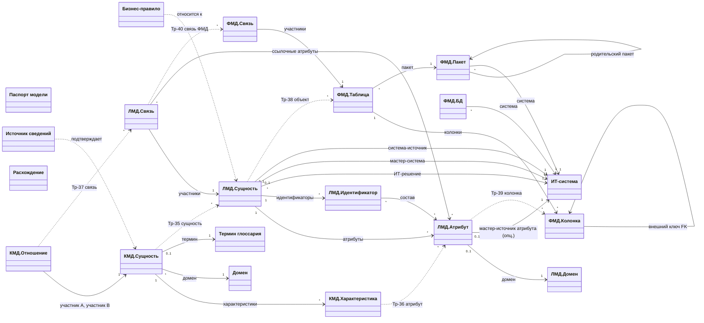

# Метамодель СиММы для моделей данных КМД / ЛМД / ФМД

**Версия:** 0.6, 2026-10-19 (0.6 — сопоставление с РП ч. 1, п. 3.5 «копирование моделей»: уточнена формулировка КР-1 — связь «родительская – дочерняя» связывает модели, а не элементы, и трассировку уровней не заменяет; этап 0 дополнен режимом эксплуатации «эталонная (родительская) модель → дочерние»; ОВ-7 — снапшоты полным копированием; новый ОВ-17 о функционале дочерней связи; 0.5 — уточнения по Требованиям ФМД: колонка Parent — дерево состава, Schema обязательна, полное имя «Схема.Код»; 0.4 — переход на «Правила моделирования v2.5» (LDM-09…11, перенумерация LDM-01…12, PDM-03/04 исключены, метасвязи 1–40); 0.3 — состав ФМД по требованиям заказчика; 0.2 — верификация по БЗ «Документация -СиММа»; 0.1 — первичная редакция)
**Статус:** проектный рабочий документ (вне нормативного комплекта `wrk/standard`; не заменяет его формулировки).
**История редакций:** одна редакция — один файл; версии фиксируются отдельными коммитами Git (v0.1 → v0.6, см. git log по этому файлу); изменения между редакциями оцениваются через git diff; при выпуске новой версии — отдельный коммит с версией в шапке документа.
**Назначение:** определить мета-модель классов СиММы (https://bm-symma.ru/) для ведения концептуальной (КМД), логической (ЛМД) и физической (ФМД) моделей данных со сквозными связями «сущность↔сущность» и «атрибут↔атрибут» между уровнями, а также порядок настройки метамодели в системе.

**Исходные материалы:**

- документация ПО СиММА (БЗ «Документация -СиММа»: «Введение в СиММА для v 2.9.1», «СиММА РП ч. 1 Архитектор» v2.12 (ПО 2.9.0.9), «СиММА РП ч. 2 Аналитик» v2.13);
- комплект Правил (рабочая редакция) — `wrk/standard/Правила.md` (в тексте — «Правила, 7.6» / «LDM-009») и приложения `wrk/standard/appendices/`;
- «Правила моделирования», v2.5 — предварительно согласованная корпоративная редакция (вложение от 2026-10-19; в тексте — **Правила v2.5**, правила `CDM-01…02, LDM-01…12, PDM-01…02`; заменила собой Реестр v.2.3);
- «ФМД. Требования» — таблица состава ФМД (вложение заказчика от 2026-10-19; ниже — Требования ФМД, ссылки по номерам строк № 1–40).

---

## 1. Границы задачи и исходные ограничения СиММы

1.1. **Что проектируется.** Метамодель СиМмы: перечень классов (метакаталогов), их метаатрибутов, метасвязей между классами с настройкой мощностей и видимости, атрибутов метасвязей, плюс порядок настройки и контроль целостности. Наполнение самих моделей (сущности предметной области) — вне этого документа.

1.2. **Ключевые свойства платформы СиММА, учтённые в проектировании** (по РП ч. 1 и Введению):

| № | Свойство платформы | Следствие для проектирования |
|---|---|---|
| П-1 | Метамодель = классы (метакаталоги) + метаатрибуты + метасвязи + стенсилы; элемент — инстанс класса; каталог — совокупность элементов одного класса | каждый конструктив КМД/ЛМД/ФМД выражается классом; «уровень модели» не встроен в СиММу и выражается составом каталогов |
| П-2 | Элемент может находиться только в одном каталоге (множественная классификация не поддерживается) | одна и та же сущность на разных уровнях — это **разные элементы** разных классов, связанные метасвязями трассировки |
| П-3 | Связь между элементами создаётся по шаблону метасвязи; метасвязь задаёт: названия полей-портов в обоих классах, «максимальное число связей в поле» (ограничение max), видимость (двусторонняя/односторонняя), тип (универсальная/иерархия/автомат/сеть) и декораторы схем; между одной парой классов допустимо несколько разных метасвязей; связи могут быть атрибутированы (атрибуты метасвязи заполняются на каждом экземпляре связи) | кардинальности связей модели данных реализуются комбинацией: max — настройкой метасвязи, min=1 — признаком «Обязательное поле» у порта; точные интервальные `min..max` и роли — атрибутами метасвязи и/или карточкой связи (см. КР-3) |
| П-4 | Связь в СиМме — ребро между **элементами**; связать связь со связью нельзя | трассировка «связь КМД ↔ связь ЛМД ↔ связь ФМД» требует, чтобы связи моделей данных были **элементами**-карточками (классы «КМД.Отношение», «ЛМД.Связь», «ФМД.Связь»), а не только графическими рёберами |
| П-5 | Типы метаатрибутов: Строка (до 125/250 знаков), Текст (16 тыс.), Текст HTML, Целое/Дробное число, Дата, Перечислимое (1)/(N), Массив строк/целых/дробных/дат, Файл, Индекс (aa.bb); базовые «Название» и «Описание» есть у каждого класса и не удаляются; один метаатрибут переиспользуется в нескольких классах | «имя» элемента = базовый «Название», «определение» = базовый «Описание»; повторно используемые свойства (статус определения, классы данных/конфиденциальности и т.п.) задаются **одним** метаатрибутом, включаемым в несколько классов |
| П-6 | У модели есть свои права доступа: «Чтение», «+Запись», «+Метамодель» (ведение классов/метаатрибутов/метасвязей/стенсилов), «+Доступы» | настройка метамодели — роль Архитектора метамодели («+Метамодель»); наполнение — роль Аналитика («+Запись») |
| П-7 | Связи между элементами возможны внутри одной модели; модель может копироваться целиком, «только ММ» или «ММ (дочерняя)» | все три уровня ведутся в **одной** модели СиМмы (КР-1); кросс-модельная трассировка средствами связей не поддерживается |

1.3. **Границы состава ФМД.** Правила v2.5 относят к ФМД только `PDM-01` (описание сущностей ФМД — поставщиков интеграций) и `PDM-02` (связь каждого атрибута ФМД с атрибутом ЛМД); владелец данных и мастер-система переведены на уровень ЛМД (`LDM-09`, `LDM-10`), поэтому из карточки ФМД.Таблица они исключены (дублирование нормативного содержания не допускается — комплект Правил, 2.7). Состав классов ФМД определён Требованиями ФМД (заказчик): иерархия ИТ-система → БД / Пакет → объект → колонка; ключи — признаки колонок (PK/AK) и ссылка (FK); связь — отдельный класс. Атрибуты за рамками (секционирование, табличные пространства, индексы, CHECK) — резерв расширения (класс «ФМД.Ограничение» из ред. 0.2 исключён из базового состава).

---

## 2. Ключевые проектные решения

**КР-1. Одна модель СиМмы для трёх уровней.** КМД, ЛМД, ФМД ведутся в одной модели СиМмы как три группы каталогов с префиксами классов «КМД.», «ЛМД.», «ФМД.» плюс общие справочные каталоги. Обоснование: сквозные связи (П-4, П-7) требуют единого пространства элементов; комплект Правил рассматривает соответствия КМД↔ЛМД↔ФМД как связи внутри одного авторитетного описания (Правила, 8.4–8.5, 11.1). Альтернатива «три модели СиМмы» (по модели на уровень) отклонена: связи **элементов** между моделями СиМмой не предусматриваются — трассировочные метасвязи 35–40 работают внутри одной модели, при разнесении уровней трассировка выродилась бы в текстовые ссылки. Не путать со связью **моделей** «родительская – дочерняя» (РП ч. 1, 3.5): она создаётся при копировании модели («Копировать только ММ (дочерняя)», «Копировать ММ и данные (дочерняя)»), связывает сами модели, а не их элементы, и трассировку уровней не заменяет; её роль в настоящей архитектуре — эталонная метамодель и снапшоты-версии (этап 0, ОВ-7, ОВ-17).

**КР-2. Сущность/атрибут/связь каждого уровня — отдельные классы.** Из П-2: «Сущность КМД» и «Сущность ЛМД» — разные классы с разным атрибутивным составом (КМД — определения и бизнес-идентичность; ЛМД — ключи, домены, обязательность, классификации; Правила, 2.2.2–2.2.3). Характеристика КМД (CDM-022–024) и атрибут ЛМД (LDM-004–008) также разведены по классам и связаны метасвязью трассировки.

**КР-3. Связи моделей данных — элементы-карточки + метасвязи участников.** Связь КМД/ЛМД/ФМД — самостоятельный элемент («КМД.Отношение», «ЛМД.Связь», «ФМД.Связь») с полным атрибутным составом карточки (участники и роли, кардинальности, характер связи — прил. Г.4; для ФМД — Требования ФМД № 36–40) и с портами на участников («Участник A», «Участник B», опционально «Участник C» для многосторонних — Правила, 6.5). Причины: (а) требуется трассировка связей между уровнями (П-4); (б) интервальные кардинальности с двух сторон, словесные прочтения и условия участия (Правила, 2.8, LDM-013, CDM-015) не помещаются в атрибуты графической связи. Отображение на схемах — через **объектные связи**: у классов КМД.Отношение, ЛМД.Связь, ФМД.Связь включается флаг «Использовать элементы класса для объектных связей», и элемент-связь привязывается к соединительной линии между графинами сущностей как объект связи, характеризующий эту линию (РП ч. 2, 7.10.5.4); карточка в каталоге остаётся авторитетным местом ведения (Правила, 2.8: «диаграмма — представление модели»). Резервный вариант — прямая графическая метасвязь «сущность–сущность» без атрибутов для обзорных схем; выбор режима — ОВ-2.

**КР-4. Мощности связей: max — метасвязь, min — обязательность поля-порта.** Точный интервал `min..max` фиксируется в атрибутах карточки связи (перечисления 0/1/N; для ФМД — `0..1/0..*/1..1/1..*` по Требованиям ФМД № 40); для трассировочных метасвязей M:N ограничение max не задаётся. Минимальная мощность 1 реализуется признаком «Обязательное поле» у порта участника; контроль min>1 (например, «ровно два родителя») СиМма автоматически не выполняет — фиксируется в атрибутах связи и проверяется по CI (разд. 4, 6).

**КР-5. Переиспользование метаатрибутов и единые перечисления.** Статус определения (Правила, 8.2), статус подтверждения (Правила, 5.8), разметка ИОД (прил. И), класс данных и класс конфиденциальности (Правила v2.5, LDM-07, LDM-08, LDM-12) задаются одними метаатрибутами, включаемыми в несколько классов с класс-специфичными названиями отображения (РП ч. 1, 4.2.3.1). Перечни значений ведутся централизованно в метаатрибуте.

**КР-6. Характеристики соответствий — атрибуты метасвязей трассировки.** Для «Тр: КМД→ЛМД» — вид соответствия (1:1/1:N/M:N) и комментарий изменений смысла (Правила, 8.4); для «Тр: ЛМД→ФМД» — тип (прямая/производная/агрегированная) и статус (актуально/расхождение зарегистрировано/утрачено) (Правила, 8.5). Атрибуты метасвязей — штатный функционал (РП ч. 1, 4.4.3–4.4.3.3; заполнение значений — «Карточка связи», вкладка «Атрибуты», РП ч. 2, 4.2.5.4). Допустимые типы атрибутов метасвязей ограничены: «Строка», «Текст», «Текст HTML», «Целое число», «Дробное число», «Дата», «Перечислимое (1)», «Индекс» — массивы не поддерживаются; все спроектированные атрибуты соответствий (вид/тип/статус, роль источника) имеют тип «Перечислимое (1)» или «Текст» и совместимы с этим ограничением.

**КР-7. Паспорт модели и реестр расхождений — классы-каталоги.** Поля паспорта модели (Правила, прил. Г.2) ведутся в элементе класса «Паспорт модели» (по одному элементу на модель); несопоставленные элементы и расхождения (Правила, 8.10) — в классе «Расхождение» с обязательными полями (вид соответствия, причина, статус, ответственный, срок пересмотра). Ссылки на затронутые элементы — текстом с ID элементов СиМмы (класс-«заглушка» с портами на все классы не создаётся из-за ОВ-6).

**КР-8. Нотация.** Для схем используются нотации «КМД», «ЛМД», «ФМД» (конструктор нотаций СиМмы): стенсилы сущностей/таблиц с полями (имя, определение), стенсил карточки связи, декораторы кардинальностей по прил. В (Crow's Foot + `min..max`); легенда обязательна (GEN-008). Детальная настройка стенсилов — этап 6 разд. 5.

**КР-9. Состав ФМД — по Требованиям ФМД (заказчик).** Колонка Parent требований задаёт дерево состава «что из чего состоит»: ИТ-система ← {ФМД.БД, ФМД.Пакет ← ФМД.Пакет (вложенность ≤ 2)}; ФМД.Таблица ← ФМД.Пакет; ФМД.Колонка и ФМД.Связь ← ФМД.Таблица (у связи владелец — участник A, см. 3.4.5). Дерево реализовано метасвязями владения 18–24. Ключи выражены признаками колонок (IsPK/IsAK) и ссылкой колонки (FK), а не классом ограничений — компактнее для импорта/экспорта и соответствует Требованиям ФМД; признак связи «материализованная / декларативная» (№ 38) отражает различие физически объявленных и логических связей (LDM-019). Двуязычие: код (англ., `*Code`) — пользовательский метаатрибут, имя (рус., `*Name`) — базовое «Название»; **полное имя объекта — «Схема.Код»** (например, `dbo.article`), выводится составным названием элемента (РП ч. 1, 4.2.3.7); уникальность полного имени в пределах БД — CI (ОВ-5).

**КР-10. Управленческие привязки ЛМД (Правила v2.5, LDM-09…11) — порты и переопределение на атрибутах.** Владелец данных (LDM-09) — метаатрибут-строка (подразделение/роль, не система); мастер-система (LDM-10, «где данные создаются») и система-источник (LDM-11, «откуда решение получает данные для внешней интеграции») — **порты на класс «ИТ-система»** (три разных метасвязи пары ЛМД.Сущность—ИТ-система: решение, мастер-система, система-источник; возможность нескольких метасвязей одной пары классов — П-3). Смешанные случаи («у разных атрибутов — разные») реализованы паттерном переопределения: атрибутные порты (метасвязи 16–17) и атрибут «Владелец данных» в ЛМД.Атрибут заполняются **только при отличии от сущностного** значения; контроль полноты LDM-09…11 — CI (в SiMMA условная обязательность портов не поддерживается). В ФМД эти привязки не дублируются (1.3).

---

## 3. Состав метамодели

Всего **20 классов**: 7 общих, 3 — КМД, 5 — ЛМД, 5 — ФМД. Префиксы обеспечивают алфавитную группировку каталогов; «Порядок» классов задаётся явно (этап 5 разд. 5). Формат карточки класса: назначение, таблица метаатрибутов (тип СиМмы; обязательность «об.» = «Обязательное поле»), основание. Базовые атрибуты «Название» и «Описание» входят в каждый класс и не удаляются (П-5); порты классов перечислены в таблицах метасвязей 3.5–3.6.

### 3.1. Общие (справочные) классы

#### 3.1.1. Паспорт модели

Назначение: паспорт модели по прил. Г.2 Правил; в модели ведётся **один** элемент этого класса.

| Метаатрибут | Тип СиМмы | Обяз. | Назначение / значения |
|---|---|---|---|
| Назначение | Текст | об. | для чего модель создана и применяется |
| Уровень и вид | Перечислимое (1) | об. | КМД / ЛМД / ФМД / комбинированная; вид по охвату (2.3) — в описании |
| Профили / спецификация | Строка | — | профили моделирования (2.4); принятая спецификация модели данных (Правила v2.5, LDM-02) |
| Режим | Перечислимое (1) | об. | TO-BE / AS-IS / смешанный |
| Домен / ИТ-решение | Строка | об. | бизнес-домен; для ЛМД/ФМД — ИТ-решение (Правила v2.5, LDM-01; см. ОВ-10) |
| Охват и исключения | Текст | об. | согласованные границы (5.2) |
| Версия и статус | Строка | об. | по статусной модели 11.9 |
| Ответственные | Текст | об. | владелец модели и иные роли (4.1) |
| Хранилище | Строка | — | авторитетное хранилище; порядок работы с копиями (11.1) |
| Дата актуальности | Дата | об. | дата и история изменений паспорта |

Основание: Правила, 5.1, 11.9; прил. Г.2; Правила v2.5 LDM-01, LDM-02.

#### 3.1.2. Домен

Назначение: бизнес-домен (справочник) — область ответственности и семантики (Правила, 2.2.1, прил. Т).

| Метаатрибут | Тип СиМмы | Обяз. | Назначение / значения |
|---|---|---|---|
| Код домена | Строка | об. | стабильный код в корпоративном пространстве имён |
| Владелец домена | Строка | об. | ответственный за определения домена |
| Назначение | Текст | — | содержание домена, основные зависимости |

Основание: Правила, 2.2.1, прил. Т.

#### 3.1.3. Термин глоссария

Назначение: термин бизнес-глоссария с определением и статусом (CDM-007, CDM-009, LDM-008; Правила v2.5 CDM-01, LDM-03). Базовое «Название» — термин, базовое «Описание» — определение.

| Метаатрибут | Тип СиМмы | Обяз. | Назначение / значения |
|---|---|---|---|
| Статус термина | Перечислимое (1) | об. | утверждён / предложен / отсутствует (Правила, 8.2) |
| Ссылка на глоссарий | Строка | — | ссылка на запись в корпоративном глоссарии/дата-каталоге |

Основание: Правила, 8.2; Правила v2.5 CDM-01, LDM-03.

#### 3.1.4. ИТ-система

Назначение: системы, платформы, СУБД, ИТ-решения (Правила v2.5, 1.1.1; Требования ФМД № 3–4). Участвует в портативных привязках ЛМД (решение, мастер-система, система-источник — КР-10) и ФМД (БД, пакеты).

| Метаатрибут | Тип СиМмы | Обяз. | Назначение / значения |
|---|---|---|---|
| Код EAM (SystemCode) | Строка | об. | системное наименование (англ.), код из EAM-каталога |
| Тип | Перечислимое (1) | об. | ИТ-система / платформа / СУБД |
| Владелец | Строка | — | ответственный за систему |

Основание: Правила v2.5 LDM-10, LDM-11 (мастер-система, система-источник); Требования ФМД № 3–4 (код EAM). Базовое «Название» — имя ИТ-системы (SystemName).

#### 3.1.5. Источник сведений

Назначение: источник для статусов подтверждения утверждений (Правила, 5.7–5.8, 9.2).

| Метаатрибут | Тип СиМмы | Обяз. | Назначение / значения |
|---|---|---|---|
| Тип источника | Перечислимое (1) | об. | документ / схема БД / код / интервью / профилирование / нормативный документ |
| Ссылка | Строка | — | адрес либо идентификатор источника |
| Дата фиксации | Дата | об. | дата фиксации состояния источника |

Основание: Правила, 5.7–5.8, 9.2.

#### 3.1.6. Бизнес-правило

Назначение: существенные бизнес-правила и декларативные ограничения всех уровней (CDM-025, LDM-021; Правила, 8.9, прил. С). Базовое «Описание» (Текст HTML) — формулировка.

| Метаатрибут | Тип СиМмы | Обяз. | Назначение / значения |
|---|---|---|---|
| Вид | Перечислимое (1) | об. | уникальность / несовместимость ролей / условие участия / диапазон / иное (Правила, 5.7) |
| Механизм контроля | Перечислимое (1) | об. | физически объявлено / контроль приложения / контроль загрузки / отдельная проверка / без контроля (8.9) |
| Состояние реализации | Перечислимое (1) | об. | реализовано / частично / запланировано / не реализовано / не установлено (8.9) |
| Уровень | Перечислимое (1) | об. | КМД / ЛМД / ФМД |

Основание: CDM-025, LDM-021; Правила, 8.9; прил. С.

#### 3.1.7. Расхождение

Назначение: единый реестр несопоставленных элементов и расхождений по всем видам соответствий (Правила, 8.10, Г.4).

| Метаатрибут | Тип СиМмы | Обяз. | Назначение / значения |
|---|---|---|---|
| Вид соответствия | Перечислимое (1) | об. | КМД↔ЛМД / ЛМД↔ФМД / КМД↔ФМД (без ЛМД) / глоссарий / референтная модель / иное |
| Ссылки на элементы | Массив строк | об. | ID элементов СиМмы — затронутые стороны |
| Причина | Текст | об. | причина несопоставления/расхождения |
| Статус | Перечислимое (1) | об. | открыто / в работе / закрыто |
| Ответственный | Строка | об. | роль/пользователь |
| Срок пересмотра | Дата | об. | дата пересмотра записи |

Основание: Правила, 8.10, Г.4.

Каталоги «Паспорт модели», «Бизнес-правило», «Расхождение» отображаются в списке каталогов; «Термин глоссария», «Домен», «ИТ-система», «Источник сведений» — по решению архитектора (справочники, наполняются до моделирования, этап 7).

### 3.2. Классы КМД

#### 3.2.1. КМД.Сущность

Назначение: концептуальная сущность (понятие) — базовый класс КМД. Базовое «Название» — имя понятия (CDM-008/009), базовое «Описание» — определение (CDM-010, не сводится к повторению имени).

| Метаатрибут | Тип СиМмы | Обяз. | Назначение / значения |
|---|---|---|---|
| Бизнес-идентичность | Текст | об. | что делает экземпляр самостоятельным; когда два представления — один объект (CDM-012) |
| Что представляет экземпляр | Перечислимое (1) | об. | объект / событие / состояние / версия / роль / агрегат за период (CDM-011) |
| Отличия от смежных понятий | Текст | — | границы понятия, существенные отличия (CDM-010) |
| Статус определения | Перечислимое (1) | об. | утверждён / предложен / локальное (8.2); переиспользуемый метаатрибут |
| Разметка ИОД | Перечислимое (N) | — | категории ИОД по прил. И (CDM-032); переиспользуемый |
| Внешний домен | Строка | — | понятие за границами модели и смысл соответствия (CDM-021) |

Основание: Правила, 6.2–6.4, 6.14; прил. Г.4; CDM-010…013, CDM-021, CDM-032.

#### 3.2.2. КМД.Характеристика

Назначение: характеристика понятия — включаются только характеристики, необходимые для понимания, а не полный атрибутивный состав (CDM-022). Ведётся из карточки сущности через порт (каталог скрыт).

| Метаатрибут | Тип СиМмы | Обяз. | Назначение / значения |
|---|---|---|---|
| Смысл | Текст | об. | смысл характеристики; не повторение имени (CDM-023) |
| Семантический класс | Перечислимое (1) | — | по прил. Е: сумма / цена / количество / ставка / процент / код / идентификатор / дата-время |
| Единица измерения | Строка | — | при существенности (CDM-023) |
| Когда должна быть известна | Текст | — | различать «неизвестно / не применимо / ещё не определено» (CDM-024) |
| Производное | Перечислимое (1) | — | да / нет (CDM-031) |
| Правило расчёта | Текст | — | для производных: правило, исходные понятия, временной контекст либо ссылка |

Основание: CDM-022…024, CDM-031; прил. Е.

#### 3.2.3. КМД.Отношение

Назначение: связь между понятиями — карточка связи (Правила v2.5 CDM-02; участники — через порты, метасвязи 2–4). Флаг «Использовать элементы класса для объектных связей» — включён (КР-3).

| Метаатрибут | Тип СиМмы | Обяз. | Назначение / значения |
|---|---|---|---|
| Словесное прочтение от A | Строка | об. | осмысленная фраза от участника A (Правила, 2.8; CDM-014) |
| Словесное прочтение от B | Строка | об. | осмысленная фраза от участника B |
| Характер | Перечислимое (1) | об. | входит в состав / является разновидностью / ссылается на справочник / участие / иное (CDM-02, CDM-026) |
| Min A / Max A | Перечислимое (1) ×2 | об. | мин./макс. участие стороны A: 0 / 1 / N (CDM-015) |
| Min B / Max B | Перечислимое (1) ×2 | об. | мин./макс. участие стороны B |
| Условия участия | Текст | — | «в момент / за срок», условное участие, зависимость от состояния (CDM-016) |
| Многосторонняя | Перечислимое (1) | — | да / нет; при «да» заполняется участник C (Правила, 6.5) |

Основание: CDM-014…017; Правила v2.5 CDM-02; Правила, 2.8, 6.5.

### 3.3. Классы ЛМД

#### 3.3.1. ЛМД.Сущность

Назначение: логическая сущность. Базовое «Название» — логическое имя (LDM-002/005), базовое «Описание» — смысл и что представляет один экземпляр (LDM-006).

| Метаатрибут | Тип СиМмы | Обяз. | Назначение / значения |
|---|---|---|---|
| Что представляет экземпляр | Перечислимое (1) | об. | объект / событие / состояние / версия / агрегат за период (LDM-006); переиспользуемый |
| Тип сущности | Перечислимое (1) | об. | основная / справочник / ассоциативная / зависимая / историческая / документная / вне охвата |
| Класс данных | Перечислимое (1) | об. | метаданные / основные / справочные / аналитические (Правила v2.5 LDM-07); переиспользуемый |
| Класс конфиденциальности | Перечислимое (1) | об. | по стандарту ИБ (Правила v2.5 LDM-08); переиспользуемый |
| Классификация ИОД | Перечислимое (1) | — | по стандарту ИБ; при смешанной — выше степень либо атрибутная разметка (Правила v2.5 LDM-12) |
| Владелец данных | Строка | об. | подразделение/роль (Правила v2.5 LDM-09); при нескольких владельцах — переопределяется на атрибутах (КР-10) |
| История / версионирование | Текст | — | связь бизнес-идентичности и идентификатора версии, периоды (LDM-006, 7.11) |
| Избыточность и обоснование | Текст | — | денормализация/дублирование и правила согласованности (LDM-032) |
| Статус определения | Перечислимое (1) | об. | утверждён / предложен / локальное; переиспользуемый |

Порты (управленческие привязки — КР-10): «ИТ-решение» (об., метасвязь 13), «Мастер-система (создание данных)» (метасвязь 14), «Система-источник (внешняя интеграция)» (метасвязь 15) — обязательность заполнения портов 14–15 контролируется CI (LDM-10, LDM-11).

Основание: LDM-004…008; Правила v2.5 LDM-01, LDM-03…12; Правила, 7.2, 7.11–7.12.

#### 3.3.2. ЛМД.Атрибут

Назначение: атрибут логической сущности. Базовое «Название» — имя атрибута в сущности (LDM-005), базовое «Описание» — смысл (LDM-007, не повторение имени). Ведётся из карточки сущности (каталог скрыт).

| Метаатрибут | Тип СиМмы | Обяз. | Назначение / значения |
|---|---|---|---|
| Тип атрибута | Перечислимое (1) | об. | бизнес / системный (LDM-007) |
| Обязательность | Перечислимое (1) | об. | обязательный / условный / необязательный (LDM-020) |
| Семантика неопределённости | Перечислимое (1) | — | неизвестно / не применимо / не получено (LDM-020) |
| Производный | Перечислимое (1) | — | да / нет (LDM-024) |
| Правило вычисления | Текст | — | правило, входные данные, условия, временной контекст (LDM-024) |
| Значение по умолчанию | Строка | — | с бизнес-смыслом; правило и момент применения (LDM-022) |
| Код: источник значений | Текст | — | для кодированных: локальный / корпоративный / внешний, смысл кодов (LDM-033) |
| Код: область уникальности | Строка | — | область уникальности кодов, правила актуальности (LDM-033) |
| Класс данных | Перечислимое (1) | — | заполняется при смешанной классификации сущности (Правила v2.5 LDM-07); переиспользуемый |
| Класс конфиденциальности | Перечислимое (1) | — | заполняется при смешанной классификации сущности (Правила v2.5 LDM-08); переиспользуемый |
| Владелец данных | Строка | — | при нескольких владельцах сущности (Правила v2.5 LDM-09; КР-10) |
| Разметка ИОД | Перечислимое (N) | — | атрибутная разметка при смешанной классификации (Правила v2.5 LDM-12); переиспользуемый |
| Статус определения | Перечислимое (1) | об. | переиспользуемый |

Порты: «Мастер-система» (опц., метасвязь 16), «Система-источник» (опц., метасвязь 17) — заполняются при отличии от сущностных значений (Правила v2.5 LDM-10, LDM-11; КР-10).

Основание: LDM-007, LDM-020, LDM-022, LDM-024, LDM-033; Правила v2.5 LDM-07…11; Правила, 7.4.

#### 3.3.3. ЛМД.Домен

Назначение: повторно используемый логический домен атрибутов (LDM-027; прил. Е). Базовое «Название» — имя домена, «Описание» — смысл домена.

| Метаатрибут | Тип СиМмы | Обяз. | Назначение / значения |
|---|---|---|---|
| Логический тип | Перечислимое (1) | об. | строка / целое / дробное / дата-время / булево / иное — без привязки к СУБД (LDM-023) |
| Допустимые значения / ограничения | Текст | — | набор значений, диапазоны, существенные ограничения |
| Формат | Строка | — | формат представления |
| Единица измерения | Строка | — | при существенности |
| Точность / масштаб | Строка | — | для числовых и дат |

Основание: LDM-023, LDM-027; прил. Е.

#### 3.3.4. ЛМД.Идентификатор

Назначение: основной либо альтернативный идентификатор сущности с составом из атрибутов (Правила v2.5 LDM-04; LDM-009–010). Состав — порты на ЛМД.Атрибут (метасвязь 8). Каталог скрыт.

| Метаатрибут | Тип СиМмы | Обяз. | Назначение / значения |
|---|---|---|---|
| Вид | Перечислимое (1) | об. | основной / альтернативный (LDM-009) |
| Состав (строкой) | Строка | об. | дублирует порты для отчётов/экспорта (Правила v2.5 LDM-04) |
| Обоснование выбора | Текст | — | для составного/суррогатного: семантика, устойчивость, область уникальности (LDM-010) |
| Способ генерации суррогата | Строка | — | документирование генерации суррогатного идентификатора (LDM-010) |

Основание: LDM-009, LDM-010; Правила v2.5 LDM-04.

#### 3.3.5. ЛМД.Связь

Назначение: логическая связь — карточка (Правила v2.5 LDM-05, LDM-06; участники — порты, метасвязи 9–10). Флаг «Использовать элементы класса для объектных связей» — включён (КР-3).

| Метаатрибут | Тип СиМмы | Обяз. | Назначение / значения |
|---|---|---|---|
| Словесное прочтение от A / от B | Строка ×2 | об. | смысл и роль связи с обеих сторон (LDM-011; Правила, 2.8) |
| Вид | Перечислимое (1) | об. | по справочнику типов: ссылочная / ассоциативная (M:N) / идентифицирующая / иерархия / рекурсивная / входит в состав / является разновидностью / ссылается на справочник / … (Правила v2.5 LDM-05, LDM-06 — перечень значений ведётся по корпоративному справочнику типов связей) |
| Min A / Max A | Перечислимое (1) ×2 | об. | 0 / 1 / N — интервальная кардинальность (LDM-013) |
| Min B / Max B | Перечислимое (1) ×2 | об. | 0 / 1 / N |
| Обязательность участия | Текст | — | явная обязательность/необязательность, допустимость частичного отсутствия (LDM-018) |
| Уникальность 1:1 | Перечислимое (1) | — | обеспечена / не обеспечена / не применимо (LDM-012) |
| Способ контроля целостности | Перечислимое (1) | об. | декларативное / приложение / логическое правило / не установлено (LDM-019) |
| Межсистемный линк | Текст | — | система-источник идентификатора, область уникальности, правила сопоставления (LDM-025) |

Основание: LDM-011…015, LDM-018, LDM-019, LDM-025; Правила v2.5 LDM-05, LDM-06.

### 3.4. Классы ФМД

Состав — по Требованиям ФМД (вложение от 2026-10-19); в таблицах указаны коды атрибутов из требований, а колонка Parent требований задаёт дерево состава (КР-9): принадлежность реализована метасвязями 18 (колонка ← объект), 19 (объект ← пакет), 20 (пакет ← пакет), 21 (БД ← система), 22 (пакет ← система); участники связей — 23–24. Отличия от ред. 0.2: добавлены ФМД.БД и ФМД.Пакет; класс «ФМД.Ограничение» исключён (ключи — признаки колонок № 26–28, FK — ссылка № 28, связи — класс ФМД.Связь № 36–40); CHECK и индексы — резерв расширения. Отличие от ред. 0.3 (Правила v2.5): из ФМД.Таблица исключены «Владелец данных» и «Мастер-система» (переведены на уровень ЛМД — LDM-09, LDM-10; 1.3). Отличие от ред. 0.4 (уточнения заказчика): Schema — обязательная схема-владелец объекта, полное имя «Схема.Код»; владелец связи — участник A.

#### 3.4.1. ФМД.БД

Назначение: база данных контура ИТ-системы; учёт технологии СУБД и имён БД (Требования ФМД, тип DB).

| Метаатрибут | Тип СиМмы | Обяз. | Назначение / значения |
|---|---|---|---|
| СУБД (DBMS) | Строка | об. | используемая технология СУБД, например PostgreSQL (№ 1) |
| Имя БД (DBName) | Строка | об. | системное наименование, англ. (№ 2) |

Порты: «ИТ-система» (об., метасвязь 21). Основание: Требования ФМД № 1–2.

#### 3.4.2. ФМД.Пакет

Назначение: пакет — бизнес-область в рамках ИТ-системы; группировка объектов хранения; вложенность ≤ 2 уровней (Требования ФМД, тип Package).

| Метаатрибут | Тип СиМмы | Обяз. | Назначение / значения |
|---|---|---|---|
| Код пакета (PackageCode) | Строка | об. | системное наименование, англ. (№ 5) |

Базовое «Название» — имя пакета (PackageName, № 6). Порты: «ИТ-система» (об., 22), «Родительский пакет» (опц., 20, тип «Иерархия»), «Объекты пакета» (19). Основание: Требования ФМД № 5–7.

#### 3.4.3. ФМД.Таблица

Назначение: объект хранения — таблица / представление / materialized view (Требования ФМД, тип Entity). Базовое «Название» — имя объекта (ObjectName, рус., № 10); базовое «Описание» — описание объекта (№ 12). Родительская система — через пакет и ИТ-систему (метасвязи 19, 22); владелец данных и мастер-система — на уровне ЛМД (Правила v2.5 LDM-09, LDM-10).

| Метаатрибут | Тип СиМмы | Обяз. | Назначение / значения |
|---|---|---|---|
| Код объекта (ObjectCode) | Строка | об. | системное наименование, англ. (№ 9); **полное имя объекта — «Схема.Код»** (dbo.article) — выводится составным названием элемента; уникальность полного имени в пределах БД — CI (ОВ-5) |
| Тип объекта (ObjectType) | Перечислимое (1) | об. | таблица / представление / materialized view (№ 11) |
| Схема / владелец (Schema) | Строка | об. | схема-владелец объекта, англ. (№ 8); **обязательна**: в одной БД в разных схемах возможны одноимённые объекты (dbo.article и acc.article); входит в полное имя объекта и в FK-ссылки (№ 28) |
| Аннотация (ObjectDefinition) | Текст | — | определение / дополнительное описание (№ 13) |
| Признак использования (ObjectIsUsed) | Перечислимое (1) | — | да (по умолчанию) / нет — вывод на схемы и в отчёты (№ 14) |
| Стереотип (ObjectStereotype) | — | — | графические свойства; реализуется стенсилами/форматами класса; автозависимость от признака использования — ОВ-11 (№ 15) |
| Теги (Tags) | Массив строк | — | ключевые слова (№ 16) |
| Поставщик интеграций | Перечислимое (1) | об. | да / нет — участвует в интеграциях ИТ-решения в качестве поставщика данных (Правила v2.5 PDM-01) |

Порты: «Пакет» (об., 19), «Колонки» (18), «Участник A/B связей» (23–24), «Реализуется в» (38). Основание: Требования ФМД № 8–19; Правила v2.5 PDM-01; Правила, 8.5.

#### 3.4.4. ФМД.Колонка

Назначение: колонка (поле) объекта хранения (Требования ФМД, тип Attribute). Базовое «Название» — имя атрибута (AttributeName, рус., № 21); базовое «Описание» — описание атрибута (№ 30). Каталог скрыт; ведётся из карточки объекта.

| Метаатрибут | Тип СиМмы | Обяз. | Назначение / значения |
|---|---|---|---|
| Код атрибута (AttributeCode) | Строка | об. | системное наименование, англ. (№ 20) |
| Порядок сортировки (SortOrder) | Целое число | об. | порядок колонки в объекте; для экспорта DDL и отчётов (№ 22) |
| Тип данных (DataType) | Строка | об. | поддерживаемый тип СУБД либо тип данных домена (№ 23) |
| Домен (Domain) | Порт → ЛМД.Домен | — | переиспользование каталога доменов; целесообразность сейчас — ОВ-14 (№ 24) |
| Обязательность (IsMandatory) | Перечислимое (1) | об. | да (по умолчанию) / нет — недопущение пустых значений (№ 25) |
| Первичный ключ (IsPK) | Перечислимое (1) | об. | да / нет (№ 26) |
| Альтернативный ключ (IsAK) | Перечислимое (1) | об. | да / нет (№ 27) |
| № альтернативного ключа | Целое число | — | заполняется при IsAK = да; номерной учёт при 2+ АК в сущности — ОВ-13 |
| Внешний ключ (FK) | Порт → ФМД.Колонка | — | ссылка на колонку родительского объекта (Schema.ObjectCode.AttributeCode, № 28); метасвязь 25; поле обязательно к ведению, пустая ссылка = нет FK |
| Значение по умолчанию (Default) | Строка | — | по умолчанию пусто (№ 29) |
| Аннотация (AttributeDefinition) | Текст | — | определение / дополнительное описание (№ 31) |
| Категория данных (DataCategory) | Перечислимое (N) | об. | категории важности, включая ПДн как отдельные признаки; значения — из Каталога данных; совместимость кодов — ОВ-12 (№ 32) |

Порты: «Объект» (об., 18), «Ссылается на колонку (FK)» (25), «Соответствует атрибуту» (**об.**, 39 — Правила v2.5 PDM-02). Основание: Требования ФМД № 20–32; Правила v2.5 PDM-02; Правила, 8.5.

#### 3.4.5. ФМД.Связь

Назначение: отношение между объектами хранения одного типа модели (Требования ФМД, тип Relationship; участники — порты, метасвязи 23–24). **Владелец связи** (колонка Parent требований № 36–40 = Object Code) — участник A: дочерний объект, на котором объявляется отношение (материализованная связь — физический FK в его колонках). Флаг «Использовать элементы класса для объектных связей» — включён (КР-3). Каталог скрыт.

| Метаатрибут | Тип СиМмы | Обяз. | Назначение / значения |
|---|---|---|---|
| Код отношения (RelationshipCode) | Строка | об. | системное наименование, англ. (№ 36) |
| Имя отношения (RelationshipName) | Название (базовый) | — | имя связи, рус. (№ 37); рекомендуется обязательное заполнение для связей между сервисами (микросервисы) |
| Тип по реализации (RelationshipIsUsed) | Перечислимое (1) | об. | материализованная (по умолчанию; физический FK существует) / декларативная (только в модели) — № 38; семантика — LDM-019 |
| Кардинальность (Cardinality) | Перечислимое (1) | об. | 0..1 / 0..* / 1..1 / 1..* (№ 40) |
| Стереотип (RelationshipStereotype) | — | — | стенсилы класса; автозависимость от типа по реализации — ОВ-11 (№ 39) |

Основание: Требования ФМД № 36–40; LDM-019; Правила, 8.5.

Скрытые каталоги (флаг «Отображать в списке каталогов» выключен): КМД.Характеристика, ЛМД.Атрибут, ЛМД.Идентификатор, ФМД.Колонка, ФМД.Связь — ведутся из карточек владельцев через порты (РП ч. 1, 4.2.2, пример «Атрибут объекта данных»).

### 3.5. Метасвязи внутри уровней

Формат: **Название метасвязи** — Класс 1 «порт 1» (max; обяз.) ↔ Класс 2 «порт 2» (max; обяз.) [атрибуты метасвязи]. Тип «Универсальная», видимость «Двусторонняя», если не указано иное.

**КМД:**

1. **КМД: характеристики** — КМД.Сущность «Характеристики» (N) ↔ КМД.Характеристика «Сущность» (1; об.).
2. **КМД: участник A** — КМД.Отношение «Участник A» (1; об.) ↔ КМД.Сущность «Участник A отношений» (N).
3. **КМД: участник B** — КМД.Отношение «Участник B» (1; об.) ↔ КМД.Сущность «Участник B отношений» (N).
4. **КМД: участник C (опц.)** — КМД.Отношение «Участник C» (1) ↔ КМД.Сущность «Участник C отношений» (N) — для многосторонних (Правила, 6.5); порт не обязателен.
5. **КМД: принадлежность домену** — КМД.Сущность «Домен» (1; об.) ↔ Домен «Понятия домена» (N).

**ЛМД:**

6. **ЛМД: атрибутный состав** — ЛМД.Сущность «Атрибуты» (N) ↔ ЛМД.Атрибут «Сущность» (1; об.).
7. **ЛМД: идентификатор сущности** — ЛМД.Сущность «Идентификаторы (осн. и альт.)» (N) ↔ ЛМД.Идентификатор «Сущность» (1; об.).
8. **ЛМД: состав идентификатора** — ЛМД.Идентификатор «Атрибуты состава» (N; об.) ↔ ЛМД.Атрибут «Входит в идентификаторы» (N).
9. **ЛМД: участник A** — ЛМД.Связь «Участник A (сущность)» (1; об.) ↔ ЛМД.Сущность «Участник A связей» (N).
10. **ЛМД: участник B** — ЛМД.Связь «Участник B (сущность)» (1; об.) ↔ ЛМД.Сущность «Участник B связей» (N).
11. **ЛМД: ссылочный атрибут** — ЛМД.Связь «Ссылочные атрибуты (FK)» (N) ↔ ЛМД.Атрибут «Реализует связи» (N) — соответствие ссылочного атрибута и цели (LDM-011/LDM-014).
12. **ЛМД: домен атрибута** — ЛМД.Атрибут «Домен» (1) ↔ ЛМД.Домен «Атрибуты домена» (N).
13. **ЛМД: принадлежность решению** — ЛМД.Сущность «ИТ-решение» (1; об.) ↔ ИТ-система «Сущности решения» (N) — Правила v2.5 LDM-01.
14. **ЛМД: мастер-система** — ЛМД.Сущность «Мастер-система (создание данных)» (1) ↔ ИТ-система «Мастер-система сущностей» (N) — Правила v2.5 LDM-10; полнота заполнения — CI.
15. **ЛМД: система-источник** — ЛМД.Сущность «Система-источник (внешняя интеграция)» (1) ↔ ИТ-система «Поставляет данные сущностям» (N) — Правила v2.5 LDM-11; полнота — CI.
16. **ЛМД: мастер-система атрибута (опц.)** — ЛМД.Атрибут «Мастер-система» (1) ↔ ИТ-система «Мастер-система атрибутов» (N) — заполняется при отличии от сущностного значения (КР-10).
17. **ЛМД: система-источник атрибута (опц.)** — ЛМД.Атрибут «Система-источник» (1) ↔ ИТ-система «Поставляет данные атрибутам» (N) — аналогично (КР-10).

**ФМД:**

18. **ФМД: колонки** — ФМД.Таблица «Колонки» (N) ↔ ФМД.Колонка «Объект» (1; об.).
19. **ФМД: пакет объекта** — ФМД.Таблица «Пакет» (1; об.) ↔ ФМД.Пакет «Объекты пакета» (N) — родительская система объекта определяется через пакет.
20. **ФМД: иерархия пакетов** — ФМД.Пакет «Родительский пакет» (1) ↔ ФМД.Пакет «Дочерние пакеты» (N) — тип «Иерархия»; глубина ≤ 2 уровней (Требования ФМД № 7) — контроль организационно/CI.
21. **ФМД: БД системы** — ФМД.БД «ИТ-система» (1; об.) ↔ ИТ-система «Базы данных» (N).
22. **ФМД: пакеты системы** — ФМД.Пакет «ИТ-система» (1; об.) ↔ ИТ-система «Пакеты» (N).
23. **ФМД: участник A** — ФМД.Связь «Участник A (объект)» (1; об.) ↔ ФМД.Таблица «Участник A связей» (N).
24. **ФМД: участник B** — ФМД.Связь «Участник B (объект)» (1; об.) ↔ ФМД.Таблица «Участник B связей» (N).
25. **ФМД: ссылочная колонка (FK)** — ФМД.Колонка «Ссылается на колонку (FK)» (1) ↔ ФМД.Колонка «На неё ссылаются (FK)» (N) — внутриклассовая; реализует ссылку FK (Требования ФМД № 28); согласованность типов ссылки и цели (LDM-014) — CI.

**Общие (термины, подтверждение, правила):**

26. **Термины: сущность КМД** — КМД.Сущность «Термин глоссария» (1) ↔ Термин глоссария «Понятия КМД» (N).
27. **Термины: сущность ЛМД** — ЛМД.Сущность «Термин глоссария» (1) ↔ Термин «Сущности ЛМД» (N).
28. **Термины: атрибут ЛМД** — ЛМД.Атрибут «Термин глоссария» (1) ↔ Термин «Атрибуты ЛМД» (N).
29. **Подтверждение: КМД** — Источник «Подтверждает элементы КМД» (N) ↔ КМД.Сущность «Источники» (N) [атрибут метасвязи: Роль источника (Перечислимое (1): подтверждает/противоречит; об.)].
30. **Подтверждение: ЛМД** — Источник «Подтверждает элементы ЛМД» (N) ↔ ЛМД.Сущность «Источники» (N) [та же].
31. **Правила: понятие** — Бизнес-правило «Понятия КМД» (N) ↔ КМД.Сущность «Правила» (N).
32. **Правила: сущность ЛМД** — Бизнес-правило «Сущности ЛМД» (N) ↔ ЛМД.Сущность «Правила» (N).
33. **Правила: атрибут** — Бизнес-правило «Атрибуты» (N) ↔ ЛМД.Атрибут «Правила» (N).
34. **Правила: связь** — Бизнес-правило «Связи ЛМД» (N) ↔ ЛМД.Связь «Правила» (N).

### 3.6. Сквозные метасвязи трассировки

Требование: связи между сущностями и между атрибутами уровней КМД↔ЛМД и ЛМД↔ФМД. Все сквозные метасвязи — тип «Универсальная», видимость «Двусторонняя», max не ограничен (M:N — Правила, 2.6, 8.4).

| № | Метасвязь | Класс 1 ↔ Класс 2 | Порты (обяз.) | Атрибуты метасвязи | Основание |
|---|---|---|---|---|---|
| 35 | **Тр: сущность КМД→ЛМД** | КМД.Сущность ↔ ЛМД.Сущность | «Детализируется в ЛМД» / «Соответствует КМД» (со стороны ЛМД — об. при существующей КМД) | Вид соответствия (Перечислимое (1): 1:1/1:N/M:N), Изменение смысла (Текст) | CDM-035, LDM-003, LDM-030; Правила, 8.4 |
| 36 | **Тр: характеристика КМД→атрибут ЛМД** | КМД.Характеристика ↔ ЛМД.Атрибут | «Детализируется в атрибуты» / «Соответствует характеристике» | Вид соответствия (1:1/1:N/M:N) | Правила, 8.4 |
| 37 | **Тр: отношение КМД→связь ЛМД** | КМД.Отношение ↔ ЛМД.Связь | «Реализуется в связях ЛМД» / «Соответствует отношению КМД» | Вид соответствия | Правила, 8.4 |
| 38 | **Тр: сущность ЛМД→объект ФМД** | ЛМД.Сущность ↔ ФМД.Таблица | «Реализуется в» / «Соответствует сущности» | Тип (прямая/производная/агрегированная), Статус (актуально/расхождение зарегистрировано/утрачено) | Правила, 8.5 |
| 39 | **Тр: атрибут ЛМД→колонка ФМД** | ЛМД.Атрибут ↔ ФМД.Колонка | «Реализуется в колонках» / «Соответствует атрибуту» (**обяз. со стороны колонки** — Правила v2.5 PDM-02) | Тип, Статус (те же) | Правила, 8.5; Правила v2.5 PDM-02; Требования ФМД |
| 40 | **Тр: связь ЛМД→связь ФМД** | ЛМД.Связь ↔ ФМД.Связь | «Реализуется в связях ФМД» / «Соответствует связи ЛМД» | Тип, Статус | Правила, 8.5, 8.9; LDM-019 |

Прямая трассировка КМД↔ФМД **не создаётся** (см. ОВ-1): при отсутствии ЛМД соответствие фиксируется в «Расхождении» (вид «КМД↔ФМД (без ЛМД)») текстовыми ссылками на ID.

### 3.7. Диаграмма метамодели

Легенда: сплошные линии `-->` — метасвязи внутри уровней и со справочными классами (подписи — названия портов; петли — внутриклассовые связи «иерархия пакетов» и «ссылочная колонка FK»; линии ЛМД→ИТ-система: решение / мастер-система / система-источник, метасвязи 13–15; атрибутные порты 16–17 показаны одной обобщённой линией), пунктир `..>` — сквозные метасвязи трассировки (номера — таблица 3.6). «Паспорт модели» и «Расхождение» — самостоятельные каталоги без связей с классами уровней (ведение — по Г.2 и 8.10, ссылки на элементы — текстом). Мощности на диаграмме ориентировочные; точные настройки портов — таблицы 3.5–3.6.

---

## 4. Что СиММА контролирует автоматически, а что — нет

| Контроль | Механизм СиМмы | Статус |
|---|---|---|
| Max мощность связи («не более N связанных элементов») | «Максимальное число связей в поле» метасвязи | автоматически |
| Min мощность = 1 (участник обязательно указан) | «Обязательное поле» порта; проверка выполняется при **редактировании** элемента — при создании элемента обязательность игнорируется (РП ч. 1, 4.2.3.3) | автоматически, с оговоркой |
| Обязательность метаатрибутов карточки | «Обязательное поле» метаатрибута | автоматически |
| Интервальные кардинальности `min..max` (min>1, «ровно N»), совпадение трёх форм представления связи | атрибуты карточки связи; проверка выгрузкой (CSV/Excel) в CI | организационно / CI |
| Уникальность имён/кодов в пространствах имён (CDM-009, LDM-005; ObjectCode/AttributeCode/PackageCode) | «Поиск дублей в каталоге» (вручную) + CI по экспорту | организационно / CI |
| Полнота управленческих привязок ЛМД: решение, мастер-система, система-источник, владелец (Правила v2.5 LDM-01, LDM-09…11) | порты 13–17 и атрибут «Владелец данных»; порты 14–15 без принудительной обязательности (условная обязательность не поддерживается) | CI |
| Каждая колонка сопоставлена с атрибутом ЛМД (Правила v2.5 PDM-02) | обязательный порт метасвязи 39 | автоматически (после настройки) |
| FK-ссылка указывает на колонку родительского объекта; типы ссылки и цели согласованы (LDM-014) | метасвязь 25 (рекурсивная); семантика цели — CI | частично автоматически / CI |
| Глубина иерархии пакетов ≤ 2 уровней (Требования ФМД № 7) | метасвязь 20 не ограничивает глубину — CI | организационно / CI |
| Зависимость стенсила от признака использования (№ 15, 39) | нет | ОВ-11 |
| Двойное ведение «карточка связи ↔ графическая связь на обзорной схеме» | нет | организационно (ОВ-2) |
| Статусное соответствие ЛМД↔ФМД (актуально/расхождение/утрачено) | атрибуты метасвязи 38–40 | вручную |
| Правило тройного соответствия (графика + `min..max` + два прочтения) | нет | проверка по прил. В/Ж, выгрузка в CI |

---

## 5. Порядок настройки в СиММА

Роли: настройка — пользователь с правом «+Метамодель» (Архитектор метамодели); наполнение — «+Запись» (Аналитик). Порядок этапов 2–8 соответствует рекомендованному порядку настройки метамодели в РП ч. 1, 4.1.2 (классы → метасвязи → метаатрибуты → порядок атрибутов → порядок классов → стенсилы → атрибуты метасвязей).

**Этап 0. Создание модели.** Создать модель СиМмы (например, «Модели данных»). Вариант: создать как копию шаблонной метамодели ERD «только ММ» и доработать (РП ч. 1, 3.5) — быстрее по стенсилам, но потребуется ревизия классов; вариант «с нуля» чище. Назначить права: архитекторам «+Метамодель», аналитикам «+Запись», остальным «Чтение». Режим эксплуатации (РП ч. 1, 3.5): после настройки и приёмки метамодели (этапы 1–9) модель становится **эталонной (родительской)**; эксперименты и доменные развилки ведутся в дочерних моделях («Копировать только ММ (дочерняя)» — наследуется метамодель без данных); перед крупными изменениями наполнения базовая версия фиксируется полным копированием («Копировать ММ и данные (дочерняя)») с видимым происхождением. Уровни КМД/ЛМД/ФМД всегда остаются вместе в каждой модели (КР-1); функциональные возможности дочерней связи — ОВ-17.

**Этап 1. Справочники перечислений (заготовки).** Согласовать перечни значений для перечислимых метаатрибутов: «Что представляет экземпляр», «Тип сущности», «Характер связи КМД»; **справочник типов связей ЛМД** (Правила v2.5 LDM-05/06: базовые «входит в состав», «является разновидностью», «ссылается на справочник» + остальные по корпоративному справочнику), «Статус термина», «Статус определения», «Класс данных», «Класс конфиденциальности», «Разметка ИОД» (по прил. И), «Семантический класс» (по прил. Е), «Вид соответствия», «Тип/Статус ЛМД↔ФМД», «Тип объекта» (№ 11), «Категория данных» (№ 32 — из Каталога данных, ОВ-12), «Тип по реализации» (№ 38), «Кардинальность ФМД» (№ 40).

**Этап 2. Классы (метакаталоги).** Создать 20 классов по подразделам 3.1–3.4: «Метамодель → Классы → Создать класс». Для каждого: название с префиксом уровня; «Описание» — назначение из карточки класса; флаги: «Отображать в списке каталогов» — выключить для КМД.Характеристика, ЛМД.Атрибут, ЛМД.Идентификатор, ФМД.Колонка, ФМД.Связь; «Порядок» — задать на этапе 5; «Использовать элементы класса для объектных связей» — включить для КМД.Отношение, ЛМД.Связь, ФМД.Связь (КР-3); поле «Нотация» — заполнить на этапе 6.

**Этап 3. Метасвязи.** «Метамодель → Метасвязи → Создать метасвязь»: выбрать пару классов, затем в окне настройки заполнить: «Название метасвязи» (по таблицам 3.5–3.6), «Поле для связывания» в обоих классах (названия портов из таблиц), «Максимальное число связей в поле» (max), тип «Универсальная» (для метасвязи 20 — «Иерархия»), видимость «Двусторонняя», декораторы по нотации (для участников связей — crow's foot). Порядок: сначала внутриуровневые (1–25), затем общие (26–34), затем трассировочные (35–40). У трассировочных 35–40 max не задавать (M:N); включить «Обязательное поле» портов: «ИТ-решение» метасвязи 13, «Объект» метасвязи 18, «Пакет» метасвязи 19, «Соответствует атрибуту» метасвязи 39 (в классе ФМД.Колонка); порты мастер-/источника 14–17 и FK-порт 25 — необязательные (полнота — CI, КР-10).

**Этап 4. Метаатрибуты.** Создавать от общих к специальным, переиспользуя (КР-5): «Статус определения» — в КМД.Сущность, ЛМД.Сущность, ЛМД.Атрибут; «Разметка ИОД» — в КМД.Сущность, ЛМД.Сущность, ЛМД.Атрибут; «Что представляет экземпляр» — в КМД.Сущность, ЛМД.Сущность; «Словесное прочтение от A/B» — в КМД.Отношение, ЛМД.Связь; **«Класс данных» и «Класс конфиденциальности» — в ЛМД.Сущность (об.) и ЛМД.Атрибут (опц., при смешанной классификации)**; «Владелец данных» — в ЛМД.Сущность (об.) и ЛМД.Атрибут (опц.). В каждом классе настроить: «Название в классе», «Обязательное поле», «Вкладка» (рекомендуемые: «Основные» — базовые и коды; «Идентификация» — ключи/идентификаторы; «Классификация» — класс данных, конфиденциальность, ИОД, категория данных; «Управление» — владелец данных, мастер-система, система-источник; «Реализация» — тип по реализации, кардинальность ФМД), «Значение» (по умолчанию — например, IsMandatory=«да», ObjectIsUsed=«да»), составы значений перечислимых. Атрибуты метасвязей (Роль источника; Вид/Тип/Статус соответствий) — последний шаг этапа: в окне редактирования метасвязи включить метаатрибуты в список «Атрибуты связи» и настроить их вывод на карточки и схемы (РП ч. 1, 4.4.3.1–4.4.3.3); типы — только скалярные (КР-6).

**Этап 5. Порядок отображения.** Упорядочить метаатрибуты в карточках (drag-and-drop в форме настройки класса) и классы: Паспорт модели → Домен → Термин глоссария → ИТ-система → Источник сведений → КМД.Сущность → КМД.Отношение → ЛМД.Сущность → ЛМД.Связь → ЛМД.Домен → ФМД.БД → ФМД.Пакет → ФМД.Таблица → Бизнес-правило → Расхождение. «Сохранить порядок».

**Этап 6. Стенсилы и нотации.** Создать стенсилы: «Сущность КМД» (прямоугольник; поля: Название, Описание), «Сущность ЛМД» (поля: Название, тип сущности), «Карточка связи» (ромб/плашка: прочтение, характер/вид, min..max), «Объект ФМД» (поля: код, имя, тип объекта; варианты «в использовании / выведен из использования» — ОВ-11), «Пакет ФМД». Стенсил можно создать со схемы: настроить вид графина → контекстное меню «Формат класса → Создать стенсил» (РП ч. 1, 4.5.2). Создать нотации «КМД», «ЛМД», «ФМД» («Метамодель → Нотации»: название, уникальный тег, источник «Фирменная»; тег без специальных сигнатур), привязать классы к нотациям (поле «Нотации» в окне редактирования класса; класс может входить в несколько нотаций — РП ч. 1, 5.1.2) и стенсилы к нотациям (на схеме с назначенной нотацией доступны только стенсилы этой нотации — РП ч. 1, 5.1.3). Настроить декораторы метасвязей: участники — «воронья лапка»/штрихи по прил. В; трассировочные — пунктир. Для отображения связей на схемах использовать объектные связи (КР-3): линия между сущностями + элемент КМД.Отношение / ЛМД.Связь / ФМД.Связь как объект связи (РП ч. 2, 7.10.5.4).

**Этап 7. Наполнение справочников.** Завести элементы: Паспорт модели (1 шт., поля по Г.2, включая ИТ-решение и спецификацию — Правила v2.5 LDM-01/02); ИТ-системы (коды EAM — Требования ФМД № 3–4; база для портов 13–17 и 21–22); Домены (по прил. Т); Термины глоссария (выгрузка из корпоративного глоссария; при большом объёме — импорт CSV, РП ч. 2, 4.4); Источники; при наличии — ФМД.БД и ФМД.Пакеты из реестров EAM/каталога (импорт CSV).

**Этап 8. Представления и проверки.** Создать представления (каскадные таблицы, РП ч. 2, разд. 5): «Домен → КМД.Сущность → характеристики»; «ИТ-решение → ЛМД.Сущность → атрибуты → идентификаторы»; «ИТ-система → ФМД.Пакет → ФМД.Таблица → колонки»; «Мастер-система → сущности ЛМД» (LDM-10); «ЛМД.Сущность ↔ ФМД.Таблица» (уровни по трассировочным метасвязям); «Несопоставленное» (фильтр: элементы без связей 35/38/39); «Незаполненные привязки» (сущности без мастера/источника/владельца — LDM-09…11). Настроить экспорт каталогов в CSV/Excel для CI-проверок (Правила, 1.2.2.2: контроль в конвейере CI/CD). Чек-лист приёмки настройки:

- [ ] все 20 классов созданы по подразделам 3.1–3.4, скрытые каталоги скрыты, порядок задан;
- [ ] метасвязи 1–40 созданы; порты обязательны у метасвязей 2, 3, 9, 10, 13, 18, 19, 21, 22, 23, 24, 35 (сторона ЛМД при наличии КМД), 39 (сторона ФМД.Колонка); max соответствуют таблицам 3.5–3.6;
- [ ] перечислимые значения совпадают с согласованными перечнями (этап 1), включая справочник типов связей ЛМД; значения по умолчанию (IsMandatory, ObjectIsUsed, Тип по реализации) выставлены;
- [ ] тестовые элементы: создан фрагмент сквозного примера (сущность → характеристика → атрибут → колонка; КМД.Отношение → ЛМД.Связь → ФМД.Связь; трассировки 35–40; FK-ссылка колонки; привязки мастер-/источника), проверки обязательности и max срабатывают;
- [ ] стенсилы и нотации привязаны; легенда схемы соответствует прил. В;
- [ ] представления и экспорт работают; права доступа назначены.

**Этап 9. Пилот.** Провести пилотное наполнение на согласованном фрагменте (рекомендуется сквозной биржевой пример — прил. Н Правил): КМД-фрагмент → ЛМД → ФМД со всеми видами трассировок, включая случай «технический элемент без концептуального аналога» (Правила, 2.6), M:M-соответствие, иерархию пакетов, FK-ссылку и смешанные классификации (атрибутная разметка LDM-07/08). По итогам — ревизия ОВ-2, ОВ-4, ОВ-5, ОВ-11…ОВ-15.

---

## 6. Соответствие правилам контроля (Правила v2.5 / комплект Правил / Требования ФМД)

Соответствие номеров v2.3 → v2.5: глоссарий ЛМД LDM-02→03; состав УИ LDM-03→04; базовые связи ЛМД LDM-04→05; остальные связи LDM-05→06; класс данных LDM-05(дубль)→07; конфиденциальность LDM-06→08; ИОД LDM-07→12; соответствие спецификации LDM-01→02; новые: LDM-01 (уровень ИТ-решения), LDM-09 (владелец), LDM-10 (мастер-система), LDM-11 (система-источник, в источнике опечатка префикса «LMD-11»); исключены PDM-03/PDM-04.

| Правило | Требование (кратко) | Механизм метамодели |
|---|---|---|
| CDM-01 (v2.5) / CDM-007 | определение глоссария для каждой сущности КМД | метасвязь 26 «Термины: сущность КМД» + статус термина |
| CDM-02 (v2.5) / CDM-014–016 | базовые типы связей КМД описаны | атрибут «Характер» класса КМД.Отношение (входит в состав / является разновидностью / ссылается на справочник) |
| LDM-01 (v2.5) | ЛМД определяется на уровне ИТ-решения | метасвязь 13 «ЛМД: принадлежность решению» (обязательный порт) + поле «Домен / ИТ-решение» в Паспорте модели |
| LDM-02 (v2.5) | соответствие принятой спецификации | Паспорт модели, поле «Профили / спецификация»; контроль — организационный |
| LDM-03 (v2.5) / LDM-008 | определения глоссария для сущностей ЛМД | метасвязи 27–28 |
| LDM-04 (v2.5) / LDM-009–010 | состав полей уникального идентификатора | класс ЛМД.Идентификатор + метасвязи 7–8 (состав — порты на атрибуты) |
| LDM-05 (v2.5) | базовые типы связей ЛМД описаны | атрибут «Вид» ЛМД.Связь — базовые значения перечня |
| LDM-06 (v2.5) | остальные типы связей — по справочнику типов | перечень значений «Вид» ведётся по корпоративному справочнику типов связей (этап 1); РЕКОМЕНДУЕТСЯ — контроль CI |
| LDM-07 (v2.5) | класс данных; при смешанной классификации — для атрибутов | «Класс данных» в ЛМД.Сущность (об.) + в ЛМД.Атрибут (при смешанной) |
| LDM-08 (v2.5) | класс конфиденциальности; при смешанной — для атрибутов | «Класс конфиденциальности» в ЛМД.Сущность (об.) + в ЛМД.Атрибут |
| LDM-09 (v2.5) | владелец данных; при нескольких — для атрибутов | «Владелец данных» в ЛМД.Сущность (об.) + в ЛМД.Атрибут (КР-10) |
| LDM-10 (v2.5) | мастер-система; при различии — для атрибутов | метасвязи 14 (сущность) и 16 (атрибут, опц.) |
| LDM-11 (v2.5) | система-источник внешней интеграции; при различии — для атрибутов | метасвязи 15 (сущность) и 17 (атрибут, опц.) |
| LDM-12 (v2.5) | классификация ИОД; при смешанной — выше степень либо атрибутная разметка | «Классификация ИОД» в ЛМД.Сущность + «Разметка ИОД» в ЛМД.Атрибут |
| LDM-003 / CDM-035 / LDM-030 (комплект) | прослеживаемость КМД↔ЛМД | метасвязи 35–37 + «Расхождение» для несопоставленного |
| Правила, 8.5 (комплект) | соответствия ЛМД↔ФМД с типом и статусом | метасвязи 38–40 с атрибутами Тип/Статус |
| PDM-01 (v2.5) | описаны сущности ФМД — поставщики интеграций | атрибут «Поставщик интеграций» ФМД.Таблица |
| PDM-02 (v2.5) | каждый атрибут ФМД связан с атрибутом ЛМД | обязательный порт метасвязи 39 |
| Требования ФМД № 1–7 | СУБД, БД, коды EAM, пакеты (≤2 уровней) | классы ФМД.БД, ФМД.Пакет, ИТ-система (Код EAM); метасвязи 20–22 |
| Требования ФМД № 8–19 | двуязычные имена объектов, тип, схема, признак использования, теги | карточка 3.4.3; стереотип — ОВ-11 |
| Требования ФМД № 20–32 | двуязычные имена, порядок, тип данных, PK/AK/FK, категория данных | карточка 3.4.4; № АК — ОВ-13; DataCategory — ОВ-12 |
| Требования ФМД № 36–40 | код/имя связи, материализованная/декларативная, кардинальность | карточка 3.4.5; семантика — LDM-019 |
| LDM-013 / CDM-015 (комплект) | кардинальности min..max с обеих сторон | атрибуты Min/Max карточек связей + max метасвязей; полнота — CI |
| Правила, 2.8 (комплект) | правило тройного соответствия | прочтения в карточке связи + декораторы стенсилов; сверка — CI/Ж |
| Правила, 5.7–5.8 (комплект) | источники и статус подтверждения | класс Источник, метасвязи 29–30 с ролью источника |
| Правила, 8.9–8.10 (комплект) | механизмы контроля; реестр расхождений | класс Бизнес-правило (механизм/состояние), класс Расхождение |
| Правила, 11.2 (комплект) | стабильные ID и пространства имён | системные ID элементов СиМмы + префиксы классов; проверка уникальности имён/кодов — CI |

---

## 7. Открытые вопросы

| № | Вопрос | Варианты / замечания |
|---|---|---|
| ОВ-1 | **Прямая трассировка КМД↔ФМД при отсутствии ЛМД** (отложено по решению владельца) | (а) вести через класс «Расхождение» текстовыми ссылками (текущее решение, минимум затрат); (б) создать метасвязь «Тр: сущность КМД→объект ФМД (без ЛМД)» с атрибутом-основанием — появится автоматическая трассировка, но риск подмены полноценной ЛМД; (в) обязательность ЛМД закрепить организационно. Решение — после первых случаев реального отсутствия ЛМД |
| ОВ-2 | Представление связей на схемах: карточка (КМД.Отношение / ЛМД.Связь / ФМД.Связь) как объект связи vs прямая графическая метасвязь сущность–сущность | приоритетный вариант — объектные связи: флаг «Использовать элементы класса для объектных связей» + привязка элемента-связи к линии между сущностями (РП ч. 2, 7.10.5.4); участники при этом дублируются (метасвязи 2–3/9–10/23–24 в репозитории + линия на схеме) — сверка на пилоте (этап 9); альтернатива — прямые графические связи как «обзорное представление» с ручной сверкой |
| ОВ-3 | Атрибуты метасвязей: функционал задокументирован полностью (РП ч. 1, 4.4.3.1–4.4.3.3; РП ч. 2, 4.2.5.4); ограничение — только скалярные типы (КР-6) | вопрос практически снят; остаточная проверка на пилоте — фактическая работа в установленной сборке ПО и удобство заполнения «Карточки связи» |
| ОВ-4 | Контроль min-мощности >1 и точных интервалов | атрибуты карточки связи + CI по экспорту; оценить целесообразность запроса вендору на расширение валидаций |
| ОВ-5 | Уникальность имён в пространствах имён (CDM-009, LDM-005), кодов ObjectCode/AttributeCode/PackageCode и **полных имён объектов «Схема.Код» в пределах БД** (dbo.article ≠ acc.article) | СиМма не контролирует; «Поиск дублей» вручную + регулярный CI-отчёт по экспорту каталогов |
| ОВ-6 | «Расхождение» ссылается на элементы текстом (ID) | приемлемо для v1; точечные метасвязи «касается» — при росте потребности (метасвязь на каждый класс дороги в сопровождении) |
| ОВ-7 | Версионирование: «Версия элемента» — копия атрибутов **без связей**, восстановление версии не меняет текущие связи; рабочие/базовые версии моделей (Правила, 4.6) системой не поддержаны. Уточнено: копия из карточки/представления переносит связи, копия на схеме — нет; удаление в корзину архивирует связи и восстанавливает их при восстановлении элемента | порядок: базовые версии — экспорт модели в файл (РП ч. 2, 4.3.4) + хранение в Git, либо полное копирование модели с дочерней связью (РП ч. 1, 3.5) как снапшот с видимым происхождением; журнал изменений — системный лог и история элементов |
| ОВ-8 | Класс вычислений (флаг при создании класса; детали настройки в РП не раскрыты — через службу поддержки поставщика) для производных атрибутов (LDM-024) | изучить применимость на этапе 9 (запрос поставщику); пока — текстовое «Правило вычисления» |
| ОВ-9 | Нотация схем: полный EER-набор (подтипы, категории — прил. В.4) ограничен стенсилами/декораторами | настроить минимальный набор (сущность, характеристика, связь, подтип-связь «является разновидностью»); остальные конструкции — легендой |
| ОВ-10 | Соответствие «ИТ-решение ↔ модель данных решения» (Правила v2.5, 1.1.2.5) на уровне модели, а не элементов | закрепить в Паспорте модели (поле «Домен / ИТ-решение») + метасвязь 13; связь на уровне моделей СиМмы отсутствует |
| ОВ-11 | Зависимость стенсила/формата от значения атрибута (ObjectStereotype ← ObjectIsUsed; RelationshipStereotype ← Тип по реализации — Требования ФМД № 15, 39) | условного форматирования в РП нет; варианты: (а) ручной выбор формата графина на схеме; (б) отдельные стенсилы «в использовании / выведен из использования», «материализованная / декларативная» с ручным назначением; (в) запрос поставщику о механизме условных форматов |
| ОВ-12 | Категория данных (DataCategory, № 32): совместимость кодов с Каталогом данных, включая ПДн | тип «Перечислимое (N)» с преднастроенным списком, синхронизируемым из Каталога данных; при частых изменениях — класс-справочник «Категория данных» с кодами каталога; порядок синхронизации — регламент |
| ОВ-13 | Номерной учёт альтернативных ключей (№ 27: «в сущности пусть редко, но бывает 2 АК») | предложено: признак IsAK (да/нет) + отдельный атрибут «№ альтернативного ключа» (Целое число); альтернатива — перечисление АК-1/АК-2/…; подтвердить достаточность на пилоте |
| ОВ-14 | Домен на уровне ФМД (№ 24: «нужен ли нам домен сейчас?») | предложено: необязательный порт ФМД.Колонка → ЛМД.Домен (переиспользование каталога доменов, консистентность ЛМД↔ФМД по типу); при отказе — только тип данных строкой |
| ОВ-15 | Привязка объекта к БД: в Требованиях ФМД объект привязан к пакету; БД — отдельная ветка под ИТ-системой | при необходимости добавить метасвязь или атрибут «БД» у ФМД.Таблица; сейчас принадлежность БД учитывается атрибутом «Схема/владелец» и иерархией системы |
| ОВ-16 | Управленческие привязки ЛМД (LDM-09…11): условная обязательность («при различии — на атрибутах») и полнота заполнения | порты 14–17 без принудительной обязательности (иначе блокируется сохранение); CI-представление «Незаполненные привязки» (этап 8); при частых нарушениях — рассмотреть перенос мастер-/источника в обязательные атрибуты-строки |
| ОВ-17 | Функциональные возможности связи моделей «родительская – дочерняя» (РП ч. 1, 3.5): распространяются ли изменения метамодели из родительской модели в дочерние, какова автономия метамодели дочерней модели — в изученных разделах РП не раскрыто | уточнить по полной версии РП и/или у вендора; от ответа зависит режим эксплуатации эталонной метамодели (этап 0): ручная синхронизация пересозданием копии «только ММ» либо автоматическое наследование изменений |

---

## 8. Источники

1. СиММА. Введение в моделирование (v 2.9.1) — базовые понятия: элемент, связь, каталог, порт, графин, стенсил, фантом; типы связей; схема МОФ.
2. СиММА. Руководство пользователя, ч. 1 «Архитектор» v2.12: гл. 4 (разработка метамодели: 4.1 порядок настройки; 4.2 классы и флаги; 4.2.3 метаатрибуты классов, обязательность, составное название; 4.3.1 типы метаатрибутов; 4.4 метасвязи: создание, типы, видимость, max, декораторы, несколько метасвязей одной пары классов; 4.4.3 атрибуты метасвязей и их вывод; 4.5 стенсилы), гл. 5 (нотации: создание, теги, привязка классов и стенсилов), гл. 3 (модели, права доступа «+Метамодель»).
3. СиММА. Руководство пользователя, ч. 2 «Аналитик» v2.13: каталоги, карточки элементов, связывание и атрибуты связи (4.2.5, 4.2.5.4), поиск дублей, импорт/экспорт (4.3–4.4), представления (разд. 5), схемы: создание связей и объектные связи (7.10.5, 7.10.5.4), версии элементов (4.2.6).
4. Правила проектирования, документирования и сопровождения концептуальных и логических моделей данных (`wrk/standard/Правила.md`, ред. 0.5+) и приложения Б, В, Г, Д, Е, И, Н, С, Т.
5. «Правила моделирования», v2.5 — предварительно согласованная корпоративная редакция (вложение от 2026-10-19): CDM-01…02, LDM-01…12 (в LDM-11 источника опечатка префикса «LMD-11»), PDM-01…02. Заменила «Реестр правил моделирования данных v.2.3» (CDM-01…02, LDM-01…07, PDM-01…04); соответствие номеров — примечание к разд. 6.
6. «ФМД. Требования» — таблица состава ФМД (вложение заказчика от 2026-10-19): типы DB / System / Package / Entity / Attribute / Relationship, атрибуты № 1–40, вопросы примечаний (№ 7, 15, 24, 27, 32, 39).

---

*Документ подготовлен для настройки пилотной метамодели СиМмы. Изменения состава классов/метасвязей (в т.ч. при утверждении Правил v2.5 или новых дополнениях по КМД и ЛМД) — через ревизию этого документа с указанием версии.*
