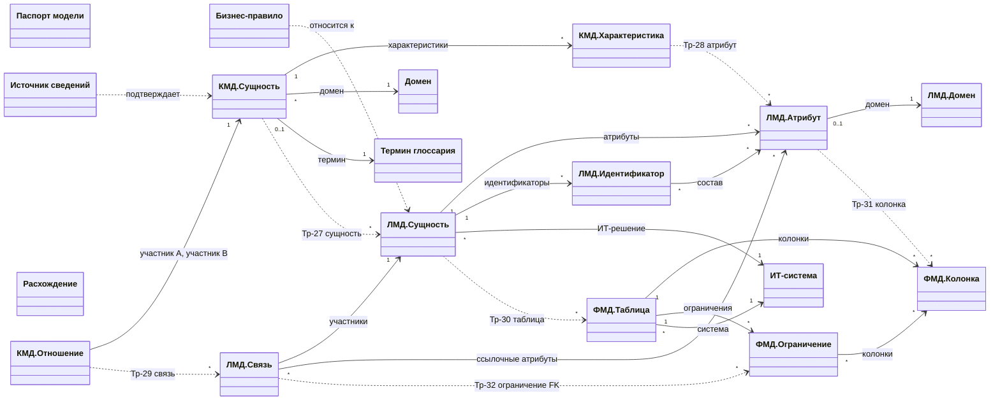

# Метамодель СиММы для моделей данных КМД / ЛМД / ФМД

**Версия:** 0.1, 2026-10-19
**Статус:** проектный рабочий документ (вне нормативного комплекта `wrk/standard`; не заменяет его формулировки).
**Назначение:** определить мета-модель классов СиММы (https://bm-symma.ru/) для ведения концептуальной (КМД), логической (ЛМД) и физической (ФМД) моделей данных со сквозными связями «сущность↔сущность» и «атрибут↔атрибут» между уровнями, а также порядок настройки метамодели в системе.

**Исходные материалы:**

- документация ПО СиММА (БЗ «Документация -СиММа»: «Введение в СиММА для v 2.9.1», «СиММА РП ч. 1 Архитектор» v2.12 (ПО 2.9.0.9), «СиММА РП ч. 2 Аналитик» v2.13);
- Правила проектирования, документирования и сопровождения КМД/ЛМД — `wrk/standard/Правила.md` (далее — Правила, ссылки вида «Правила, 7.6» / «LDM-009») и приложения `wrk/standard/appendices/`;
- «Реестр правил моделирования данных — v.2.3» (далее — Реестр v.2.3; правила `CDM-01…PDM-04`).

---

## 1. Границы задачи и исходные ограничения СиММы

1.1. **Что проектируется.** Метамодель СиМмы: перечень классов (метакаталогов), их метаатрибутов, метасвязей между классами с настройкой мощностей и видимости, атрибутов метасвязей, плюс порядок настройки и контроль целостности. Наполнение самих моделей (сущности предметной области) — вне этого документа.

1.2. **Ключевые свойства платформы СиММА, учтённые в проектировании** (по РП ч. 1 и Введению):

| № | Свойство платформы | Следствие для проектирования |
|---|---|---|
| П-1 | Метамодель = классы (метакаталоги) + метаатрибуты + метасвязи + стенсилы; элемент — инстанс класса; каталог — совокупность элементов одного класса | каждый конструктив КМД/ЛМД/ФМД выражается классом; «уровень модели» не встроен в СиММу и выражается составом каталогов |
| П-2 | Элемент может находиться только в одном каталоге (множественная классификация не поддерживается) | одна и та же сущность на разных уровнях — это **разные элементы** разных классов, связанные метасвязями трассировки |
| П-3 | Связь между элементами создаётся по шаблону метасвязи; метасвязь задаёт: названия полей-портов в обоих классах, «максимальное число связей в поле» (ограничение max), видимость (двусторонняя/односторонняя), тип (универсальная/иерархия/автомат/сеть) и декораторы схем; связи могут быть атрибутированы (атрибуты метасвязи заполняются на каждом экземпляре связи) | кардинальности связей модели данных реализуются комбинацией: max — настройкой метасвязи, min=1 — признаком «Обязательное поле» у порта; точные интервальные `min..max` и роли — атрибутами метасвязи и/или карточкой связи (см. КР-3) |
| П-4 | Связь в СиМме — ребро между **элементами**; связать связь со связью нельзя | трассировка «связь КМД ↔ связь ЛМД» требует, чтобы связи моделей данных были **элементами**-карточками (классы «КМД.Отношение», «ЛМД.Связь»), а не только графическими рёберами |
| П-5 | Типы метаатрибутов: Строка (до 125/250 знаков), Текст (16 тыс.), Текст HTML, Целое/Дробное число, Дата, Перечислимое (1)/(N), Массив строк/целых/дробных/дат, Файл, Индекс (aa.bb); базовые «Название» и «Описание» есть у каждого класса и не удаляются; один метаатрибут переиспользуется в нескольких классах | «имя» элемента = базовый «Название», «определение» = базовый «Описание»; повторно используемые свойства (статус определения, разметка ИОД и т.п.) задаются **одним** метаатрибутом, включаемым в несколько классов |
| П-6 | У модели есть свои права доступа: «Чтение», «+Запись», «+Метамодель» (ведение классов/метаатрибутов/метасвязей/стенсилов), «+Доступы» | настройка метамодели — роль Архитектора метамодели («+Метамодель»); наполнение — роль Аналитика («+Запись») |
| П-7 | Связи между элементами возможны внутри одной модели; модель может копироваться целиком, «только ММ» или «ММ (дочерняя)» | все три уровня ведутся в **одной** модели СиМмы (КР-1); кросс-модельная трассировка средствами связей не поддерживается |

1.3. **Ограничение законодательства о соответствии.** Реестр v.2.3 определяет ФМД и правила `PDM-01…04` как обязательные к отражению; Правила задают соответствия ЛМД↔ФМД (Правила, 8.5), но само физическое проектирование — вне области Правил (Правила, 1.5, 2.2.4). Поэтому классы ФМД в метамодели минимизированы: их состав достаточен для фиксации соответствий и управления (владелец, система), но не претендует на полный физический дизайн (секционирование, табличные пространства и т.п. — при необходимости расширяется).

---

## 2. Ключевые проектные решения

**КР-1. Одна модель СиМмы для трёх уровней.** КМД, ЛМД, ФМД ведутся в одной модели СиМмы как три группы каталогов с префиксами классов «КМД.», «ЛМД.», «ФМД.» плюс общие справочные каталоги. Обоснование: сквозные связи (П-4, П-7) требуют единого пространства элементов; Правила рассматривают соответствия КМД↔ЛМД↔ФМД как связи внутри одного авторитетного описания (Правила, 8.4–8.5, 11.1). Альтернатива «три модели СиМмы» отклонена: связи между моделями СиМма не поддерживает, трассировка превратилась бы в текстовые ссылки.

**КР-2. Сущность/атрибут/связь каждого уровня — отдельные классы.** Из П-2: «Сущность КМД» и «Сущность ЛМД» — разные классы с разным атрибутивным составом (КМД — определения и бизнес-идентичность; ЛМД — ключи, домены, обязательность; Правила, 2.2.2–2.2.3). Характеристика КМД (CDM-022–024) и атрибут ЛМД (LDM-004–008) также разведены по классам и связаны метасвязью трассировки.

**КР-3. Связи моделей данных — элементы-карточки + метасвязи участников.** Связь КМД/ЛМД — самостоятельный элемент («КМД.Отношение», «ЛМД.Связь») с полным атрибутным составом карточки по Правилам (прил. Г.4: участники и роли, кардинальности, характер связи) и с порталами на участников («Участник A», «Участник B», опционально «Участник C» для многосторонних — Правила, 6.5). Причины: (а) требуется трассировка связей между уровнями (П-4); (б) интервальные кардинальности `min..max` с двух сторон, словесные прочтения и условия участия (Правила, 2.8, LDM-013, CDM-015) не помещаются в атрибуты графической связи. На обзорных схемах допускается параллельное использование прямой графической метасвязи «сущность–сущность» как представления (без атрибутов); авторитетное место ведения связи — карточка в каталоге (Правила, 2.8: «диаграмма — представление модели»). Синхронизация схемы и каталога — организационная проверка (разд. 6).

**КР-4. Мощности связей: max — метасвязь, min — обязательность поля-порта.** Точный интервал `min..max` фиксируется в атрибутах карточки связи («Min A/Max A/Min B/Max B», перечисления 0/1/N); для трассировочных метасвязей M:N ограничение max не задаётся. Минимальная мощность 1 реализуется признаком «Обязательное поле» у порта участника; контроль min>1 (например, «ровно два родителя») СиМма автоматически не выполняет — фиксируется в атрибутах связи и проверяется по CI (разд. 6).

**КР-5. Переиспользование метаатрибутов и единые перечисления.** Статус определения (Правила, 8.2), статус подтверждения (Правила, 5.8), разметка ИОД (прил. И), класс данных и класс конфиденциальности (Реестр v.2.3, LDM-05…07) задаются одними метаатрибутами, включаемыми в несколько классов с класс-специфичными названиями отображения (РП ч. 1, 4.2.3.1). Перечни значений ведутся централизованно в метаатрибуте.

**КР-6. Характеристики соответствий — атрибуты метасвязей трассировки.** Для «Тр: КМД→ЛМД» — вид соответствия (1:1/1:N/M:N) и комментарий изменений смысла (Правила, 8.4); для «Тр: ЛМД→ФМД» — тип (прямая/производная/агрегированная) и статус (актуально/расхождение зарегистрировано/утрачено) (Правила, 8.5). Атрибуты метасвязей — штатный функционал (РП ч. 1, 4.4.3–4.4.3.3; заполнение значений — «Карточка связи», вкладка «Атрибуты», РП ч. 2, 4.2.5.4). Допустимые типы атрибутов метасвязей ограничены: «Строка», «Текст», «Текст HTML», «Целое число», «Дробное число», «Дата», «Перечислимое (1)», «Индекс» — массивы не поддерживаются; все спроектированные атрибуты соответствий (вид/тип/статус, роль источника) имеют тип «Перечислимое (1)» или «Текст» и совместимы с этим ограничением. Если в установленной версии ПО редактирование атрибутов метасвязей окажется недоступно, эти свойства переносятся в карточку элемента-цели (резервный вариант, ОВ-3).

**КР-7. Паспорт модели и реестр расхождений — классы-каталоги.** Поля паспорта модели (Правила, прил. Г.2) ведутся в элементе класса «Паспорт модели» (по одному элементу на модель); несопоставленные элементы и расхождения (Правила, 8.10) — в классе «Расхождение» с обязательными полями (вид соответствия, причина, статус, ответственный, срок пересмотра). Ссылки на затронутые элементы — текстом с ID элементов СиМмы (класс-«заглушка» с портами на все классы не создаётся из-за ОВ-6).

**КР-8. Нотация.** Для схем используются нотации «КМД», «ЛМД», «ФМД» (конструктор нотаций СиМмы): стенсилы сущностей/таблиц с полями (имя, определение), стенсил карточки связи, декораторы кардинальностей по прил. В (Crow's Foot + `min..max`); легенда обязательна (GEN-008). Детальная настройка стенсилов — этап 6 разд. 5.

---

## 3. Состав метамодели

Всего 18 классов: 7 общих, 3 — КМД, 5 — ЛМД, 3 — ФМД. Префиксы обеспечивают алфавитную группировку каталогов; «Порядок» классов задаётся явно (этап 5 разд. 5).

### 3.1. Общие (справочные) классы

| Класс | Назначение | Ключевые метаатрибуты (тип; обязательность) | Основание |
|---|---|---|---|
| **Паспорт модели** | паспорт модели по Г.2; 1 элемент на модель | Назначение (Текст; об.), Уровень и вид (Перечислимое: КМД/ЛМД/ФМД/комбинированная; об.), Профили (Строка), Режим (Перечислимое: TO-BE/AS-IS/смешанный; об.), Домен (Строка; об.), Охват и исключения (Текст; об.), Версия и статус (Строка; об.), Ответственные (Текст; об.), Хранилище (Строка), Дата актуальности (Дата; об.) | Правила, 5.1, Г.2 |
| **Домен** | бизнес-домен (справочник) | Код домена (Строка; об.), Владелец домена (Строка; об.), Назначение (Текст) | Правила, 2.2.1, прил. Т |
| **Термин глоссария** | термин + определение + статус | Статус термина (Перечислимое: утверждён/предложен/отсутствует; об.), Определение (Текст; об.), Ссылка на глоссарий (Строка) | CDM-007, CDM-009, LDM-008; Реестр v.2.3 CDM-01, LDM-02 |
| **ИТ-система** | системы, платформы, СУБД; ИТ-решения | Тип (Перечислимое: ИТ-система/платформа/СУБД; об.), Владелец (Строка) | Правила, 2.1; Реестр v.2.3 PDM-04 |
| **Источник сведений** | источник для статуса подтверждения | Тип источника (Перечислимое: документ/схема БД/код/интервью/профилирование/норм. документ; об.), Ссылка (Строка), Дата фиксации (Дата; об.) | Правила, 5.7–5.8, 9.2 |
| **Бизнес-правило** | существенные правила и декларативные ограничения всех уровней | Формулировка (Текст HTML; об. — в «Описании»), Вид (Перечислимое: уникальность/несовместимость ролей/условие участия/диапазон/иное; об.), Механизм контроля (Перечислимое: физически объявлено/контроль приложения/контроль загрузки/отдельная проверка/без контроля; об.), Состояние реализации (Перечислимое: реализовано/частично/запланировано/не реализовано/не установлено; об.), Уровень (Перечислимое: КМД/ЛМД/ФМД; об.) | CDM-025, LDM-021, Правила 8.9, прил. С |
| **Расхождение** | реестр несопоставленных элементов и расхождений | Вид соответствия (Перечислимое: КМД↔ЛМД/ЛМД↔ФМД/глоссарий/референтная/иное; об.), Ссылки на элементы (Массив строк — ID СиМмы; об.), Причина (Текст; об.), Статус (Перечислимое: открыто/в работе/закрыто; об.), Ответственный (Строка; об.), Срок пересмотра (Дата; об.) | Правила, 8.10, Г.4 |

Каталог «Бизнес-правило» и «Расхождение» отображаются в списке каталогов; «Термин глоссария», «Домен», «ИТ-система», «Источник сведений» — по решению архитектора (справочники, наполняются до моделирования).

### 3.2. Классы КМД

| Класс | Назначение | Метаатрибуты (тип; обязательность) | Основание |
|---|---|---|---|
| **КМД.Сущность** | концептуальная сущность (понятие) | Название — имя понятия; Описание — определение (об. по смыслу CDM-010); Бизнес-идентичность (Текст; об.), Что представляет экземпляр (Перечислимое: объект/событие/состояние/версия/роль/агрегат за период; об.), Отличия от смежных понятий (Текст), Статус определения (Перечислимое: утверждён/предложен/локальное; об.), Разметка ИОД (Перечислимое по прил. И), Внешний домен (Строка — понятие за границами модели) | Правила 6.2–6.4, 6.14; Г.4; CDM-010…013, CDM-032 |
| **КМД.Характеристика** | характеристика понятия (не полный атрибутный состав) | Смысл (Текст; об.), Семантический класс (Перечислимое по прил. Е: сумма/цена/количество/…), Единица измерения (Строка), Когда должна быть известна (Текст — «неизвестно/не применимо/ещё не определено»), Производное (Перечислимое: да/нет), Правило расчёта (Текст, если производное) | CDM-022…024, CDM-031; прил. Е |
| **КМД.Отношение** | связь между понятиями (карточка связи) | Словесное прочтение от A (Строка; об.), Словесное прочтение от B (Строка; об.), Характер (Перечислимое: входит в состав/является разновидностью/ссылается на справочник/участие/иное; об.), Min A/Max A/Min B/Max B (Перечислимое: 0/1/N; об.), Условия участия (Текст — «в момент/за срок», условное участие), Многосторонняя (Перечислимое: да/нет) | CDM-014…016, CDM-017; Реестр v.2.3 CDM-02; Правила 2.8 |

### 3.3. Классы ЛМД

| Класс | Назначение | Метаатрибуты (тип; обязательность) | Основание |
|---|---|---|---|
| **ЛМД.Сущность** | логическая сущность | Название — логическое имя; Описание — смысл; Что представляет экземпляр (Перечислимое; об.), Тип сущности (Перечислимое: основная/справочник/ассоциативная/зависимая/историческая/документная/вне охвата; об.), Класс данных (Перечислимое: метаданные/основные/справочные/аналитические; об.), Класс конфиденциальности (Перечислимое; об.), Классификация ИОД (Перечислимое), История/версионирование (Текст), Избыточность и обоснование (Текст), Статус определения (Перечислимое; об.) | LDM-004…008; Реестр v.2.3 LDM-02…07; LDM-006, LDM-032 |
| **ЛМД.Атрибут** | атрибут сущности | Название; Описание — смысл (об.), Тип атрибута (Перечислимое: бизнес/системный; об.), Обязательность (Перечислимое: обязательный/условный/необязательный; об.), Семантика NULL (Перечислимое: неизвестно/не применимо/не получено), Производный (Перечислимое: да/нет), Правило вычисления (Текст), Значение по умолчанию (Строка), Код: источник значений (Текст — для кодированных), Код: область уникальности (Строка), Разметка ИОД (Перечислимое — атрибутная разметка при смешанной классификации) | LDM-007, LDM-020, LDM-022, LDM-024, LDM-033; Реестр v.2.3 LDM-07 |
| **ЛМД.Домен** | каталог логических доменов | Логический тип (Перечислимое: строка/целое/дробное/дата-время/булево/иное; об.), Допустимые значения/ограничения (Текст), Формат (Строка), Единица измерения (Строка), Точность/масштаб (Строка) | LDM-023, LDM-027; прил. Е |
| **ЛМД.Идентификатор** | основной/альтернативный идентификатор сущности | Вид (Перечислимое: основной/альтернативный; об.), Обоснование выбора (Текст — для составного/суррогатного), Способ генерации суррогата (Строка), Состав (строкой — дублирует порты для отчётов; об.) | LDM-009, LDM-010; Реестр v.2.3 LDM-03 |
| **ЛМД.Связь** | логическая связь (карточка) | Словесное прочтение от A/B (Строка; об.), Вид (Перечислимое: ссылочная/ассоциативная (M:N)/идентифицирующая/иерархия/рекурсивная; об.), Min/Max A, Min/Max B (Перечислимое: 0/1/N; об.), Обязательность участия (Текст), Уникальность 1:1 (Перечислимое: обеспечена/не обеспечена/не применимо), Способ контроля целостности (Перечислимое: декларативное/приложение/логическое правило/не установлено), Межсистемный линк (Строка: система-источник идентификатора, область уникальности) | LDM-011…015, LDM-018, LDM-019, LDM-025; Реестр v.2.3 LDM-04, LDM-05 |

### 3.4. Классы ФМД

| Класс | Назначение | Метаатрибуты (тип; обязательность) | Основание |
|---|---|---|---|
| **ФМД.Таблица** | объект хранения | Название — физическое имя; Описание — комментарий; Тип объекта (Перечислимое: таблица/представление/materialized view/иное; об.), СУБД/система (порт на «ИТ-система»; об.), Схема (Строка), Владелец данных (Строка; об.), Родительская система (Строка; об.), Мастер-система (Строка; об.), Участвует в интеграциях (Перечислимое: да/нет; об.) | Правила 8.5; Реестр v.2.3 PDM-01, PDM-03, PDM-04 |
| **ФМД.Колонка** | поле объекта хранения | Название — физическое имя; Описание — комментарий; Тип данных СУБД (Строка; об.), Длина/точность (Строка), NULL/NOT NULL (Перечислимое: да/нет; об.), DEFAULT (Строка) | Правила 8.5; Реестр v.2.3 PDM-02 |
| **ФМД.Ограничение** | ограничения и индексы | Вид (Перечислимое: PK/FK/UNIQUE/CHECK/NOT NULL/индекс/иное; об.), Выражение/определение (Текст), Уникальный (Перечислимое: да/нет — для индексов) | Правила 8.5, 8.9 |

Каталоги «КМД.Характеристика», «ЛМД.Атрибут», «ЛМД.Идентификатор», «ФМД.Колонка», «ФМД.Ограничение» скрываются из перечня каталогов (флаг «Отображать в списке каталогов» выключен): они ведутся из карточек владельцев (сущность/таблица) через порты — как рекомендует РП ч. 1, 4.2.2 (пример «Атрибут объекта данных»).

### 3.5. Метасвязи внутри уровней

Формат: **Название метасвязи** — Класс 1 «порт 1» (max; обяз.) ↔ Класс 2 «порт 2» (max; обяз.) [атрибуты метасвязи]. Тип «Универсальная», видимость «Двусторонняя», если не указано иное.

**КМД:**

1. **КМД: характеристики** — КМД.Сущность «Характеристики» (N) ↔ КМД.Характеристика «Сущность» (1; об.).
2. **КМД: участник A** — КМД.Отношение «Участник A» (1; об.) ↔ КМД.Сущность «Участник A отношений» (N).
3. **КМД: участник B** — КМД.Отношение «Участник B» (1; об.) ↔ КМД.Сущность «Участник B отношений» (N).
4. **КМД: участник C (опц.)** — КМД.Отношение «Участник C» (1) ↔ КМД.Сущность «Участник C отношений» (N) — для многосторонних (Правила, 6.5); порт не обязателен.
5. **КМД: принадлежность домену** — КМД.Сущность «Домен» (1; об.) ↔ Домен «Понятия домена» (N).

**ЛМД:**

6. **ЛМД: атрибутный состав** — ЛМД.Сущность «Атрибуты» (N) ↔ ЛМД.Атрибут «Сущность» (1; об.).
7. **ЛМД: идентификатор сущности** — ЛМД.Сущность «Идентификаторы» (N) ↔ ЛМД.Идентификатор «Сущность» (1; об.). Port «Идентификаторы» — уточнение названия: «Идентификаторы (осн. и альт.)».
8. **ЛМД: состав идентификатора** — ЛМД.Идентификатор «Атрибуты состава» (N; об.) ↔ ЛМД.Атрибут «Входит в идентификаторы» (N).
9. **ЛМД: участник A** — ЛМД.Связь «Участник A (сущность)» (1; об.) ↔ ЛМД.Сущность «Участник A связей» (N).
10. **ЛМД: участник B** — ЛМД.Связь «Участник B (сущность)» (1; об.) ↔ ЛМД.Сущность «Участник B связей» (N).
11. **ЛМД: ссылочный атрибут** — ЛМД.Связь «Ссылочные атрибуты (FK)» (N) ↔ ЛМД.Атрибут «Реализует связи» (N) — соответствие ссылочного атрибута и цели по LDM-011/LDM-014.
12. **ЛМД: домен атрибута** — ЛМД.Атрибут «Домен» (1) ↔ ЛМД.Домен «Атрибуты домена» (N).
13. **ЛМД: принадлежность решению** — ЛМД.Сущность «ИТ-решение» (1; об.) ↔ ИТ-система «Сущности решения» (N).

**ФМД:**

14. **ФМД: колонки** — ФМД.Таблица «Колонки» (N) ↔ ФМД.Колонка «Таблица» (1; об.).
15. **ФМД: ограничения таблицы** — ФМД.Таблица «Ограничения» (N) ↔ ФМД.Ограничение «Таблица» (1; об.).
16. **ФМД: колонки в ограничении** — ФМД.Ограничение «Колонки» (N; об.) ↔ ФМД.Колонка «Входит в ограничения» (N).
17. **ФМД: система хранения** — ФМД.Таблица «Система хранения» (1; об.) ↔ ИТ-система «Объекты хранения» (N). Основание: Реестр v.2.3 PDM-04 (родительская система), Правила 8.5.

**Общие (подтверждение и правила):**

18. **Термины: сущность КМД** — КМД.Сущность «Термин глоссария» (1) ↔ Термин глоссария «Понятия КМД» (N).
19. **Термины: сущность ЛМД** — ЛМД.Сущность «Термин глоссария» (1) ↔ Термин «Сущности ЛМД» (N).
20. **Термины: атрибут ЛМД** — ЛМД.Атрибут «Термин глоссария» (1) ↔ Термин «Атрибуты ЛМД» (N).
21. **Подтверждение: КМД** — Источник «Подтверждает элементы КМД» (N) ↔ КМД.Сущность «Источники» (N) [атрибут метасвязи: Роль источника (Перечислимое: подтверждает/противоречит; об.)].
22. **Подтверждение: ЛМД** — Источник «Подтверждает элементы ЛМД» (N) ↔ ЛМД.Сущность «Источники» (N) [та же].
23. **Правила: понятие** — Бизнес-правило «Понятия КМД» (N) ↔ КМД.Сущность «Правила» (N).
24. **Правила: сущность ЛМД** — Бизнес-правило «Сущности ЛМД» (N) ↔ ЛМД.Сущность «Правила» (N).
25. **Правила: атрибут** — Бизнес-правило «Атрибуты» (N) ↔ ЛМД.Атрибут «Правила» (N).
26. **Правила: связь** — Бизнес-правило «Связи ЛМД» (N) ↔ ЛМД.Связь «Правила» (N).

### 3.6. Сквозные метасвязи трассировки

Требование пользователя: связи между сущностями и между атрибутами уровней КМД↔ЛМД и ЛМД↔ФМД. Все сквозные метасвязи — тип «Универсальная», видимость «Двусторонняя», max не ограничен (M:N — Правила, 2.6, 8.4: соответствия 1:1, 1:N, M:N).

| № | Метасвязь | Класс 1 ↔ Класс 2 | Порты (обяз.) | Атрибуты метасвязи | Основание |
|---|---|---|---|---|---|
| 27 | **Тр: сущность КМД→ЛМД** | КМД.Сущность ↔ ЛМД.Сущность | «Детализируется в ЛМД» / «Соответствует КМД» (со стороны ЛМД — об. при существующей КМД) | Вид соответствия (Перечислимое: 1:1/1:N/M:N), Изменение смысла (Текст) | CDM-035, LDM-003, LDM-030; Правила 8.4 |
| 28 | **Тр: характеристика КМД→атрибут ЛМД** | КМД.Характеристика ↔ ЛМД.Атрибут | «Детализируется в атрибуты» / «Соответствует характеристике» | Вид соответствия (1:1/1:N/M:N) | Правила 8.4 |
| 29 | **Тр: отношение КМД→связь ЛМД** | КМД.Отношение ↔ ЛМД.Связь | «Реализуется в связях ЛМД» / «Соответствует отношению КМД» | Вид соответствия | Правила 8.4 |
| 30 | **Тр: сущность ЛМД→таблица** | ЛМД.Сущность ↔ ФМД.Таблица | «Реализуется в» / «Соответствует сущности» | Тип (прямая/производная/агрегированная), Статус (актуально/расхождение зарегистрировано/утрачено) | Правила 8.5; Реестр v.2.3 PDM-02 |
| 31 | **Тр: атрибут ЛМД→колонка** | ЛМД.Атрибут ↔ ФМД.Колонка | «Реализуется в колонках» / «Соответствует атрибуту» (**обяз. со стороны колонки** — PDM-02) | Тип, Статус (те же) | Правила 8.5; PDM-02 |
| 32 | **Тр: связь ЛМД→ограничение** | ЛМД.Связь ↔ ФМД.Ограничение | «Реализуется ограничениями» / «Соответствует связи» | Тип, Статус | Правила 8.5, 8.9 |

Прямая трассировка КМД↔ФМД **не создаётся** (см. ОВ-1): при отсутствии ЛМД соответствие фиксируется в «Расхождении» (вид «КМД↔ФМД (без ЛМД)») текстовыми ссылками на ID.

### 3.7. Диаграмма метамодели

Легенда: сплошные линии `-->` — метасвязи внутри уровней и со справочными классами (подписи — названия портов), пунктир `..>` — сквозные метасвязи трассировки (номера — таблица 3.6). «Паспорт модели» и «Расхождение» — самостоятельные каталоги без связей с классами уровней (ведение — по Г.2 и 8.10, ссылки на элементы — текстом). Мощности на диаграмме ориентировочные; точные настройки портов — таблицы 3.5–3.6.

---

## 4. Что СиММА контролирует автоматически, а что — нет

| Контроль | Механизм СиМмы | Статус |
|---|---|---|
| Max мощность связи («не более N связанных элементов») | «Максимальное число связей в поле» метасвязи | автоматически |
| Min мощность = 1 (участник обязательно указан) | «Обязательное поле» порта (проверяется при сохранении элемента) | автоматически |
| Обязательность метаатрибутов карточки | «Обязательное поле» метаатрибута | автоматически |
| Интервальные кардинальности `min..max` (min>1, «ровно N»), совпадение трёх форм представления связи | атрибуты карточки связи; проверка выгрузкой (CSV/Excel) в CI | организационно / CI |
| Уникальность имён сущностей в пространстве имён, имён атрибутов в сущности | «Поиск дублей в каталоге» (вручную) + CI по экспорту | организационно / CI |
| Каждая колонка сопоставлена с атрибутом ЛМД (PDM-02) | обязательный порт метасвязи 31 | автоматически (после настройки) |
| Двойное ведение «карточка связи ↔ графическая связь на обзорной схеме» | нет | организационно (ОВ-2) |
| Статусное соответствие ЛМД↔ФМД (актуально/расхождение/утрачено) | атрибуты метасвязи 30–32 | вручную |
| Правило тройного соответствия (графика + `min..max` + два прочтения) | нет | проверка по прил. В/Ж, выгрузка в CI |

---

## 5. Порядок настройки в СиММА

Роли: настройка — пользователь с правом «+Метамодель» (Архитектор метамодели); наполнение — «+Запись» (Аналитик). Порядок этапов 2–8 соответствует рекомендованному порядку настройки метамодели в РП ч. 1, 4.1.2 (классы → метасвязи → метаатрибуты → порядок атрибутов → порядок классов → стенсилы → атрибуты метасвязей).

**Этап 0. Создание модели.** Создать модель СиМмы (например, «Модели данных»). Вариант: создать как копию шаблонной метамодели ERD «только ММ» и доработать (РП ч. 1, 3.5) — быстрее по стенсилам, но потребуется ревизия классов; вариант «с нуля» чище. Назначить права: архитекторам «+Метамодель», аналитикам «+Запись», остальным «Чтение».

**Этап 1. Справочники перечислений (заготовки).** Согласовать перечни значений для перечислимых метаатрибутов: «Что представляет экземпляр», «Тип сущности», «Характер связи», «Статус термина», «Класс данных», «Класс конфиденциальности», «Разметка ИОД» (по прил. И), «Семантический класс» (по прил. Е), «Вид соответствия», «Тип/Статус ЛМД↔ФМД».

**Этап 2. Классы (метакаталоги).** Создать 18 классов по таблицам 3.1–3.4: «Метамодель → Классы → Создать класс». Для каждого: название с префиксом уровня; «Описание» — краткое назначение (перенести формулировки из таблиц); флаги: «Отображать в списке каталогов» — выключить для КМД.Характеристика, ЛМД.Атрибут, ЛМД.Идентификатор, ФМД.Колонка, ФМД.Ограничение; «Порядок» — задать на шаге 6; поле «Нотация» — заполнить на шаге 7.

**Этап 3. Метасвязи.** «Метамодель → Метасвязи → Создать метасвязь»: выбрать пару классов, затем в окне настройки заполнить: «Название метасвязи» (по таблицам 3.5–3.6), «Поле для связывания» в обоих классах (названия портов из таблиц), «Максимальное число связей в поле» (max), тип «Универсальная», видимость «Двусторонняя», декораторы по нотации (для участников связей — crow's foot). Порядок: сначала внутриуровневые (1–17), затем общие (18–26), затем трассировочные (27–32). У трассировочных 27–32 max не задавать (M:N); у метасвязи 31 включить «Обязательное поле» порта «Соответствует атрибуту» в классе ФМД.Колонка.

**Этап 4. Метаатрибуты.** Создавать от общих к специальным, переиспользуя: один метаатрибут «Статус определения» включить в КМД.Сущность, ЛМД.Сущность, ЛМД.Атрибут; «Разметка ИОД» — в КМД.Сущность, ЛМД.Сущность, ЛМД.Атрибут; «Что представляет экземпляр» — в КМД.Сущность, ЛМД.Сущность; «Словесное прочтение от A/B» — в КМД.Отношение, ЛМД.Связь. В каждом классе настроить: «Название в классе», «Обязательное поле», «Вкладка» (рекомендуемые вкладки: «Основные» — базовые; «Идентификация» — идентификаторы/ключи; «Классификация» — класс данных, конфиденциальность, ИОД; «Статусы» — статусы определения/подтверждения; «Физическая реализация» — атрибуты ФМД; «Трассировка» — не требуется, порты выводятся стандартно), «Значение» (по умолчанию), составы значений перечислимых. Атрибуты метасвязей (Роли источника; Вид/Тип/Статус соответствий) — последний шаг этапа (в РП помечен как опциональный; при недоступности — ОВ-3).

**Этап 5. Порядок отображения.** Упорядочить метаатрибуты в карточках (drag-and-drop в форме настройки класса) и классы: Паспорт модели → Домен → Термин глоссария → ИТ-система → Источник сведений → КМД.Сущность → КМД.Отношение → ЛМД.Сущность → ЛМД.Связь → ЛМД.Домен → ФМД.Таблица → Бизнес-правило → Расхождение. «Сохранить порядок».

**Этап 6. Стенсилы и нотации.** Создать стенсилы: «Сущность КМД» (прямоугольник; поля: Название, Описание), «Сущность ЛМД» (поля: Название, тип сущности), «Карточка связи» (ромб/плашка: прочтение, характер, min..max), «Таблица ФМД» (поля: имя, тип объекта), «Колонка ФМД». Стенсил можно создать со схемы: настроить вид графина → контекстное меню «Формат класса → Создать стенсил» (РП ч. 1, 4.5.2). Создать нотации «КМД», «ЛМД», «ФМД» и привязать классы к нотациям (поле «Нотация» класса). Настроить декораторы метасвязей: участники — «воронья лапка»/штрихи по прил. В; трассировочные — пунктир.

**Этап 7. Наполнение справочников.** Завести элементы: Паспорт модели (1 шт., поля по Г.2), Домены (по прил. Т), Термины глоссария (выгрузка из корпоративного глоссария; при большом объёме — импорт CSV, РП ч. 2, 4.4), ИТ-системы, Источники.

**Этап 8. Представления и проверки.** Создать представления (каскадные таблицы, РП ч. 2, разд. 5): «Домен → КМД.Сущность → характеристики», «ИТ-решение → ЛМД.Сущность → атрибуты → идентификаторы», «ЛМД.Сущность ↔ ФМД.Таблица» (с уровнями по трассировочным метасвязям), «Несопоставленное» (фильтр: элементы без связей 27/30/31). Настроить экспорт каталогов в CSV/Excel для CI-проверок (Правила, 1.2.2.2: контроль в конвейере CI/CD). Чек-лист приёмки настройки:

- [ ] все 18 классов созданы, скрытые каталоги скрыты, порядок задан;
- [ ] метасвязи 1–32 созданы; у 2, 3, 9, 10, 14–17, 27 (сторона ЛМД при наличии КМД), 31 (сторона ФМД.Колонка) порты обязательны; max соответствуют таблицам;
- [ ] перечислимые значения совпадают с согласованными перечнями (этап 1);
- [ ] тестовые элементы: создан фрагмент сквозного примера (сущность → характеристика → атрибут → колонка, связи, трассировки), проверки обязательности и max срабатывают;
- [ ] стенсилы и нотации привязаны; легенда схемы соответствует прил. В;
- [ ] представления и экспорт работают; права доступа назначены.

**Этап 9. Пилот.** Провести пилотное наполнение на согласованном фрагменте (рекомендуется сквозной биржевой пример — прил. Н Правил): КМД-фрагмент → ЛМД → ФМД со всеми видами трассировок, включая случай «технический элемент без концептуального аналога» (Правила, 2.6) и M:M-соответствие. По итогам — ревизия ОВ-2, ОВ-4, ОВ-5.

---

## 6. Соответствие правилам контроля (Реестр v.2.3 / Правила)

| Правило | Требование (кратко) | Механизм метамодели |
|---|---|---|
| CDM-01 (Реестр) / CDM-007 | определение глоссария для каждой сущности КМД | метасвязь 18 «Термины: сущность КМД» + статус термина |
| CDM-02 (Реестр) / CDM-014–016 | базовые типы связей КМД описаны | атрибут «Характер» класса КМД.Отношение (входит в состав / является разновидностью / ссылается на справочник) |
| LDM-02 (Реестр) / LDM-008 | определения глоссария для сущностей ЛМД | метасвязи 19–20 |
| LDM-03 (Реестр) / LDM-009–010 | состав полей уникального идентификатора | класс ЛМД.Идентификатор + метасвязи 7–8 (состав — порты на атрибуты) |
| LDM-04, LDM-05 (Реестр) | базовые типы связей ЛМД; остальные типы | атрибут «Вид» ЛМД.Связь + прочтения; LDM-05 — прочтения и условия |
| LDM-05–07 (Реестр, нумерация v2.3) | класс данных; конфиденциальность; ИОД | метаатрибуты ЛМД.Сущность + атрибутная разметка ИОД в ЛМД.Атрибут |
| LDM-003 / CDM-035 / LDM-030 | прослеживаемость КМД↔ЛМД | метасвязи 27–29 + «Расхождение» для несопоставленного |
| Правила 8.5 | соответствия ЛМД↔ФМД с типом и статусом | метасвязи 30–32 с атрибутами Тип/Статус |
| PDM-01 | описаны сущности ФМД интеграций | атрибут «Участвует в интеграциях» ФМД.Таблица |
| PDM-02 | все атрибуты ФМД сопоставлены с ЛМД | обязательный порт метасвязи 31 |
| PDM-03 | владелец данных для сущности ФМД | атрибут «Владелец данных» ФМД.Таблица |
| PDM-04 | родительская и мастер-система | атрибуты + метасвязь «ФМД: система» (через порт класса ИТ-система) |
| LDM-013 / CDM-015 | кардинальности min..max с обеих сторон | атрибуты Min/Max карточек связей + max метасвязей; полнота — CI |
| Правила 2.8 | правило тройного соответствия | прочтения в карточке связи + декораторы стенсилов; сверка — CI/Ж |
| Правила 5.7–5.8 | источники и статус подтверждения | класс Источник, метасвязи 21–22 с ролью источника |
| Правила 8.9–8.10 | механизмы контроля; реестр расхождений | класс Бизнес-правило (механизм/состояние), класс Расхождение |
| Правила 11.2 | стабильные ID и пространства имён | системные ID элементов СиМмы + префиксы классов; проверка уникальности имён — CI |

---

## 7. Открытые вопросы

| № | Вопрос | Варианты / замечания |
|---|---|---|
| ОВ-1 | **Прямая трассировка КМД↔ФМД при отсутствии ЛМД** (отложено по решению владельца) | (а) вести через класс «Расхождение» текстовыми ссылками (текущее решение, минимум затрат); (б) создать метасвязь «Тр: сущность КМД→таблица (без ЛМД)» с атрибутом-основанием — появится автоматическая трассировка, но риск подмены полноценной ЛМД; (в) обязательность ЛМД закрепить организационно. Решение — после первых случаев реального отсутствия ЛМД |
| ОВ-2 | Двойное представление связей: карточка (КМД.Отношение / ЛМД.Связь) vs прямая графическая связь на обзорных схемах | пилот (этап 9): либо запретить прямые графические метасвязи сущность–сущность (все связи — только карточками), либо разрешить как «обзорное представление» с ручной сверкой; возможна автогенерация обзорных схем из карточек |
| ОВ-3 | Доступность настройки атрибутов метасвязей в установленной версии ПО (в РП ч. 1, 4.1.2 помечена как опциональная) | проверить на инсталляции; резерв — перенести «Вид/Тип/Статус соответствия» в метаатрибуты карточек-участников |
| ОВ-4 | Контроль min-мощности >1 и точных интервалов | атрибуты карточки связи + CI по экспорту; оценить целесообразность запроса вендору на расширение валидаций |
| ОВ-5 | Уникальность имён в пространствах имён (CDM-009, LDM-005) | СиМма не контролирует; «Поиск дублей» вручную + регулярный CI-отчёт по экспорту каталогов |
| ОВ-6 | «Расхождение» ссылается на элементы текстом (ID) | приемлемо для v1; точечные метасвязи «касается» — при росте потребности (метасвязь на каждый класс дороги в сопровождении) |
| ОВ-7 | Версионирование: «Версия элемента» СиМмы копирует элемент **без связей**; рабочие/базовые версии моделей (Правила, 4.6) системой не поддержаны | порядок: базовые версии — экспорт модели в файл (РП ч. 2, 4.3.4) + хранение в Git; журнал изменений — системный лог и история элементов |
| ОВ-8 | Класс вычислений (переиспользуемые вычисления СиМмы) для производных атрибутов (LDM-024) | изучить применимость на этапе 9; пока — текстовое «Правило вычисления» |
| ОВ-9 | Нотация схем: полный EER-набор (подтипы, категории — прил. В.4) ограничен стенсилами/декораторами | настроить минимальный набор (сущность, характеристика, связь, подтип-связь «является разновидностью»); остальные конструкции — легендой |
| ОВ-10 | Соответствие «ИТ-решение ↔ модель данных решения» (Реестр v.2.3, 1.1.2.5) на уровне модели, а не элементов | закрепить в Паспорте модели (поле «Домен/Решение»); связь на уровне моделей СиМмы отсутствует |

---

## 8. Источники

1. СиММА. Введение в моделирование (v 2.9.1) — базовые понятия: элемент, связь, каталог, порт, графин, стенсил, фантом; типы связей; схема МОФ.
2. СиММА. Руководство пользователя, ч. 1 «Архитектор» v2.12: гл. 4 (разработка метамодели: 4.1 порядок настройки; 4.2 классы; 4.2.3 метаатрибуты классов; 4.3.1 типы метаатрибутов; 4.4 метасвязи: создание, типы, видимость, max, декораторы; 4.5 стенсилы), гл. 3 (модели, права доступа «+Метамодель»).
3. СиММА. Руководство пользователя, ч. 2 «Аналитик» v2.13: каталоги, карточки элементов, связывание, поиск дублей, импорт/экспорт (4.3–4.4), представления (разд. 5).
4. Правила проектирования, документирования и сопровождения концептуальных и логических моделей данных (`wrk/standard/Правила.md`, ред. 0.5+) и приложения Б, В, Г, Д, Е, И, Н, С, Т.
5. Реестр правил моделирования данных, v.2.3 (`wrk/standard/Реестр правил моделирования данных - v.2.3.md`) — CDM-01…02, LDM-01…07, PDM-01…04.

---

*Документ подготовлен для настройки пилотной метамодели СиМмы. Изменения состава классов/метасвязей — через ревизию этого документа с указанием версии.*
