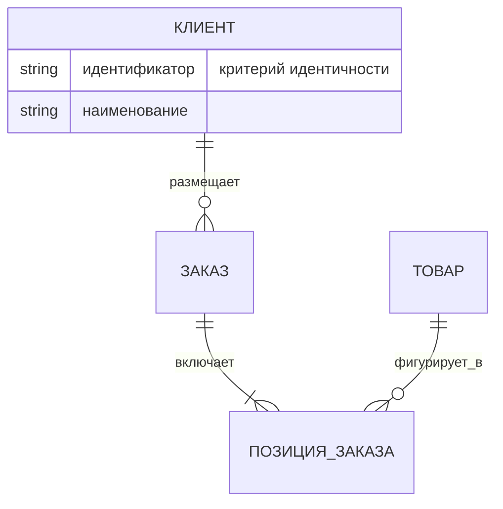

# Моделирование данных (концептуальный и логический уровни)

> Адаптация навыка `data-modeling` (melodic-software/claude-code-plugins,
> skills.sh — исходный SKILL.md удалён из репозитория, восстановлен по превью)
> под охват правил корпоративной модели данных: концептуальный и логический
> уровни. Методика концептуального слоя согласована с навыком
> `conceptual-modeling` (jacob-balslev).

## Когда применять

- Проектирование новой модели данных: от глоссария и сценариев к сущностям и связям
- Ревью концептуальной или логической модели на соответствие правилам
- Составление словаря данных по модели
- Согласование междоменных понятий (общие сущности, границы доменов)

## Два уровня — две разные дисциплины

### 1. Концептуальный уровень (сначала смысл)

Переводит язык бизнеса в реализационно-нейтральную модель. Модель — не БД
и не API, а **соглашение о домене**, которое последующие артефакты обязаны
сохранить.

Фиксируются:

- **Сущности** — существительные домена, значимые сами по себе
- **Критерии идентичности** — что делает экземпляр тем же самым (не ключ БД!)
- **Именованные связи** — глагол/предлог между сущностями («заказ **включает** позиции»), не безликие «связан с»
- **Кардинальности** — 1:1, 1:N, M:N (скрытые M:N — частая ошибка)
- **Специализация/обобщение** — подтипы и правила их различения

Запрещено на этом уровне (протечки физического дизайна):

- первичные/внешние ключи, индексы, типы данных;
- нормальные формы;
- имена таблиц/колонок и решения по хранению;
- аудит-поля (created_by, updated_at) без бизнес-смысла.

### 2. Логический уровень (структура без СУБД)

Уточняет концептуальную модель до структуры, независимой от платформы:

- **Атрибуты** — с доменными типами (деньги, дата, справочник — не varchar(50))
- **Логические идентификаторы** — естественные и суррогатные, выбор обосновывается
- **Нормализация** — 3НФ как база; осознанные денормализации фиксируются как решения (ADR)
- **Разрешение M:N** — ассоциативные сущности получают собственный смысл и атрибуты
- **Словарь данных** — обязательный артефакт (шаблон ниже)

## Артефакты результата

### ER-диаграмма (Mermaid)

Именование связей — глаголами в active voice; кардинальность по нотации crow's foot.

### Словарь данных

| Атрибут | Сущность | Домен | Обяз. | Определение | Источник/владелец |
|---|---|---|---|---|---|
| — | — | — | — | — | — |

Правила: одно определение на термин по корпоративному глоссарию; расхождения
с глоссарием — замечание ревью, а не локальная инновация.

## Чек-лист ревью модели

Концептуальный уровень:

- [ ] Каждая сущность имеет критерий идентичности, формулируемый словами бизнеса
- [ ] Нет сущностей-«мешков» (объединяют разные понятия) и дублей-омонимов
- [ ] Все связи именованы; нет связей «связан/относится к»
- [ ] Кардинальности проставлены и обоснованы сценариями, а не привычкой
- [ ] Атрибут, размноженный по подтипам, проверен: не должен ли это быть подтип/сущность
- [ ] Нет физических артефактов (ключи, типы СУБД, аудит-поля)
- [ ] Специализации взаимно исключают и покрывают супертип (правило полноты зафиксировано)

Логический уровень:

- [ ] Каждый атрибут: домен, обязательность, определение, владелец — в словаре данных
- [ ] Модель в 3НФ; каждая денормализация оформлена как решение (ADR) с ценой
- [ ] M:N разрешены ассоциативными сущностями с собственным смыслом
- [ ] Идентификаторы: естественный ключ либо обоснованный суррогатный
- [ ] Термины совпадают с корпоративным глоссарием; новые термины помечены на внесение
- [ ] Общие сущности между доменами: указан владелец и правило согласования

## Типичные анти-паттерны

| Анти-паттерн | Почему плохо | Что делать |
|---|---|---|
| Атрибут должен быть сущностью | Теряются связи и жизненный цикл | Ревизификация: выделить сущность |
| Сущность должна быть связью/атрибутом | Лишняя сложность, дубли идентичности | Свернуть, оставить атрибут |
| Скрытое M:N | Правила домена не выражены | Явная ассоциативная сущность |
| «Универсальная» сущность (тип + значение) | Разрушает типизацию и ограничения | Отдельные типизированные сущности |
| Физика в концептуальной модели | Блокирует обсуждение с бизнесом | Вынести в логический/физический слой |
| Подтип, меняющий бизнес-правила молча | Скрытые исключения | Зафиксировать правило различения подтипов |

## Границы навыка

- Не выбирает СУБД, не пишет DDL, не проектирует индексы и миграции
- Не строит формальные онтологии (OWL/RDFS, SHACL) — см. `data-knowledge-architect`
- Не заменяет DDD-тактику (агрегаты, anti-corruption layers) — см. `domain-modeling`
- Проверка соответствия корпоративным правилам — отдельный навык ревью (в плане создания)
