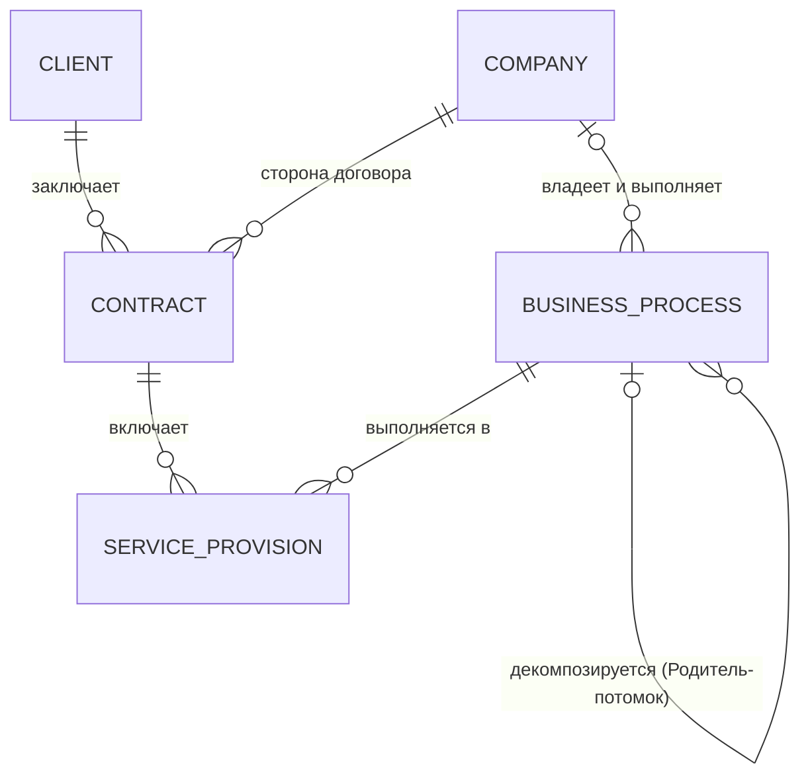
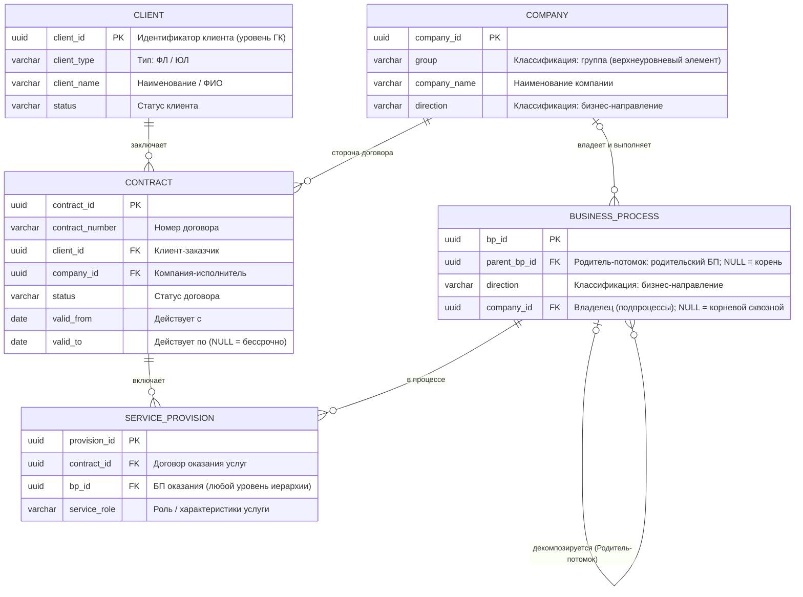
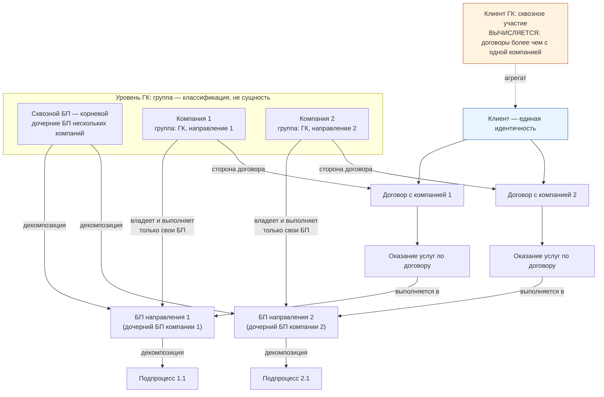
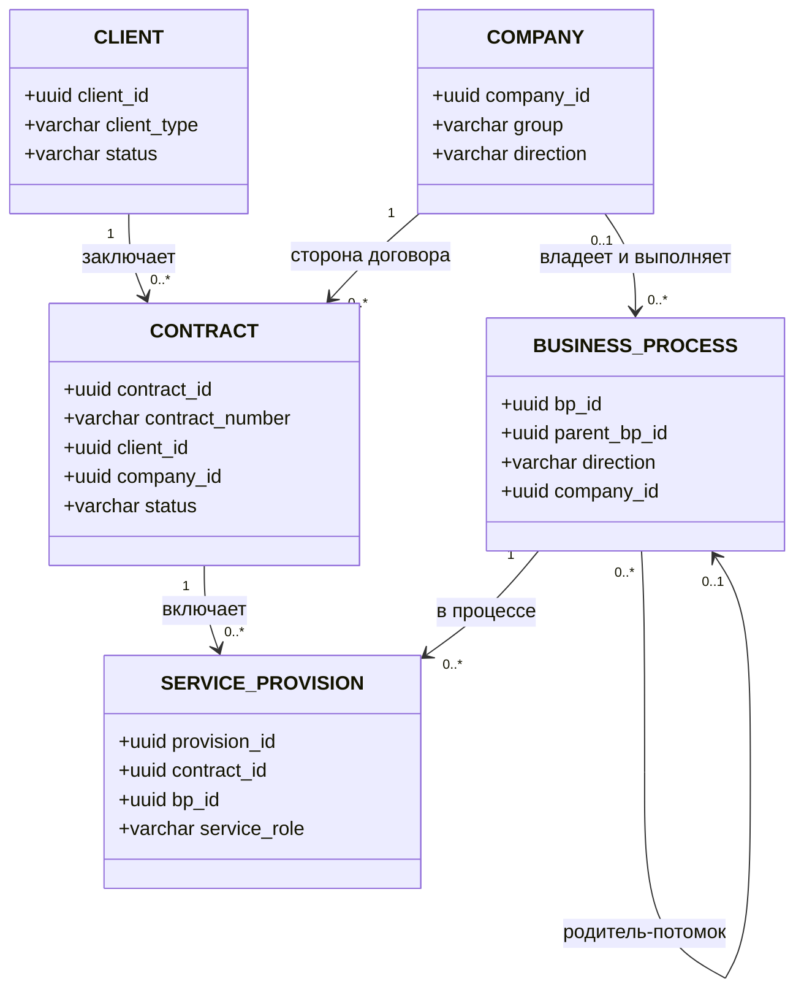

# Пример модели данных для ГК

> **Сценарий:** Показан упрощенный пример модели, где существует группа компаний (ГК) с несколькими бизнес-направлениями и основным сквозным бизнес-процессом (БП). **Клиент ГК** участвует в сквозном БП или его части; **клиент компании** — только в БП своего бизнес-направления.
>
> Заметка — рабочий пример применения требований из [[Требования к КМД|Требований к КМД]] и [[Требования к ЛМД]] в контексте [[Разработка стандарта моделирования|стандарта моделирования]]. Диаграммы — Mermaid, рендерятся в Obsidian напрямую.

## 1. Ключевой принцип

Не создавать два типа «клиентов». Клиент — **одна сущность с единой идентичностью** на уровне ГК (паттерн Party / Party Role, «единый клиент» MDM). А «клиент ГК» и «клиент компании» — это **роли / уровни участия**, которые моделируются связками-фактами, а не дублированием клиента:

- отношение клиент — компания выражается **Договором** (договорное основание отношений);
- участие в процессах выражается **Оказанием услуг по договору** (участие клиента в БП — опосредованное);
- **сквозное участие Клиента ГК — производное понятие**: договоры на оказание услуг более чем с одной компанией группы;
- **бизнес-направление — классификационный признак** БП, услуг и компаний, а не отдельная сущность;
- **группа — верхнеуровневый элемент (классификационный признак) Компании**, а не отдельная сущность;
- **компания владеет и выполняет только свои** БП и подпроцессы сквозного БП (процессы компаний не пересекаются);
- **БП — единая сущность с иерархией «Родитель-потомок»**: сквозной БП — корневой элемент, классификация «сквозной/подпроцесс» — производная по вложенности (сквозной имеет дочерние БП нескольких компаний), глубина не ограничена.

---

## 2. КМД (концептуальная модель)

### 2.1. Диаграмма



Сквозной БП — **корневой элемент** сущности `BUSINESS_PROCESS` (отдельной сущности и хранимого признака «тип» нет): родительская ссылка у корня пустая, владелец корня — уровень ГК. Классификация «сквозной / подпроцесс» определяется **вложенностью**: сквозной БП имеет дочерние БП нескольких компаний. Подпроцессы любого уровня принадлежат компаниям.

### 2.2. Легенда сущностей

| Имя на диаграмме | Понятие |
|---|---|
| `BUSINESS_PROCESS` | БП: сквозной — корневой элемент, имеющий дочерние БП нескольких компаний (производная классификация по вложенности); подпроцессы — вложенные элементы любых уровней |
| `COMPANY` | Компания ГК (владеет и выполняет свои БП; корневой сквозной БП — без компании-владельца) |
| `CLIENT` | Клиент (единая идентичность) |
| `CONTRACT` | Договор (связка клиент — компания) |
| `SERVICE_PROVISION` | Оказание услуг по договору |

### 2.3. Сущности и правила

- **БП — единая сущность с иерархией «Родитель-потомок»**: сквозной БП — корневой элемент (пустая родительская ссылка, владелец — уровень ГК); все подпроцессы имеют ссылку на родительский БП, который может быть сквозным; количество уровней подпроцессов ограничено только разумностью декомпозиции.
- **Классификация «сквозной / подпроцесс» определяется не типом, а вложенностью**: сквозной БП имеет дочерние БП нескольких компаний; подпроцесс — вложенный элемент без дочерних БП нескольких компаний. Хранимый признак «тип БП» не вводится.
- **Сквозной БП всегда корневой** — никогда не является подпроцессом.
- **Компания** — сущность уровня ГК; её верхнеуровневый элемент — **группа** (классификационный признак), а не отдельная сущность.
- **Каждая компания владеет и выполняет только свои** БП и подпроцессы сквозного БП; подпроцессы (кроме корневого) принадлежат ровно одной компании.
- **Клиент** — единый (ФЛ/ЮЛ), принадлежит уровню ГК; связывается с компанией только через договор.
- **Договор** — самостоятельный факт с собственным жизненным циклом (номер, статус, даты действия); связывает клиента (заказчик) и компанию (исполнитель).
- **Оказание услуг по договору** — самостоятельный факт участия: экземпляр оказания услуги в рамках БП; характеристики услуги — атрибуты оказания, а не клиента или договора.
- Клиент участвует в БП **опосредованно**: клиент → договор → оказание услуг → БП.
- **Сквозное участие Клиента ГК — производное понятие**: клиент участвует в сквозном БП, если заключил договоры на оказание услуг **более чем с одной компанией** группы. Отдельного представления в модели не имеет.
- Клиент компании — клиент, договоры и оказания услуг которого ограничены одной компанией.

### 2.4. Классификации и производные понятия

- **Группа — верхнеуровневый элемент Компании, а не отдельная сущность.** Группа выражается классификационным признаком компании (верхний уровень); иерархия групп и отдельный объект «группа» не выделяются.
- **Бизнес-направление — не отдельная сущность.** Это классификационный признак, по которому классифицируются сами объекты: компании, БП и услуги.
- **Критерий классификации** — направление деятельности. Услуги разных компаний не пересекаются, поэтому направление услуги однозначно определяется компанией договора, а направление БП — компанией-владельцем.
- **«Сквозной / подпроцесс» — производная классификация по вложенности, а не хранимый тип:** сквозной БП имеет дочерние БП нескольких компаний; сквозной БП всегда корневой.
- **«Участие Клиента ГК в сквозном БП»** — производное понятие: исходные понятия — клиент, договор, оказание услуг, компания; условие вывода — договоры на оказание услуг более чем с одной компанией группы.

---

## 3. ЛМД (логическая модель)

### 3.1. Диаграмма



Легенда: `CONTRACT` — Договор; `SERVICE_PROVISION` — Оказание услуг по договору; остальные имена — как в легенде КМД (п. 2.2). Отдельных таблиц группы, бизнес-направлений и сквозного БП нет; признака «тип БП» нет — сквозной/подпроцесс выводится по вложенности.

### 3.2. Таблицы и ключи

| Таблица | Ключевые поля | Комментарий |
|---|---|---|
| `client` | `client_id PK`, тип, реквизиты, статус | Идентичность, уровень ГК |
| `company` | `company_id PK`, `group` (классификатор — верхнеуровневый элемент), `direction` (классификатор), наименование | Компания ГК; группа и направление — классификационные признаки |
| `contract` | `contract_id PK`, `contract_number`, `client_id FK`, `company_id FK`, статус, даты действия; `UK(contract_number, company_id)` | Стороны: клиент — компания |
| `business_process` | `bp_id PK`, `parent_bp_id FK NULL` (Родитель-потомок), `direction` (классификатор), `company_id FK NULL` | Корень — сквозной БП (`parent_bp_id NULL`); классификация сквозной/подпроцесс — производная по вложенности (не хранится) |
| `service_provision` | `provision_id PK`, `contract_id FK`, `bp_id FK`, характеристики услуги | = «оказание услуг по договору»; направление выводится из владельца БП / компании договора |

### 3.3. Правила целостности

- **Иерархия БП (Родитель-потомок):** корневой БП имеет пустую родительскую ссылку (`parent_bp_id NULL`); все подпроцессы имеют ссылку на родительский БП (`parent_bp_id NOT NULL`), который может быть сквозным; сквозной БП всегда корневой; количество уровней подпроцессов ограничено только разумностью декомпозиции; циклы недопустимы.
- **Классификация «сквозной / подпроцесс» — производная по вложенности, не хранится:** сквозной БП ⇔ имеет дочерние БП нескольких компаний — `COUNT(DISTINCT company_id)` по дочерним БП (`parent_bp_id = bp_id`) `> 1`; иначе БП — подпроцесс. Сквозной БП всегда корневой (`parent_bp_id IS NULL`).
- **Владение процессами:** подпроцессы (кроме корневого сквозного) принадлежат ровно одной компании (`company_id NOT NULL`); корневой сквозной БП не имеет компании-владельца (`company_id NULL`). Компания владеет и выполняет только свои БП и подпроцессы сквозного БП.
- **Группа — классификация, а не сущность:** `company.group` — верхнеуровневый классификационный признак компании; отдельных таблиц группы и иерархии групп нет.
- **Согласованность классификаций:** `business_process.direction` = `company.direction` (по владельцу); направление услуги выводится из владельца БП / компании договора (услуги не пересекаются между компаниями).
- **Сквозное участие Клиента ГК не хранится** — вычисляется: клиент участвует в сквозном БП ⇔ число компаний, с которыми у него договоры на оказание услуг, более одной: `COUNT(DISTINCT company_id)` по договорам с оказаниями услуг `> 1`.
- Оказание услуг в БП → компания договора = владелец БП: `contract.company_id = business_process.company_id`.
- Один договор может включать несколько оказаний услуг; один клиент — несколько договоров с одной компанией (различаются номером и периодом).
- Идентификация: суррогатный `contract_id PK`; альтернативный ключ — `UK(contract_number, company_id)`; при корпоративной нумерации — `UK(contract_number)`.
- При повторяемости оказаний в рамках одного договора и одного БП в `service_provision` добавляются экземпляр/дата оказания либо составной `PK(contract_id, bp_id, ...)`.

---

## 4. Логика уровней участия (flowchart)



Классификация «сквозной/подпроцесс» — по вложенности: сквозной БП — корневой, имеющий дочерние БП нескольких компаний (здесь — компании 1 и 2). Иерархия не ограничена по глубине: подпроцессы ссылаются на родительский БП, который может быть сквозным. Каждая компания владеет и выполняет только свои БП и подпроцессы сквозного БП. Клиент с договорами в двух компаниях получает услуги в частях сквозного БП двух направлений → сквозное участие выводится автоматически. Клиент одного договора — «клиент компании», участвует только в БП своего направления.

---

## 5. Альтернативная нотация ЛМД (classDiagram)

Имена классов — как в легенде ЛМД (п. 3.1).



---

## 6. Особенности Mermaid для Obsidian

- Диаграммы пишутся в блоках ```` ```mermaid ```` и рендерятся нативно в просмотре Obsidian.
- **Алиасы сущностей не использовать**: синтаксис `CLIENT["Клиент"]` в `erDiagram` и `class CLIENT["Клиент"]` в `classDiagram` появился только в Mermaid 10.5 и во встроенном в Obsidian рендере может не поддерживаться (parse error). Русские имена понятий даются легендой-таблицей под диаграммой.
- Имена сущностей/классов — латиница в верхнем регистре (`SNAKE_CASE`); кириллица допустима в подписях связей в кавычках: `: "состоит из"`.
- Атрибуты `erDiagram`: `тип имя ключ "комментарий"`; несколько ключей у атрибута (`PK, FK`) — синтаксис Mermaid 10.1+, ключи связи лучше указывать в комментарии или таблице.
- Рекурсивные связи (иерархии «Родитель-потомок») допустимы прямо: `BUSINESS_PROCESS |o--o{ BUSINESS_PROCESS`; нулевая кардинальность на стороне родителя (`|o`) означает корень иерархии (пустая родительская ссылка).
- Верхнеуровневый контекст (уровень ГК), не являющийся сущностью, в `flowchart` удобно показывать `subgraph` с пояснением.
- В `flowchart` переносы строк в тексте узлов — `<br/>`, подписи рёбер — в кавычках после `|`.
- Для стандарта: диаграммы должны быть представлениями согласованной модели (единая идентичность сущностей между диаграммами), а не независимыми копиями — см. п. 2.1.10 [[Требования к КМД|Требований к КМД]].

---

## 7. Анти-паттерны

- Прямая связь клиент — компания в обход договора, когда отношения по природе договорные (теряется основание и жизненный цикл отношений).
- Двойной путь участия клиента в БП: и напрямую, и через оказание услуг — участие должно иметь один источник.
- Хранение сквозного участия Клиента ГК отдельной записью, когда оно всегда выводимо из договоров (см. п. 3.3).
- Выделение «сквозного БП», «бизнес-направления» или «группы» в отдельную сущность, когда достаточно классификации и позиции в иерархии (см. п. 2.4: справочник/признак не становится сущностью автоматически).
- Хранимый признак «тип БП» (сквозной/подпроцесс) при выводимой по вложенности классификации — дублирование, риск рассогласования с иерархией.
- БП без владельца или с несколькими компаниями-владельцами, когда по бизнес-правилу компания выполняет только свои процессы (неоднозначность ответственности за процесс).
- Смешение уровней иерархии: сквозной БП как потомок, подпроцесс без родительской ссылки, фиксированный лимит уровней декомпозиции вместо разумности.
- Отсутствие ссылки Родитель-потомок у иерархических элементов (например, БП) — без `parent_bp_id` невозможна навигация по иерархии и проверка циклов.
- Полиморфный FK (`participant_type` / `participant_id`) в процессе вместо явных связей.
- Хранение «клиент ГК» как независимого типа объекта без обоснования (см. требование о различении сущностей, ролей и состояний).

## 8. Референс

- Лен Силверстон, «The Data Model Resource Book» — паттерн Party–Party Role.
- Подход «единый клиент 360°» в MDM.

## История изменений

- **2026-10-08 (v8)** — классификация «сквозной/подпроцесс» определена как производная по вложенности (сквозной БП имеет дочерние БП нескольких компаний), а не хранимый тип; атрибут `bp_type` удалён из ЛМД; анти-паттерн — хранимый признак «тип БП» при выводимой классификации.
- **2026-10-08 (v7)** — `END2END_BP` определён как корневой элемент сущности БП, а не отдельная сущность; `DIRECTION_BP` переименована в `BUSINESS_PROCESS`; правила иерархии: корневой БП — пустая родительская ссылка, подпроцессы ссылаются на родителя (может быть сквозным), сквозной БП всегда корневой, глубина ограничена только разумностью декомпозиции.
- **2026-10-08 (v6)** — «Группа» исключена как отдельная сущность: верхнеуровневый элемент (классификационный признак) Компании.
- **2026-10-08 (v5)** — в ЛМД добавлен элемент «Группа компаний» (`group`) с рекурсивной ссылкой Родитель-потомок `parent_group_id`.
- **2026-10-08 (v4)** — зафиксировано владение процессами: каждая компания владеет и выполняет только свои БП и подпроцессы сквозного БП; `company_id FK` в `business_process`.
- **2026-10-08 (v3)** — «Бизнес-направление» исключено как отдельная сущность (классификационный признак БП, услуг и компаний); сквозное участие Клиента ГК — производное понятие (договоры более чем с одной компанией).
- **2026-10-08 (v2)** — связь клиент–компания перенесена в «Договор» (`CONTRACT`); «Участие клиента в БП» заменено на «Оказание услуг по договору» (`SERVICE_PROVISION`).
- **2026-10-08 (v1)** — первичный пример (прямая связь клиент–компания, участие клиента в БП).

## Связанные заметки

- [[Требования к КМД]]
- [[Требования к ЛМД]]
- [[Заметки к стандарту моделирования]]
- [[Разработка стандарта моделирования]]
