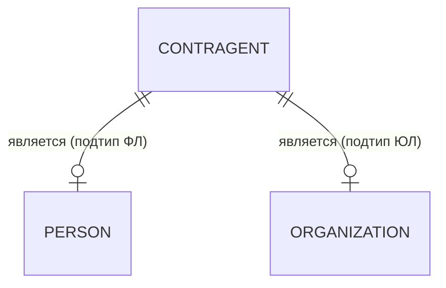
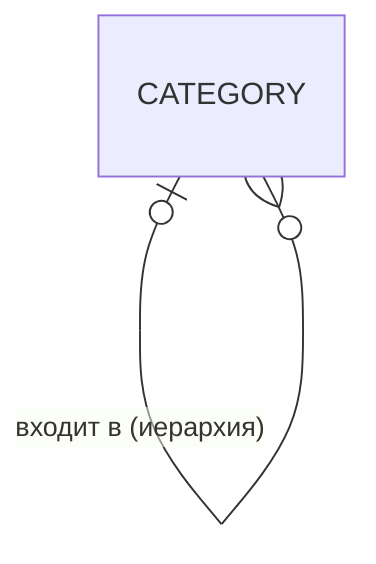
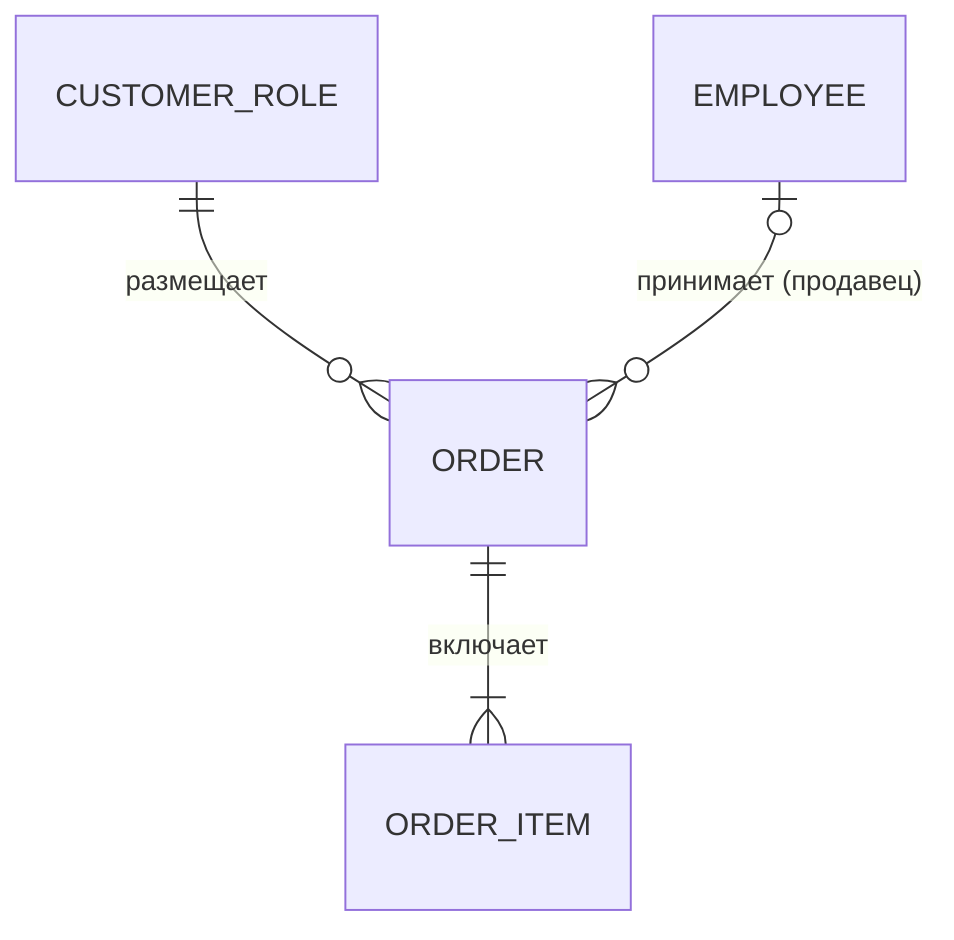
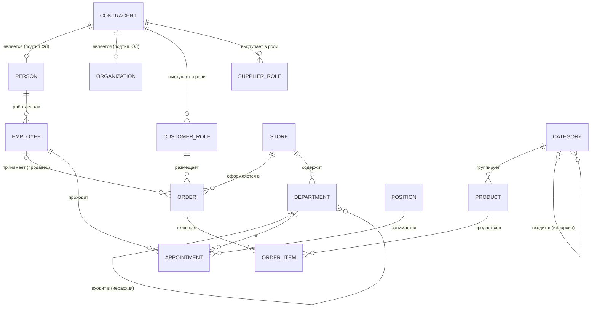
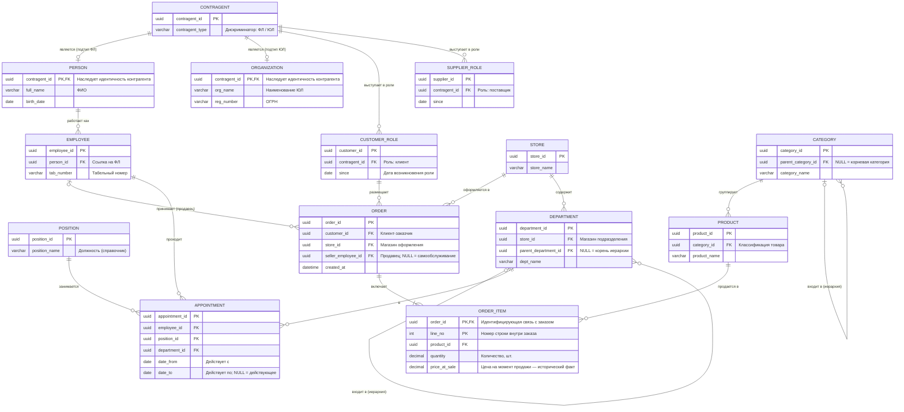

# Руководство по EER (Extended ER)

Практическое руководство по расширенной модели «сущность — связь» (Extended Entity-Relationship, EER): базовые и расширенные конструкции, правила отображения связей и кардинальностей, сквозной пример КМД → ЛМД. Дополняет [[Требования к КМД]] и [[Требования к ЛМД]]; терминология — по [[Глоссарий (КМД, ЛМД)]].

**Согласованный режим отображения кардинальностей** (выбор по итогам обсуждения): графическая нотация **Crow's Foot** («воронья лапка») на диаграммах + **интервальная запись min..max** (`0..1`, `1..1`, `0..*`, `1..*`) в текстовых спецификациях связей. Совпадает с нотацией [[Пример модели данных для ГК]] и напрямую закрывает требование «минимальная и максимальная кардинальность с обеих сторон» (CDM-015, LDM-013).

---

## Содержание

1. [[#1. Назначение и область применения]]
2. [[#2. Базовые конструкции ER]]
   - [[#2.1. Сущность и экземпляр]]
   - [[#2.2. Атрибуты и домены]]
   - [[#2.3. Связи и роли]]
   - [[#2.4. Кардинальность и обязательность участия]]
   - [[#2.5. Атрибуты связи]]
3. [[#3. Расширенные конструкции EER]]
   - [[#3.1. Специализация и обобщение (подтипы)]]
   - [[#3.2. Идентифицирующая связь, зависимость существования и идентичности]]
   - [[#3.3. Ассоциативная сущность]]
   - [[#3.4. Рекурсивные (иерархические) связи]]
   - [[#3.5. Роли и категории (union)]]
   - [[#3.6. Временная семантика]]
4. [[#4. Правила отображения и нотация]]
   - [[#4.1. Соглашение о кардинальностях: Crow's Foot + min..max]]
   - [[#4.2. Легенда обозначений]]
   - [[#4.3. Правила чтения диаграммы]]
   - [[#4.4. Отображение в Mermaid (erDiagram)]]
5. [[#5. Сквозной пример: торговая сеть (КМД → ЛМД)]]
   - [[#5.1. Фрагмент КМД]]
   - [[#5.2. Правила трансформации КМД → ЛМД]]
   - [[#5.3. Фрагмент ЛМД]]
   - [[#5.4. Прослеживаемость конструкций]]
6. [[#6. Типовые ошибки (анти-паттерны)]]
7. [[#7. Связь руководства с требованиями]]
8. [[#8. Источники и материалы]]

---

## 1. Назначение и область применения

EER — расширение классической ER-модели, добавляющее к сущностям, атрибутам и связям конструкции семантического моделирования: **специализацию/обобщение (подтипы)**, **идентифицирующие связи**, **категории (union)**, **ассоциативные сущности** и явную работу с **ролями** и **временной семантикой**.

В контуре метамодели EER используется на двух уровнях:

| Уровень | Роль EER | Отличия |
|---|---|---|
| **КМД** | Язык описания бизнес-понятий и бизнес-фактов: сущности раскрываются через смысл, связи — через правила предметной области. | Без атрибутов-типов, без PK/FK. M:M допустимо напрямую (CDM-017). Подтипы — как бизнес-классификация. |
| **ЛМД** | Язык детализации: сущности получают атрибуты, домены, идентификаторы; связи — способ реализации (LDM-019). | M:M разрешается ассоциативной сущностью (LDM-015). Подтипы получают стратегию представления (LDM-034). |

Ключевой принцип: **EER-конструкция считается описанной, только когда раскрыт ее смысл** — критерий принадлежности к подтипу, условие обязательности, правило «в момент / за срок». Графика вторична по отношению к семантике (LDM-001, LDM-034).

---

## 2. Базовые конструкции ER

### 2.1. Сущность и экземпляр

**Сущность** — тип объектов, событий или понятий предметной области, значимых в границах модели. **Экземпляр** — один конкретный представитель. Определения терминов раздела — в [[Глоссарий (КМД, ЛМД)#Понятия и сущности|глоссарии, разд. «Понятия и сущности»]].

Для каждой сущности фиксируются (CDM-010, LDM-006):

- **бизнес-смысл** — определение, не сводящееся к повторению имени; желательно с примерами и контрпримерами;
- **гранулярность** — что представляет один экземпляр: объект, событие, состояние, версию, роль или агрегат за период. «Заказ» (факт покупки) ≠ «Отправка заказа» (факт исполнения) — разные гранулярности, не смешиваются без явного описания;
- **границы понятия** — отличие от смежных понятий («Подразделение» ≠ «Магазин», даже если магазин административно един).

Пример (сквозная область — торговая сеть):

| Сущность | Экземпляр — это… | Гранулярность |
|---|---|---|
| Заказ | один зафиксированный факт покупки клиентом | событие |
| Позиция заказа | одна строка одного заказа | часть события |
| Назначение | один факт занятия сотрудником должности в подразделении за период | событие с длительностью |
| Сотрудник | человек в статусе работающего в сети | объект |

### 2.2. Атрибуты и домены

**Атрибут** — свойство сущности. На уровне ЛМД для атрибута определяются: логический тип, обязательность (NULL / NOT NULL, LDM-020), существенные ограничения, единица измерения, точность, формат (LDM-023).

**Домен** — повторно используемый логический тип атрибута: имя, смысл, допустимые значения, формат, единица измерения (LDM-027). Ссылка на домен предпочтительнее повторного определения: домен «Код валюты ISO 4217» или «Неотрицательное количество (шт.)» используется многими атрибутами, сохраняя единый смысл.

**Производный атрибут** включается при бизнес-значимости и сопровождается правилом вычисления, входными данными и моментом расчета (CDM-031, LDM-024): «Сумма позиции = цена на момент продажи × количество».

### 2.3. Связи и роли

**Связь** — самостоятельный бизнес-факт об участии экземпляров сущностей (CDM-014). Связь читается как осмысленное утверждение от каждой стороны:

> «Клиент **размещает** заказ» / «Заказ **размещен** клиентом».

**Роль** — характер участия объекта в связи (CDM-028). Между двумя сущностями может быть несколько связей с разными ролями: сотрудник может **принять** заказ (продавец) и **собрать** его (сборщик) — две разные связи, а не одна «универсальная».

Правила:

- совпадение значений полей в разных таблицах **не доказывает** бизнес-связь — фиксируется смысл и основание;
- наименование связи позволяет прочитать фразу целиком; при нескольких связях одних участников обязательны различение по ролям/именам (LDM-005).

### 2.4. Кардинальность и обязательность участия

Ключевое понятие руководства. **Кардинальность связи** — минимальное и максимальное участие **каждой** из двух сторон (CDM-015, LDM-013). Обозначается с обеих сторон: `min..max`. Понятия «кардинальность», «обязательность участия», «условное участие», «атрибуты связи» — [[Глоссарий (КМД, ЛМД)#Идентификация и связи|глоссарий, разд. «Идентификация и связи»]].

| Интервал | Смысл | Пример (торговая сеть) |
|---|---|---|
| `1..1` | ровно один | у заказа ровно один клиент-заказчик — следует из определения заказа |
| `0..1` | не более одного | у заказа не более одного продавца: заказы самообслуживания проходят без продавца |
| `1..*` | один и более | в заказе хотя бы одна позиция — «пустой заказ» не имеет бизнес-смысла |
| `0..*` | ноль и более | у клиента может не быть ни одного заказа (только зарегистрировался) |

Правила работы с кардинальностью:

1. **Обязательность участия устанавливается бизнес-правилом, а не «по умолчанию»** (CDM-015). Вопрос к предметнику: «Может ли существовать X без Y?» — ответ фиксируется как правило.
2. **Различаются ограничения «в один момент времени» и «за весь срок существования»** (CDM-016):
   - у сотрудника **в текущий момент** одно действующее назначение (`0..1`), **за срок работы** — много назначений (`0..*`);
   - «один действующий руководитель подразделения» ≠ «один руководитель за всю историю».
3. **Условное участие фиксируется с условием**: продавец у заказа отсутствует, только если канал — самообслуживание.
4. В AS-IS наблюдающаяся по данным кардинальность **не считается бизнес-правилом автоматически** (LDM-013): «во всех просмотренных заказах есть продавец» не означает `1..1`.
5. Для связей с более чем двумя участниками ограничения формулируются в контексте сочетаний остальных участников (CDM-015): «у сотрудника не более одного действующего назначения **для данной должности и подразделения**».

**Как задается мин/макс:** минимум — может ли сторона участвовать «ноль раз» (необязательное участие); максимум — сколько экземпляров связи допускается на один экземпляр сущности.

Чтение двустороннее — от каждого конца:

```
Клиент (0..*) размещает (1..1) Заказ
```
- на одного клиента приходится от нуля до многих заказов;
- каждый заказ размещен ровно одним клиентом.

### 2.5. Атрибуты связи

Если связь несет характеристики (дату, количество, статус), это сигнал либо атрибутов связи, либо — самостоятельного факта (см. [[#3.3. Ассоциативная сущность]]). «Товар входит в заказ **с количеством и ценой на момент продажи**» — атрибуты принадлежат паре «заказ–товар», а не товару и не заказу. Классическая ошибка — размещать такие атрибуты в одной из сторон связи.

---

## 3. Расширенные конструкции EER

### 3.1. Специализация и обобщение (подтипы)

**Обобщение** — объединение близких понятий в родовое; **специализация** — выделение разновидностей. Подтип наследует смысл и идентичность родителя и добавляет собственные атрибуты/связи (CDM-027, LDM-034).

Для каждой иерархии подтипов фиксируются два свойства:

| Свойство | Варианты | Пример |
|---|---|---|
| **Полнота** (totality) | **полная** (total): каждый экземпляр родителя принадлежит какому-то подтипу / **частичная** (partial): не каждый | Контрагент — всегда ФЛ или ЮЛ (полная); Контрагент — не обязательно клиент (частичная) |
| **Пересечение** | **непересекающиеся** (disjoint): подтипы исключают друг друга / **пересекающиеся** (overlapping): экземпляр принадлежит нескольким подтипам | ФЛ и ЮЛ — непересекающиеся; «Клиент» и «Поставщик» — пересекающиеся (одно ЮЛ может быть и тем, и другим) |

Обязательно задается **критерий принадлежности** («дискриминатор»): чем определяется, что контрагент — ЮЛ (организационная форма регистрации), а не «наличие поля ИНН». Термины «дискриминатор», «полнота (total/partial)», «пересечение (disjoint/overlapping)», «наследование идентичности», «стратегии представления подтипов» — [[Глоссарий (КМД, ЛМД)#Понятия и сущности|глоссарий, разд. «Понятия и сущности»]].

Диаграммно в нотации Crow's Foot подтип изображается связью `0..1 ↔ 1..1` с именем «является»:



Читается: каждый ФЛ — ровно один контрагент; у контрагента — не более одного представления ФЛ (иначе это ЮЛ). **Полнота и непересечение из символов кардинальности не выводятся** — задаются правилами и отражаются в легенде. В академической нотации для этого служат кружки с пометками d/o и двойная линия (total); в Crow's Foot это текстовые правила.

Наследование идентификаторов: подтип не получает собственного суррогатного ключа — идентичность наследуется от родителя (в ЛМД PK подтипа одновременно является FK к родителю).

### 3.2. Идентифицирующая связь, зависимость существования и идентичности

**Идентифицирующая связь** — связь, через которую задается идентичность зависимого понятия (CDM-019). Различаются две независимые вещи:

- **зависимость существования** — объект не может существовать вне контекста другого: «Позиция заказа» не существует без «Заказа»;
- **зависимость идентичности** — объект различается только в контексте другого: номер строки `1, 2, 3…` имеет смысл только внутри конкретного заказа.

Идентифицирующая связь **не сводится к PK/FK** и не равна обязательному участию: связь «Заказ → Клиент» обязательна (`1..1`), но не идентифицирующая — заказ имеет собственный номер и не «принадлежит» номеру клиента. В ЛМД идентифицирующая связь обычно реализуется составным ключом `(order_id, line_no)`, но смысл — в бизнес-правиле, а не в форме ключа.

Признак идентифицирующей связи для интервью: «Имеет ли смысл номер/имя этого объекта вне родителя?» — «строка 3» вне заказа не означает ничего.

### 3.3. Ассоциативная сущность

Если участие в связи имеет **самостоятельный бизнес-смысл, собственный жизненный цикл, повторяемые случаи или значимые характеристики** — представляется ассоциативной сущностью (CDM-018).

Триггеры для выделения:

- у связи есть собственные атрибуты (даты, статус, комментарий);
- у связи свой жизненный цикл (включение → исключение, приемка → закрытие);
- одна пара участников встречается многократно во времени;
- в связи участвуют три и более сущности.

| Уровень | Представление M:M |
|---|---|
| КМД | допустимо прямо линией с кардинальностями `0..* ↔ 0..*` (CDM-017), если свойства несущественны |
| ЛМД | **обязательно** разрешается ассоциативной сущностью (LDM-015); атрибуты связи переносятся в нее |

Пример: «Товар — входит в — Заказ» в КМД допустимо как M:M, но атрибуты «количество» и «цена на момент продажи» делают «Позицию заказа» самостоятельным фактом.

### 3.4. Рекурсивные (иерархические) связи

**Рекурсивная связь** — отношение сущности к самой себе (CDM-029, LDM-034). Для каждой иерархии фиксируются:

- **смысл**: «Подразделение входит в вышестоящее подразделение»; «Категория товаров вложена в родительскую категорию»;
- **количество родителей**: один (`0..1`) или несколько (`0..*`) — у оргструктуры обычно один;
- **корни**: наличие элементов без родителя (`0..1` с допустимым «нет родителя» = корень);
- **циклы**: в иерархиях обычно запрещены бизнес-правилом;
- **зависимость от времени**: «в момент» руководитель один, «за срок» — много.



Читается: у категории не более одного родителя (`0..1` — есть корни); у категории ноль и более потомков (`0..*` — листья).

### 3.5. Роли и категории (union)

**Роль** — участие объекта в связи, а не тип объекта (CDM-028). **Категория (union)** — объединение разнородных сущностей, экземпляры которых могут выступать в одной роли.

Критерий выбора «подтип или роль»:

| Вопрос | Подтип | Роль |
|---|---|---|
| Классификация постоянна и определяется природой объекта? | да: ФЛ/ЮЛ | — |
| Участие возникает/исчезает со временем, может совмещаться? | — | да: «Клиент», «Поставщик» |
| У подвида собственные существенные атрибуты? | да: у ЮЛ — наименование, ОГРН | обычно нет: у роли только факт и дата возникновения |
| Экземпляр может быть несколькими одновременно? | пересекающиеся подтипы — редко и осознанно | роли — штатно совмещаются |

Пример: контрагент **выступает в роли** клиента и **одновременно** поставщика — две записи роли у одного контрагента. Если смоделировать «Клиента» и «Поставщика» непересекающимися подтипами, совмещение станет невозможным — это искажение семантики.

### 3.6. Временная семантика

Время влияет на смысл понятий и ограничения связей (CDM-016, CDM-030):

- **бизнес-объект ≠ его историческое представление**: «Сотрудник» (человек в статусе работы) ≠ «Назначение» (факт работы на должности в период); история изменений записи — отдельные версии с периодами действия (LDM-006);
- **«в момент» vs «за срок»** — см. [[#2.4. Кардинальность и обязательность участия]];
- **историзация фактов**: «цена на момент продажи» фиксируется в позиции заказа и не меняется при изменении текущей цены товара;
- **периоды действия** у назначений, ролей, договоров: `date_from` / `date_to` + правило непересечения интервалов и «не более одного действующего».

---

## 4. Правила отображения и нотация

### 4.1. Соглашение о кардинальностях: Crow's Foot + min..max

**Согласованный режим** (см. преамбулу): диаграммы — «воронья лапка», спецификации связей — интервальная запись. Соответствие символов:

| Символ у конца связи | Интервал | Смысл | Пример |
|---|---|---|---|
| `——||` | `1..1` | ровно один | у заказа ровно один клиент |
| `——o\|` | `0..1` | не более одного | у заказа не более одного продавца |
| `——\|{` | `1..*` | один и более | в заказе хотя бы одна позиция |
| `——o{` | `0..*` | ноль и более | у клиента ноль и более заказов |

Интервальная запись **пишется у каждой стороны** в спецификации: `Клиент 0..* ←размещает→ 1..1 Заказ`. В тексте допустима форма «(min..max)» у наименования сущности.

Почему выбран комбинированный режим:

- Crow's Foot компактен, привычен инструментам (ERwin, PowerDesigner, dbdiagram.io, SqlDBM) и совместим с Mermaid `erDiagram` (как в [[Пример модели данных для ГК]]);
- интервальная запись явно показывает мин/макс с обеих сторон — дословно требование CDM-015 / LDM-013, и сохраняет однозначность при передаче в таблицах/документах, где графика теряется;
- чистая Crow's Foot требует «декодирования» символов при чтении спецификаций; чистая интервальная запись не поддерживается Mermaid `erDiagram`.

Термины нотации продублированы в [[Глоссарий (КМД, ЛМД)#Нотация EER (согласованные обозначения)|глоссарии, разд. «Нотация EER (согласованные обозначения)»]].

### 4.2. Легенда обозначений

Легенда обязательна для каждой модели (CDM-003) и включает:

1. использованные символы кардинальностей и их значения (таблица выше);
2. как изображаются: подтипы (связь «является» `0..1 ↔ 1..1` + текстовые правила полноты/пересечения), ассоциативные сущности (при необходимости — особая шапка/цвет), идентифицирующие связи (в Mermaid — текстовая пометка, в CASE-средствах — сплошная линия к зависимой сущности);
3. правила, не выражаемые графикой: «в момент / за срок», условия участия, статус достоверности (подтверждено / предположение / не установлено).

### 4.3. Правила чтения диаграммы

1. Найти имя связи и прочитать фразу от каждой стороны: «Заказ — включает — Позицию заказа»; «Позиция заказа — входит в — Заказ».
2. Посмотреть на символ **у дальнего от читателя конца**: символ у сущности X отвечает на вопрос «сколько X на один экземпляр другой стороны». `ORDER ||--|{ ORDER_ITEM`: у `ORDER_ITEM` стоит `|{` → «на один заказ — одна и более позиций»; у `ORDER` стоит `||` → «на одну позицию — ровно один заказ».
3. Восстановить интервалы: `Заказ 1..* ←включает→ 1..1 Позиция`.
4. Проверить обязательность по бизнес-правилу, условное участие — по условию из описания.
5. Для связей-«является» — обратиться к правилам полноты/пересечения в тексте.

### 4.4. Отображение в Mermaid (erDiagram)

Синтаксис связи: `A <символы A>--<символы B> B : "имя связи"`. Символы у A описывают участие A, у B — участие B.



Ограничения Mermaid и обходы:

- нет встроенного символа ISA-иерархии → подтипы связью «является» + правила в тексте (см. [[#3.1. Специализация и обобщение (подтипы)]]);
- нет вынесенных подписей кардинальностей числами → интервалы приводятся в спецификации связей рядом с диаграммой;
- идентифицирующая связь помечается комментарием у атрибута (`"PK, FK — идентифицирующая"`) или именем связи;
- альтернатива с более богатыми средствами — `classDiagram` (мультичисла `"0..*"` подписываются у концов), показана в [[Пример модели данных для ГК]].

---

## 5. Сквозной пример: торговая сеть (КМД → ЛМД)

Область (согласована): **ритейл + HR** — торговая сеть с магазинами и оргструктурой. Один и тот же фрагмент проведен от КМД к ЛМД, чтобы показать трансформацию конструкций. Охват умышленно ограничен; полный Lifecycle (возвраты, склад, смены) — за границами примера.

### 5.1. Фрагмент КМД

#### 5.1.1. Диаграмма



#### 5.1.2. Легенда сущностей

| Имя на диаграмме | Понятие | Комментарий |
|---|---|---|
| `CONTRAGENT` | Контрагент | родовое понятие: любое лицо, с которым у сети возникают отношения |
| `PERSON` | Физическое лицо | подтип контрагента {disjoint, total — вместе с ЮЛ} |
| `ORGANIZATION` | Юридическое лицо | подтип контрагента {disjoint, total — вместе с ФЛ} |
| `CUSTOMER_ROLE` | Клиент | **роль** контрагента: факт регистрации как покупателя; совмещается с ролью поставщика |
| `SUPPLIER_ROLE` | Поставщик | **роль** контрагента; пересекается с ролью клиента |
| `EMPLOYEE` | Сотрудник | человек, работающий в сети; ссылается на ФЛ |
| `APPOINTMENT` | Назначение | ассоциативный факт: сотрудник на должности в подразделении за период |
| `POSITION` | Должность | справочник |
| `DEPARTMENT` | Подразделение | оргединица; образует иерархию; относится к магазину |
| `STORE` | Магазин | точка продаж |
| `CATEGORY` | Категория товаров | иерархия классификации |
| `PRODUCT` | Товар | номенклатурная единица |
| `ORDER` | Заказ | факт покупки; экземпляр — событие |
| `ORDER_ITEM` | Позиция заказа | строка заказа; идентифицируется заказом и номером строки |

#### 5.1.3. Спецификация связей (кардинальности)

Формат: `Сущность min..max — имя связи — min..max Сущность`. Условие и основание обязательны там, где участие условное или временное.

| # | Связь | Кардинальность (обе стороны) | Основание / условие |
|---|---|---|---|
| 1 | Контрагент `1..1 ↔ 0..1` ФЛ «является» | каждый ФЛ — ровно 1 контрагент; контрагент — не более одного представления ФЛ | деление ФЛ/ЮЛ непересекающееся и **полное**: каждый контрагент — либо ФЛ, либо ЮЛ (правило, из графики не следует) |
| 2 | Контрагент `1..1 ↔ 0..*` Клиент «выступает в роли» | роль возникает при первой покупке/регистрации | необязательное участие; роль **совмещается** с ролью поставщика |
| 3 | ФЛ `1..1 ↔ 0..*` Сотрудник «работает как» | каждый сотрудник — ровно одно ФЛ; ФЛ может быть нанято повторно | один и тот же человек может быть **одновременно** клиентом и сотрудником (пересекающиеся категории) |
| 4 | Клиент `0..* ↔ 1..1` Заказ «размещает» | у заказа ровно один заказчик | из определения заказа; «ничей» заказ не существует |
| 5 | Магазин `0..* ↔ 1..1` Заказ «оформляется в» | каждый заказ оформлен в конкретном магазине | интернет-заказ привязан к «виртуальному» магазину канала — оговаривается в легенде |
| 6 | Сотрудник `0..* ↔ 0..1` Заказ «принимает (продавец)» | у заказа не более одного продавца | **условное участие**: продавца нет, если канал — самообслуживание |
| 7 | Заказ `1..* ↔ 1..1` Позиция «включает» | в заказе одна и более позиций; позиция ровно в одном заказе | **идентифицирующая связь** + зависимость существования: номер строки вне заказа бессмыслен |
| 8 | Товар `0..* ↔ 1..1` Позиция «продается в» | позиция ссылается ровно на один товар | в одной позиции не смешиваются товары; состав набора — отдельные позиции |
| 9 | Категория `0..* ↔ 1..1` Товар «группирует» | у товара ровно одна категория | однократная классификация; перегруппировка меняет ссылку, а не плодит версии (в данном охвате) |
| 10 | Категория `0..* ↔ 0..1` Категория «входит в» | у категории не более одного родителя | корни без родителя; **циклы запрещены** — правило |
| 11 | Подразделение `0..* ↔ 1..1` Магазин «содержит» | подразделение относится ровно к одному магазину | оргструктура не пересекает границы магазина |
| 12 | Подразделение `0..* ↔ 0..1` Подразделение «входит в» | один родитель; корни — верхний уровень сети | циклы запрещены |
| 13 | Сотрудник `0..* ↔ 1..1` Назначение «проходит» | назначение — ровно один сотрудник | |
| 14 | Должность `0..* ↔ 1..1` Назначение «занимается» | назначение — ровно одна должность | совмещение должностей = два параллельных назначения |
| 15 | Подразделение `0..* ↔ 1..1` Назначение «в» | назначение — ровно одно подразделение | |
| 16 | Сотрудник **«в момент»** `0..1` / **«за срок»** `0..*` действующих назначений | | временная семантика: правило «не более одного действующего назначения»; история сохраняется |

#### 5.1.4. Существенные правила КМД

- Подтипы ФЛ/ЮЛ: критерий — организационная форма регистрации; пересечение запрещено; классификация полная.
- Роли Клиент/Поставщик: совмещаются; у роли фиксируются дата возникновения и основание.
- Назначение — самостоятельный факт с периодом действия; увольнение закрывает назначение, а не удаляет историю.
- Цена на момент продажи фиксируется позицией заказа и не следует за текущей ценой товара.
- Все связи выше имеют статус «подтверждено бизнес-заказчиком» (в реальном AS-IS проставляется по источникам, CDM-037).

### 5.2. Правила трансформации КМД → ЛМД

| Конструкция КМД | Решение ЛМД | Требование |
|---|---|---|
| M:M «Товар ↔ Заказ» с атрибутами | ассоциативная сущность `ORDER_ITEM` | LDM-015 |
| Подтипы ФЛ/ЮЛ | таблица супертипа + таблицы подтипов; PK подтипа = FK к супертипу (наследование идентичности) | LDM-034 |
| Роли Клиент/Поставщик (пересекающиеся) | отдельные таблицы ролей с FK на контрагента — совмещение допускается | CDM-028 |
| Идентифицирующая связь «Заказ → Позиция» | составной PK `(order_id, line_no)` | CDM-019 |
| Рекурсия «входит в» | self-FK `parent_id` c допустимым NULL у корней | LDM-034 |
| Временная семантика назначений | `date_from` / `date_to` + правило «не более одного действующего» (`date_to IS NULL`) | CDM-016 |
| Условное участие продавца | необязательный FK + описание условия | LDM-013 |
| Кардинальности | символы Crow's Foot на диаграмме + интервалы в спецификации | CDM-015, LDM-013 |

Стратегии представления подтипов (выбор фиксируется и обосновывается):

| Стратегия | Когда уместна |
|---|---|
| Одна таблица с дискриминатором | мало специфических атрибутов, подтипы не участвуют в разных связях |
| Супертип + подтипы (PK = FK) | много специфических атрибутов; подтипы нужны разным связям; **использовано в примере** |
| Только таблицы подтипов | нет общих атрибутов и общих связей |

### 5.3. Фрагмент ЛМД

#### 5.3.1. Диаграмма



#### 5.3.2. Спецификация ключей и правил целостности

| Объект | Ключ / правило | Связь с КМД |
|---|---|---|
| `ORDER_ITEM` | PK `(order_id, line_no)`; `order_id` — FK, идентифицирующая связь | правило № 7 |
| `PERSON`, `ORGANIZATION` | PK = FK `contragent_id`; дискриминатор в супертипе контролирует непересечение/полноту | правила № 1 |
| `CUSTOMER_ROLE.contragent_id` | не уникален: одно ЮЛ — клиент и поставщик одновременно (две записи в разных таблицах ролей) | правило № 2 |
| `ORDER.seller_employee_id` | NULL допустим — условие «самообслуживание»; уникальность не требуется | правило № 6 |
| `APPOINTMENT` | правило: не более одной записи с `date_to IS NULL` на сотрудника; интервалы одного сотрудника не пересекаются | правило № 16 |
| `CATEGORY.parent_category_id`, `DEPARTMENT.parent_department_id` | NULL = корень; циклы запрещены (контроль приложения — фиксируется способ реализации) | правила № 10, 12 |
| Способ реализации связей | FK объявлены декларативно, кроме запрета циклов — контроль приложения (LDM-019) | |

### 5.4. Прослеживаемость конструкций

| Конструкция EER | Где в КМД | Где в ЛМД | Требования |
|---|---|---|---|
| Подтипы {disjoint, total} | правила 5.1.4, связь № 1 | `CONTRAGENT` + `PERSON`/`ORGANIZATION` | CDM-027, LDM-034 |
| Пересекающиеся роли | связи № 2, 3 | `CUSTOMER_ROLE` / `SUPPLIER_ROLE` | CDM-028 |
| Ассоциативная сущность | `ORDER_ITEM` как факт | таблица с собственными атрибутами | CDM-018, LDM-015 |
| Идентифицирующая связь | № 7 | составной PK | CDM-019 |
| Рекурсивные иерархии | № 10, 12 | self-FK | CDM-029, LDM-034 |
| Временная семантика | № 16, «цена на момент продажи» | `date_from`/`date_to`, `price_at_sale` | CDM-016, CDM-030 |
| Условное участие | № 6 | nullable FK | LDM-013 |
| Кардинальность min..max | спецификация 5.1.3 | диаграмма 5.3.1 + спецификация | CDM-015, LDM-013 |

---

## 6. Типовые ошибки (анти-паттерны)

1. **Кардинальность «по умолчанию».** Ставить `1..1` «чтобы точно было заполнено» без бизнес-правила — обязательность выводится из правила (CDM-015).
2. **Правило из наблюдений данных.** «Во всех заказах продавец заполнен» в AS-IS — наблюдение, а не правило; оформляется предположением со статусом.
3. **M:M в ЛМД напрямую.** «Таблица товаров» + «таблица заказов» + пересечение в приложении — нарушает LDM-015; как минимум фиксируется логическая ассоциативная сущность.
4. **Подтип вместо роли.** «Клиент» и «Поставщик» как непересекающиеся подтипы контрагента делают совмещение невозможным — искажение семантики (см. [[#3.5. Роли и категории (union)]]).
5. **Роль вместо подтипа.** «ФЛ» и «ЮЛ» как роли с флагами плодят nullable-атрибуты и лишают наследования идентичности.
6. **Смешение «в момент» и «за срок».** «У подразделения один руководитель» без квалификатора времени порождает ложную уникальность.
7. **Связь по похожим полям.** `phone` в двух таблицах не создает связь «клиент — сотрудник»; связь требует бизнес-факта (CDM-014).
8. **Идентифицирующая связь везде, где обязательное участие.** Заказчик заказа обязателен, но заказ идентичен собственным номером, а не клиентом (CDM-019).
9. **Атрибуты связи в стороне связи.** «Количество» в карточке товара (актуальный остаток ≠ проданное количество) или в шапке заказа (неверно при разных товарах).
10. **Сокрытие отсутствия контроля.** Если ссылочная целостность держится только на приложении — это фиксируется в модели, а не замалчивается (LDM-019).

---

## 7. Связь руководства с требованиями

| Раздел руководства | Требования [[Требования к КМД]] | Требования [[Требования к ЛМД]] |
|---|---|---|
| 2.1 Сущность и экземпляр | CDM-010, CDM-011, CDM-012 | LDM-005, LDM-006 |
| 2.2 Атрибуты и домены | CDM-024, CDM-031 | LDM-020, LDM-023, LDM-024, LDM-027 |
| 2.3 Связи и роли | CDM-014, CDM-028 | LDM-005 |
| 2.4 Кардинальность | CDM-015, CDM-016 | LDM-012, LDM-013 |
| 3.1 Подтипы | CDM-027 | LDM-034 |
| 3.2 Идентифицирующие связи | CDM-019 | — |
| 3.3 Ассоциативная сущность, M:M | CDM-017, CDM-018 | LDM-015 |
| 3.4 Рекурсия | CDM-029 | LDM-016, LDM-034 |
| 3.5 Роли и категории | CDM-028 | — |
| 3.6 Временная семантика | CDM-016, CDM-030 | LDM-006 |
| 4 Нотация и легенда | CDM-003 | LDM-001 |
| Способ реализации связей | — | LDM-019 |

---

## 8. Источники и материалы

**Классические работы и учебники:**

1. Chen P. P.-S. *The Entity-Relationship Model — Toward a Unified View of Data.* ACM Transactions on Database Systems, 1(1), 1976 — исходная работа ER-модели.
2. Elmasri R., Navathe S. B. *Fundamentals of Database Systems.* 7th ed., Pearson, 2016 — главы по ER- и EER-модели (в русских изданиях: Эльмасри Р., Навате Ш. «Основы современных баз данных»).
3. Silberschatz A., Korth H. F., Sudarshan S. *Database System Concepts.* 7th ed., McGraw-Hill, 2019 — гл. 7 (ER-модель и проектирование).
4. Simsion G., Witt G. *Data Modeling Essentials.* 3rd ed., Morgan Kaufmann, 2005 — практика кардинальностей, ролей, типов сущностей и данных.
5. Halpin T., Morgan T. *Information Modeling and Relational Databases.* 2nd ed., Morgan Kaufmann, 2008 — концептуальное моделирование и трансформации в реляционную схему.

**Нотация и инструменты:**

6. Mermaid — Entity Relationship Diagrams: <https://mermaid.js.org/syntax/entityRelationshipDiagram.html> (синтаксис кардинальностей Crow's Foot, атрибуты с PK/FK).
7. Документация CASE-средств (ERwin Data Modeler, PowerDesigner, dbdiagram.io, SqlDBM) — разделы о нотации Crow's Foot и изображении подтипов.

**Внутренние материалы:**

8. [[Требования к КМД]] — базовые требования к концептуальной модели.
9. [[Требования к ЛМД]] — базовые требования к логической модели.
10. [[Глоссарий (КМД, ЛМД)]] — термины и определения.
11. [[Пример модели данных для ГК]] — пример в нотации Mermaid (область бизнес-процессов).
12. [[Метамодель модели данных]] — контур метамодели.

---

## Связанные заметки

- [[Требования к КМД]]
- [[Требования к ЛМД]]
- [[Глоссарий (КМД, ЛМД)]]
- [[Пример модели данных для ГК]]
- [[Метамодель модели данных]]
- [[Заметки по дизайну метамодели]]

## История изменений

| Дата | Изменение |
|---|---|
| 2026-10-09 | Создано: структура, базовые и расширенные конструкции, соглашение о кардинальностях (Crow's Foot + min..max — согласовано), сквозной пример «торговая сеть» (ритейл + HR), источники |
| 2026-10-09 | Добавлены ссылки на глоссарий по разделам; [[Глоссарий (КМД, ЛМД)]] дополнен терминами руководства (дискриминатор, полнота/пересечение подтипов, наследование идентичности, категория, условное участие, атрибуты связи, нотация Crow's Foot и min..max) |
