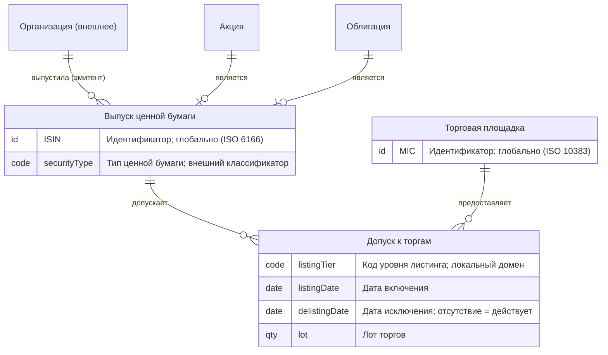
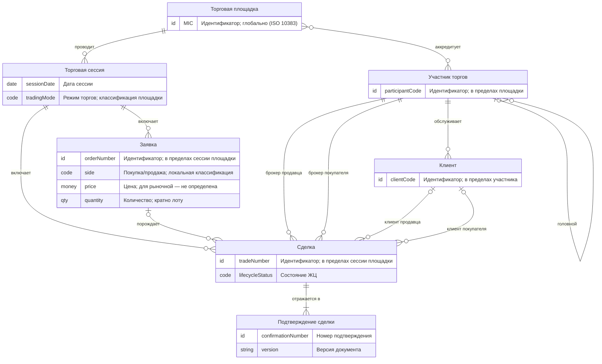
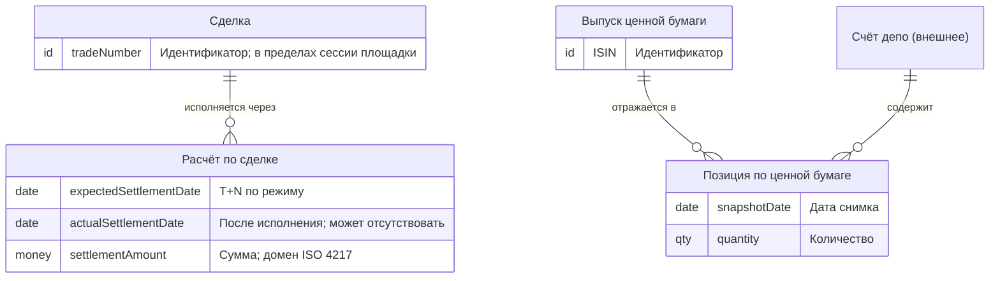

# Приложение Н. Сквозной биржевой пример

**Версия:** 0.8-в7 (Р-035 — итерация 1 из 4: выполнены Н.0–Н.2 «Карта домена» и «КМД»; Н.3–Н.5 — итерации 2–4). Статус — **методический пример** (рабочий документ): полный сквозной пример применения стандарта к фрагменту вторичного рынка ценных бумаг; цепочка «карта домена → КМД → ЛМД → правила → соответствия → проверка». Новых обязательств не вводит (3.10); синтетическая подготовка не выдаётся за AS-IS-пилот (ПВ-09); включение материалов примера ГК — после ПВ-06.

Текст подготовительной части (0.6-в4) заменён полной редакцией; ревизии — по истории Git.

## Н.0. Рамка примера, паспорт и допущения

### Н.0.1. Итерационная рамка

| Итерация | Разделы | Содержание | Основные нормы |
|---|---|---|---|
| 1 (выполнена) | Н.0–Н.2 | Карта домена и КМД фрагмента по разделу 6 + прил. В/Е/И/Л | CDM-004…CDM-044 |
| 2 | Н.3 | ЛМД фрагмента по разделу 7 + прил. Б/Д/Е/Р | LDM-002…LDM-046 |
| 3 | Н.4 | Правила и их преобразование (8.8–8.9, прил. С); соответствия КМД↔ЛМД (8.4) и междоменные (8.6) | CDM-034/035, LDM-030, GEN-004 |
| 4 | Н.5 | Проверка: листы К-1/Л-1/О-4, сценарная проверка; **испытание PR-004/PR-005/PR-007** на материалах примера | 10.1–10.4, CDM-042 |

### Н.0.2. Паспорт фрагмента (мини-форма по Г.2/Л.1; методический)

| Поле | Значение |
|---|---|
| Идентификатор модели | `MD-EXCH-01` (пространство имён методических примеров) |
| Назначение | Методическая демонстрация применения стандарта; не операционная модель |
| Уровень и вид | КМД; фрагмент доменной модели (итерация 1); профиль к КМД не применяется (2.4 — решение о профиле относится к ЛМД, итерация 2) |
| Режим и состояние | TO-BE (учебно-методический); AS-IS-элементов нет (ПВ-09) |
| Домен | Ядро — «Торги»; в охват включены фрагменты доменов «Ценные бумаги», «Стороны», «Расчёты» (Н.1) |
| Охват | Заключение, подтверждение и исполнение биржевых сделок вторичного рынка эмиссионных ценных бумаг |
| Исключения | Первичный рынок (размещение); деривативы; маржинальное кредитование; внебиржевой контур (допущен только как граничный сценарий S3); корпоративные действия — только сценарием S6 |
| Версия и статус | 0.8-в7, итерация 1; статус — черновик методического примера |
| Ответственные | Владелец стандарта (методическая роль; организационные назначения — ПВ-01) |
| Хранилище | Репозиторий проекта (текст по прил. В); авторитетное хранилище организации — 11.1, неприменимо до ПВ-01 |
| Источники | Синтетические: С02 (биржевые примеры исходной базы), учебный регламент организатора торгов (редакция 1.0, синтетический), ISO 6166 (ISIN), ISO 4217, ISO 10383 (MIC), внешний классификатор типов ЦБ |

### Н.0.3. Допущения примера

1. Источники синтетические; статус «подтверждено» означает подтверждённость синтетическим учебным источником, а не корпоративным актом (5.8).
2. Пример не объявляется AS-IS (ПВ-09) и не создаёт обязательств (3.10).
3. Упрощения фиксируются явно: расчёты показаны без разделения денежной/бумажной legs (одна сущность «Расчёт по сделке»); встречные требования и неттинг — за охватом; счета депо и лица — внешние понятия (Н.1.2).
4. Старая подготовительная часть содержала неточность чтения кардинальностей в текстовой нотации (`Выпуск 1..* ←допускает→ 0..* Допуск`); полная редакция использует однозначное правило чтения по прил. В — интервал у сущности означает количество связанных экземпляров другой стороны на один её экземпляр (`Клиент 0..* ←размещает→ 1..1 Заказ` — у клиента ноль и более заказов).

### Н.0.4. Приоритетные понятия и информационные потребности (мини, 5.5)

| Потребитель | Потребность | Связанные понятия |
|---|---|---|
| Участник торгов | Сверка полученных подтверждений со своими сделками | Сделка, Подтверждение сделки |
| Расчётный контур | Состав обязательств к исполнению | Сделка, Расчёт по сделке |
| Риск-менеджмент (учебный) | Позиции клиентов по выпускам на дату | Позиция, Клиент, Выпуск |

### Н.0.5. Реестр вопросов примера (форма Л.2; ведётся в примере)

| ID | Формулировка | Категория | Статус (5.8) | Влияние |
|---|---|---|---|---|
| Q-Н.1 | Категория ИОД для «Клиента» (персональные данные) не подтверждена ИБ; основание-вопрос разметки по И.4 п. 4 | пробел документации | не установлено | ограничивающее |
| Q-Н.2 | Является ли сочетание «Сделка × Клиент» объектом тайны брокерского обслуживания (комбинация полей, И.2) | конфликтующая трактовка | не установлено | ограничивающее |
| Q-Н.3 | Допустима ли кросс-сделка — один участник в ролях брокера покупателя и брокера продавца (регламент молчит; учебный риск-контур запрещает) | конфликтующая трактовка | противоречие источников | ограничивающее |
| Q-Н.4 | Методика расчёта «Позиции» при частичных исполнениях (снятие за день) — источник результата и статус уточнения (CDM-031) | пробел документации | не установлено | не влияющее (методическое) |
| Q-Н.5 | Повторное использование номера заявки после отмены (правила повторного использования, CDM-013) | пробел документации | не установлено | не влияющее (методическое) |

## Н.1. Карта домена фрагмента

### Н.1.1. Домены фрагмента (форма прил. Т)

| Домен (фрагмент) | Назначение в примере | Владелец (учебный) | Основные зависимости |
|---|---|---|---|
| Ценные бумаги | Выпуски эмиссионных ЦБ и их идентификация | Методическая роль | Эмитенты — внешний домен «Организации» |
| Торги | Допуск к торгам, сессии, заявки, заключение и подтверждение сделок | Методическая роль | «Ценные бумаги» (допуск выпусков), «Стороны» (участие), «Расчёты» (исполнение) |
| Стороны | Участники торгов и клиенты | Методическая роль | «Организации»/«Лица» — внешние; «Торги» (членство, роли в сделках) |
| Расчёты | Исполнение сделок; позиции | Методическая роль | «Торги» (сделки), «Хранение» (счета депо — внешние) |

### Н.1.2. Границы и внешние зависимости (5.2, CDM-021)

Границы — по паспорту (Н.0.2). Внешние понятия (за границами модели; полное описание не требуется, тождественность автоматически не предполагается):

| Внешнее понятие | Домен | Смысл соответствия | Степень подтверждения |
|---|---|---|---|
| Организация | «Организации» (внешний) | Носитель ролей «эмитент» и «участник торгов» — тот же объект | предположение (учебное) |
| Лицо (физическое/юридическое) | «Лица» (внешний) | Носитель роли «клиент» — тот же объект | предположение (учебное) |
| Счёт депо | «Хранение» (внешний) | Позиция учитывается на счёте — тот же объект | предположение (учебное) |

## Н.2. КМД фрагмента

### Н.2.1. Каталог понятий

Форма — карточка сущности (Г.4): определение с границами и контрпримерами (CDM-010), что представляет экземпляр (CDM-011), идентичность (CDM-012), бизнес-идентификатор и область уникальности (CDM-013). Статус определений — локальное, согласовано в рамках примера (CDM-007); термины канонические — по глоссарию С04/словарю T-xxx, предметные термины — локальные.

| Понятие (домен) | Определение, границы, контрпримеры (CDM-010) | Экземпляр есть (CDM-011) | Бизнес-идентичность (CDM-012) | Бизнес-идентификатор, область (CDM-013) |
|---|---|---|---|---|
| **Выпуск ценной бумаги** (ЦБ) | Совокупность эмиссионных ценных бумаг, тождественных по объёму удостоверяемых прав, выпущенных одним эмитентом. Границы: неэмиссионные бумаги (вексель) — вне понятия; запись по счёту депо (права владельца) и «штучная» бумага — другие понятия того же домена | Самостоятельный объект (агрегат всех бумаг выпуска) | Один выпуск = все бумаги с одним ISIN; смена ISIN — новый объект (вопрос преобразований — S6) | ISIN, глобально (ISO 6166); альтернативный — тикер, в пределах площадки (повторное использование не допускается) |
| **Акция** (ЦБ) | Подтип выпуска: удостоверяет долю в уставном капитале (дивидендные и корпоративные права). Контрпример: не требование долга — это облигация | Разновидность выпуска (подтип) | Наследуется от выпуска | Наследуется |
| **Облигация** (ЦБ) | Подтип выпуска: удостоверяет требование долга (номинал, проценты). Контрпример: не доля в капитале | Разновидность выпуска (подтип) | Наследуется от выпуска | Наследуется |
| **Организация** (внешнее) | Юридическое лицо — носитель ролей эмитента и участника торгов (описание — домен «Организации») | Самостоятельный объект | За границами фрагмента | За границами фрагмента (роли — в Н.2.3) |
| **Торговая площадка** (Торги) | Организатор торгов, обеспечивающий сессии и заключение сделок. Границы: клиринговый и депозитарный контуры — другие домены | Самостоятельный объект | Одна площадка = один организатор торгов | Код площадки MIC, глобально (ISO 10383) |
| **Допуск к торгам** (Торги) | Факт и условия допуска выпуска к торгам на площадке: интервал действия, уровень листинга, лот. Контрпример: членство участника — другой факт участия | Факт-участие с собственным жизненным циклом (событие-период) | Идентичность задаётся сочетанием «выпуск × площадка × интервал» (идентифицирующие связи — CDM-019); повторный допуск после делистинга — новый экземпляр | Составной (выпуск + площадка); отдельный код не вводится |
| **Торговая сессия** (Торги) | Период приёма заявок и заключения сделок на площадке в установленном режиме. Границы: клиринговая сессия — вне понятия | Событие-период | Площадка + календарный день + режим | Код сессии, в пределах площадки |
| **Заявка** (Торги) | Адресованное площадке предложение заключить сделку на указанных условиях. Границы: адресная (переговорная) сделка заключается без заявки — S3 | Событие (подача) | Одна заявка = одно предложение с номером | Номер заявки, в пределах сессии площадки; повторное использование номеров — Q-Н.5 |
| **Сделка** (Торги) | Бизнес-факт заключения сделки между сторонами в сессии на площадке. Контрпример: расчёт по сделке (исполнение) — другое понятие (Р.8); не «запись в торговой системе» | Событие | Один бизнес-факт заключения; один факт = один номер в сессии площадки; исправление записи — та же сделка, аннулирование — прекращение факта | Номер сделки, в пределах сессии площадки (правило НП-1) |
| **Подтверждение сделки** (Торги) | Документ-извещение участнику о заключённой сделке (CDM-044). Содержимое: реквизиты сделки | Документ как бизнес-объект: идентичность, версии, содержимое | Один документ = извещение по одной сделке одному адресату; перевыпуск — новая версия (не новый документ) | Номер подтверждения, в пределах площадки; версия документа |
| **Участник торгов** (Стороны) | Организация, допущенная к торгам (брокер/дилер). Роль, носитель — Организация (CDM-028); «клиент» — другая роль | Роль-объект участия: лицо в контексте членства | Один участник = организация в контексте её членства; дочерняя структура — самостоятельный участник (S8) | Код участника, в пределах площадки |
| **Клиент** (Стороны) | Сторона, от имени которой участник заключает сделки. Роль, носитель — Лицо; «клиент» существует только в контексте обслуживания участником | Факт-роль обслуживания | Идентичность задаётся связью с участником (идентифицирующая — CDM-019): одно лицо у двух участников — два клиента | Код клиента, в пределах участника |
| **Расчёт по сделке** (Расчёты) | Бизнес-факт исполнения обязательств по сделке (поставка бумаг и/или перевод денежных средств). Контрпример: сделка (заключение) ≠ расчёт (исполнение) | Событие-процесс с состояниями | Один бизнес-факт исполнения (частичное исполнение — несколько фактов, S9) | Номер расчёта, в пределах расчётного контура (внешнего); связь со сделкой — междоменная (Н.2.3, связь 14) |
| **Позиция по ценной бумаге** (Расчёты) | Производное понятие (CDM-031): остаток выпуска на счёте депо на дату. Исходные понятия — сделки, расчёты, переводы; методика — внешняя система учёта; статус уточнения — Q-Н.4 | Историческое представление (снимок на дату) | Выпуск × счёт депо × дата снимка | Составной (выпуск + счёт + дата) |
| **Счёт депо** (внешнее) | Счёт учёта прав на бумаги в депозитарии (описание — домен «Хранение») | Самостоятельный объект | За границами фрагмента | За границами фрагмента |

Именование — по прил. Д: полные наименования без сокращений (словарь сокращений организации не заполнен); одинаковые слова с разным смыслом разведены квалификаторами («торговая сессия»/«клиринговая сессия» — CDM-009; последнее в охват не входит). Идентификаторы элементов в диаграммах (Н.2.4) и будущих машиночитаемых представлениях — нативные английские термины без транслитерации, по авторитетным источникам (FIBO, ISO 20022, MiFID II); соответствие идентификаторов русскоязычным понятиям фиксируется таблицей (Н.2.4) и не создаёт дублей понятий — различаются роли имён по Д.3 (бизнес-наименование — русское; логический идентификатор — английский).

### Н.2.2. Ключевые характеристики (CDM-022–CDM-024)

Включены характеристики, необходимые для понимания и выражения правил Н.2.7; полный атрибутивный состав не требуется (CDM-022). Семантические классы — по прил. Е.3; переиспользуемые и локальные домены — по Е.1/Е.4 с пометкой локальности.

| Сущность | Характеристика | Класс (Е.3) / домен | Смысл и контекст (CDM-023) | Обязательность (CDM-024) |
|---|---|---|---|---|
| Выпуск | ISIN | Идентификатор | Глобальная идентификация выпуска (ISO 6166) | Известна для всех экземпляров охвата |
| Выпуск | Тип ценной бумаги | Код; внешний классификатор (Е.4) | Вид удостоверяемых прав; владелец — нормативный классификатор | Известна при включении |
| Выпуск | Номинальная стоимость | Сумма | Для облигаций — база погашения; для акций — не применимо (различие «не применимо»/«неизвестно» фиксируется) | Облигации: известна при выпуске |
| Допуск к торгам | Уровень листинга | Код; локальный домен «Код уровня листинга» (владелец — площадка) | Категория допуска; «один действующий уровень» — в момент (НП-4) | Известна при включении |
| Допуск к торгам | Дата включения / дата исключения | Дата/время | Интервал действия допуска; отсутствие даты исключения = «ещё не определено» (действует), ≠ «не применимо» | Включение — известна; исключение — может отсутствовать |
| Допуск к торгам | Лот торгов | Количество | Минимальная кратность количества (НП-2) | Известна при включении |
| Торговая сессия | Дата и режим | Дата/время; Код | Календарный день и режим торгов (классификация площадки) | Известна всегда |
| Заявка | Номер | Идентификатор | Уникален в сессии площадки | Известна всегда |
| Заявка | Сторона | Код; локальная классификация | Покупка/продажа | Известна всегда |
| Заявка | Цена | Цена | Для рыночной заявки не определена — «ещё не определено», а не «нуль» | Лимитная: известна; рыночная: нет |
| Заявка | Количество | Количество | Кратно лоту (НП-2) | Известна всегда |
| Сделка | Номер | Идентификатор | Уникален в сессии площадки (НП-1) | Известна всегда |
| Сделка | Цена | Цена | Цена единицы; валюта — характеристика сделки | Известна при заключении |
| Сделка | Количество | Количество | Кратно лоту | Известна при заключении |
| Сделка | Валюта цены | Код; домен «Код валюты ISO 4217» (Е.4, переиспользуется) | Валюта номинирования цены | Известна при заключении |
| Сделка | Дата/время заключения | Дата/время | Бизнес-время факта заключения (T-041) | Известна всегда |
| Сделка | Состояние | Код состояний ЖЦ | Заключена/исполнена/расчёты завершены (Н.2.6); состояние ≠ классификация (6.8) | Известна всегда |
| Подтверждение | Номер, версия | Идентификатор | В пределах площадки; перевыпуск — новая версия | Известны всегда |
| Участник | Код, наименование | Идентификатор; текст | Код — в пределах площадки | Известны всегда |
| Клиент | Код | Идентификатор | В пределах участника | Известна при заведении |
| Расчёт | Плановая/фактическая дата | Дата/время | Плановая — T+N по режиму; фактическая может отсутствовать («ещё не определено») | Плановая — всегда; фактическая — после исполнения |
| Расчёт | Сумма | Сумма; домен ISO 4217 (переиспользуется) | Денежная величина обязательства | Известна при инициации |
| Позиция | Дата снимка, количество | Дата/время; Количество | Снимок на дату; количество в штуках | Известны на дату снимка |

### Н.2.3. Связи: спецификация и словесные прочтения (прил. В.2–В.3)

Правило чтения — по Н.0.3 п. 4: интервал у сущности — количество экземпляров другой стороны на один её экземпляр. Для каждой связи: два интервала и два прочтения (тройное соответствие — В.3). Идентифицирующие связи помечены (CDM-019); условия и временные квалификаторы — «в момент»/«за срок» (CDM-016).

| № | Связь и роли | Интервалы | Прочтение от A | Прочтение от B | Примечания |
|---|---|---|---|---|---|
| 1 | Выпуск — допускает — Допуск к торгам | Выпуск 0..*; Допуск 1..1 | Выпуск допускается на торги ноль и более раз | Допуск относится ровно к одному выпуску | Идентифицирующая |
| 2 | Торговая площадка — предоставляет — Допуск к торгам | Площадка 0..*; Допуск 1..1 | Площадка предоставляет ноль и более допусков | Допуск предоставлен ровно одной площадкой | Идентифицирующая |
| 3 | Акция — является — Выпуск | Акция 0..1; Выпуск 1..1 | Выпуск является акцией не более одной | Акция является ровно одним выпуском | Подтип; правила полноты/пересечения — Н.2.5 |
| 4 | Облигация — является — Выпуск | Облигация 0..1; Выпуск 1..1 | Выпуск является облигацией не более одной | Облигация является ровно одним выпуском | Подтип |
| 5 | Организация [внешнее] — выпустила (роль: эмитент) — Выпуск | Организация 0..*; Выпуск 1..1 | Организация выпустила ноль и более выпусков | Выпуск выпущен ровно одной организацией-эмитентом | «За весь срок» (CDM-016, НП-5); внешняя — CDM-021 |
| 6 | Торговая площадка — проводит — Торговая сессия | Площадка 0..*; Сессия 1..1 | Площадка проводит ноль и более сессий | Сессия проводится ровно одной площадкой | — |
| 7 | Торговая сессия — включает — Заявка | Сессия 0..*; Заявка 1..1 | Сессия включает ноль и более заявок | Заявка подана ровно в одной сессии | — |
| 8 | Заявка — порождает — Сделка | Заявка 0..*; Сделка 0..1 | Заявка порождает ноль и более сделок (частичное исполнение — S2) | Сделка порождена не более одной заявкой (адресная сделка — без заявки, S3) | Необязательность — по режиму торгов |
| 9 | Торговая сессия — включает — Сделка | Сессия 0..*; Сделка 1..1 | Сессия включает ноль и более сделок | Сделка заключена ровно в одной сессии | — |
| 10 | Сделка — отражается в — Подтверждение сделки | Сделка 1..*; Подтверждение 1..1 | Сделка отражается в одном и более подтверждениях | Подтверждение относится ровно к одной сделке | Не менее одного — по одному адресату (НП-6) |
| 11 | Сделка — заключена при участии (роль: брокер продавца) — Участник торгов | Сделка 0..*; Участник 1..1 | Участник выступает брокером продавца в нуле и более сделках | В сделке участвует ровно один брокер продавца | Несколько связей одной пары — CDM-014; действующее членство — условие (НП-7) |
| 12 | Сделка — заключена при участии (роль: брокер покупателя) — Участник торгов | Сделка 0..*; Участник 1..1 | Участник выступает брокером покупателя в нуле и более сделках | В сделке участвует ровно один брокер покупателя | Совмещение ролей — Q-Н.3 |
| 13 | Сделка — от имени (роль: клиент продавца) — Клиент | Сделка 0..*; Клиент 0..1 | Клиент является клиентом продавца в нуле и более сделках | Сделка заключена от имени не более одного клиента продавца | Сделка дилера (от своего имени) — без клиента |
| 14 | Сделка — от имени (роль: клиент покупателя) — Клиент | Сделка 0..*; Клиент 0..1 | Клиент является клиентом покупателя в нуле и более сделках | Сделка заключена от имени не более одного клиента покупателя | — |
| 15 | Участник торгов — обслуживает — Клиент | Участник 0..*; Клиент 1..1 | Участник обслуживает ноль и более клиентов | Клиент обслуживается ровно одним участником | Идентифицирующая: код клиента значим в пределах участника |
| 16 | Участник торгов — головной (роль) — Участник торгов | Подчинённый 0..*; Головной 0..1 | Головной участник имеет ноль и более подчинённых | Подчинённый подчинён не более одному головному | Рекурсивная (CDM-029): один родитель, циклы запрещены, корни — головные |
| 17 | Участник торгов — аккредитован на — Торговая площадка | Участник 0..*; Площадка 0..* | Участник аккредитован на нуле и более площадках | Площадка аккредитует ноль и более участников | Прямое M:M (CDM-017): свойства членства несущественны для охвата; действующее членство «в момент» — НП-7 |
| 18 | Сделка — исполняется через — Расчёт по сделке | Сделка 0..*; Расчёт 1..1 | Сделка исполняется через ноль и более расчётов | Расчёт относится ровно к одной сделке | Условная обязательность (CDM-016): биржевая — не менее одного (НП-8); расторгнутая адресная — ноль |
| 19 | Выпуск — отражается в — Позиция | Выпуск 0..*; Позиция 1..1 | Выпуск отражается в нуле и более позициях | Позиция относится ровно к одному выпуску | — |
| 20 | Счёт депо [внешнее] — содержит — Позиция | Счёт 0..*; Позиция 1..1 | Счёт содержит ноль и более позиций (на дату) | Позиция учитывается ровно на одном счёте | Внешняя — CDM-021 |

### Н.2.4. Диаграммы (Mermaid `erDiagram`, В.5) и легенда (В.4)

Разделение на представления — CDM-033: три представления согласованной модели; общие элементы имеют единую идентичность (TRADING_VENUE — в Д1/Д2, SECURITY_ISSUE — в Д1/Д3, TRADE — в Д2/Д3). Типы атрибутов в диаграммах — семантические классы (Е.3); интервалы — в спецификации Н.2.3.

Соответствие идентификаторов диаграмм понятиям (Н.2.1):

| Идентификатор | Понятие | Источник термина |
|---|---|---|
| SECURITY_ISSUE | Выпуск ценной бумаги | ISO 6166 (issue of securities); FIBO SEC |
| SHARE | Акция | FIBO (Share) |
| BOND | Облигация | FIBO (Bond) |
| ORGANIZATION | Организация (внешнее) | FIBO FND (Organization; Legal Entity) |
| TRADING_VENUE | Торговая площадка | MiFID II (trading venue); FIBO |
| LISTING | Допуск к торгам | FIBO SEC (Listing) |
| TRADING_SESSION | Торговая сессия | ISO 20022 (Trading Session) |
| ORDER | Заявка | рыночная практика (order); FIBO |
| TRADE | Сделка | FIBO (Trade); ISO 20022 |
| TRADE_CONFIRMATION | Подтверждение сделки | рыночная практика (trade confirmation) |
| TRADING_PARTICIPANT | Участник торгов | MiFID II (member or participant of a trading venue) |
| CLIENT | Клиент | FIBO (Client) |
| SETTLEMENT | Расчёт по сделке | ISO 20022; FIBO (Settlement) |
| POSITION | Позиция по ценной бумаге | ISO 20022 (Position) |
| SECURITIES_ACCOUNT | Счёт депо (внешнее) | ISO 20022 (Securities Account) |

Наименования характеристик — по той же базе: ISIN (ISO 6166), MIC (ISO 10383), listingDate/delistingDate (FIBO Listing), expectedSettlementDate/actualSettlementDate (ISO 20022), side/price/quantity (ISO 20022). Имена связей в диаграммах сохранены на русском — связи читаются словесными прочтениями Н.2.3 (В.3).

**Д1. Выпуски и допуск к торгам**

**Д2. Торги и стороны**

**Д3. Расчёты и позиции**

**Легенда (В.4):** символы кардинальностей — В.2; подтипы — связь «является» с текстовыми правилами (Н.2.5), полнота/пересечение задаются правилом, не символами; идентифицирующие связи (1, 2, 15) — в Mermaid помечаются именем связи и комментарием в спецификации (В.5); внешние сущности — пометка «(внешнее)» в алиасе; правила «в момент/за срок» и условное участие — текстом (Н.2.3, Н.2.7); статус достоверности — все связи «предположение (учебное)», кроме помеченных в Н.2.7. Цвет не используется.

### Н.2.5. Классификации и подтипы (CDM-026, CDM-027)

| Классификация | Назначение | Критерий | Источник/владелец | Статус |
|---|---|---|---|---|
| Подтипы выпуска: Акция, Облигация | Различие характера прав | Характер удостоверяемых прав (дискриминатор) | Локальная (пример) | Пересечение — disjoint (экземпляр не одновременно акция и облигация); полнота — partial (в охвате возможны иные типы выпусков — за границами подтипов); принадлежность — по типу ЦБ выпуска |
| Тип ценной бумаги | Нормативная классификация выпусков | Вид удостоверяемых прав | Внешний нормативный классификатор (Е.4) | Подтверждено (учебное) |
| Уровень листинга | Категория допуска | Правила площадки | Площадка (локальный домен «Код уровня листинга») | Предположение (учебное) |
| Сторона заявки/сделки | Направление операции | Покупка/продажа | Локальная | Подтверждено (учебное) |
| Режим торгов | Разграничение сессий | Правила площадки | Площадка | Предположение (учебное) |

Различение: «состояние сделки» — состояние ЖЦ (Н.2.6), не классификация; «брокер продавца/покупателя» — роли связей, не типы объектов (CDM-028, Р.3).

### Н.2.6. Временная семантика и жизненный цикл (CDM-030)

| Объект | Состояния/события | Временная семантика |
|---|---|---|
| Сделка | Заключена → исполнена → расчёты завершены; событие аннулирования — прекращение | Даты этапов; бизнес-время факта заключения (T-041); полная диаграмма состояний не обязательна (6.10) |
| Допуск к торгам | Включение → (изменение уровня) → делистинг | Интервал действия; «один действующий уровень листинга» — в момент; повторный допуск — новый экземпляр (НП-4) |
| Расчёт по сделке | Инициирован → исполнен; отказ | Плановая дата T+N; фактическая — «ещё не определено» до исполнения |
| Позиция | Снимок на дату | Историческое представление; бизнес-объект ≠ его историческое представление (CDM-030) |

Примеры «в момент»/«за срок» (CDM-016): эмитент выпуска — за весь срок (НП-5); действующий допуск с данным уровнем — в момент (НП-4); действующее членство участника — в момент (НП-7); номер сделки — за срок сессии (НП-1).

### Н.2.7. Существенные бизнес-правила (CDM-025)

Механизмы реализации не требуются на КМД (6.13); преобразование и механизмы — Н.4 (итерация 3). Источник — учебный регламент организатора торгов (синтетический), кроме отмеченного.

| ID | Правило | Вид | Контекст действия | Источник | Статус (5.8) |
|---|---|---|---|---|---|
| НП-1 | Номер сделки уникален в пределах торговой сессии площадки | Уникальность в бизнес-контексте | Все сделки | Учебный регламент, п. 5.2 | Подтверждено (учебное) |
| НП-2 | Количество в заявке и сделке кратно лоту допуска | Ограничение допустимых значений | Заявки и сделки по допущенным выпускам | Учебный регламент, п. 5.4 | Подтверждено (учебное) |
| НП-3 | У выпуска не более одного действующего ISIN | Уникальность | Все выпуски | ISO 6166 (учебное толкование) | Подтверждено (учебное) |
| НП-4 | У выпуска не более одного действующего допуска на данную площадку; один действующий уровень листинга | Уникальность «в момент» | Допуски | Учебный регламент, п. 3.1 | Подтверждено (учебное) |
| НП-5 | Эмитент выпуска неизменен за весь срок существования выпуска | Неизменность «за срок» | Все выпуски | Учебный регламент, п. 2.3 | Подтверждено (учебное) |
| НП-6 | По каждой сделке формируется не менее одного подтверждения (по одному адресату) | Условие участия | Биржевые сделки | Учебный регламент, п. 6.1 | Подтверждено (учебное) |
| НП-7 | Участник выступает брокером в сделке только при действующем членстве на площадке | Условие участия «в момент» | Роли в сделках | Учебный регламент, п. 4.2 | Предположение (учебное) |
| НП-8 | Биржевая сделка имеет не менее одного расчёта | Условная обязательность | Биржевые сделки; расторгнутые адресные — исключение | Учебный регламент, п. 7.1 | Предположение (учебное) |
| — | Совмещение ролей брокера покупателя и продавца одним участником (кросс-сделка) | Несовместимость ролей — не установлено | Сделки | Конфликт источников | Противоречие источников (Q-Н.3) |

### Н.2.8. Разметка ИОД (CDM-032, минимальный объём — прил. И.4)

Категорий, подтверждённых ИБ, нет (перечень И.3 иллюстративный и недействующий — Р-030); по И.4 п. 4 разметка фиксирует статус установленности без категории, с основанием-вопросом в реестре. Непроверенное значение не интерпретируется как «не относится» (И.2).

| Объект разметки | Категория | Основание | Контекст применимости | Статус установленности |
|---|---|---|---|---|
| Клиент (код и иные сведения) | Не присвоена (кандидат — персональные данные, И.3) | Отсутствует; Q-Н.1 | Носитель — физическое лицо | Частично установлено |
| Сочетание «Сделка × Клиент» | Не присвоена (кандидат — тайна брокерского обслуживания) | Отсутствует; Q-Н.2 | Комбинация элементов, нейтральных по отдельности (И.2) | Не установлено |
| Подтверждение сделки (содержимое) | Не присвоена | Отсутствует; Q-Н.2 | Документ может содержать сведения клиента | Не установлено |

Понятия, не включённые в таблицу, не размечены: отсутствие разметки не означает общедоступность (И.1). Режим доступа к артефактам примера — отдельная характеристика (11.10), не устанавливается.

### Н.2.9. Каталог сценариев для проверки (5.6, CDM-042)

Прогон — в Н.5 (итерация 4, PR-004); состав согласован с методической ролью владельца бизнес-семантики.

| ID | Тип | Входные условия и участники | Результатные сведения | Затрагиваемые понятия |
|---|---|---|---|---|
| S1 | Типовой | Лимитная заявка клиента на покупку акций; два брокера | Сделка, подтверждения, расчёт, изменение позиции | Заявка, Сделка, Подтверждение, Расчёт, Позиция |
| S2 | Граничный | Частичное исполнение заявки (несколько контрагентов) | Одна заявка — несколько сделок | Заявка, Сделка (связь 8) |
| S3 | Граничный | Адресная (переговорная) сделка без заявки | Сделка без заявки; аннулированная — без расчёта | Сделка, Расчёт (связи 8, 18) |
| S4 | Исключительный | Кросс-сделка: один брокер в обеих ролях | Фиксация противоречия; поведение модели не разрушается | Участник, роли (связи 11–12, Q-Н.3) |
| S5 | Негативный | Делистинг и повторный допуск выпуска | Прежний допуск закрыт интервалом; новый допуск — новый экземпляр | Допуск (НП-4) |
| S6 | Исключительный | Сплит акций / конвертация выпуска | Различение «выпуск / партия / права»; преобразование выпусков — отдельные события за пределами охвата | Выпуск, Акция (CDM-011, Р.8) |
| S7 | Негативный | Отказ расчёта и повторная инициация | Несколько расчётов по сделке; состояния расчёта | Расчёт (связь 18, НП-8) |
| S8 | Граничный | Сделка дочернего участника; подчинение головному | Дочерний — самостоятельный участник; один родитель, без циклов | Участник (связь 16, CDM-029) |
| S9 | Граничный | Частичное исполнение расчёта | Несколько фактов исполнения одной сделки | Расчёт (CDM-011) |

### Н.2.10. Покрытие норм раздела 6 примером

| Норма | Где иллюстрируется |
|---|---|
| CDM-004, CDM-005, CDM-006 | Н.0.2 (охват/исключения), Н.1, Н.2.1 (понятия не зависят от систем) |
| CDM-007, CDM-008, CDM-009 | Н.2.1 (статусы определений, именование, квалификаторы «сессия») |
| CDM-010, CDM-011 | Н.2.1 (колонки определений и экземпляров; контрпримеры; S6/S9) |
| CDM-012, CDM-013 | Н.2.1 (идентичность и идентификаторы с областями уникальности; Q-Н.5) |
| CDM-014, CDM-015, CDM-016 | Н.2.3 (роли, интервалы, два прочтения; «в момент/за срок» — Н.2.6) |
| CDM-017, CDM-018, CDM-019 | Н.2.3: связь 17 (прямое M:M), Допуск/Клиент (ассоциативные и идентифицирующие) |
| CDM-020, CDM-033 | Н.2.4 (три представления единой модели; циклических связей нет — проверка в Н.5) |
| CDM-021 | Н.1.2 (внешние понятия и смыслы соответствий) |
| CDM-022, CDM-023, CDM-024 | Н.2.2 (ключевые характеристики, семклассы, различение «неизвестно/не применимо/ещё не определено») |
| CDM-025 | Н.2.7 (правила с видами, источниками, статусами, контекстом) |
| CDM-026, CDM-027 | Н.2.5 (классификации с владельцами; подтипы с дискриминатором, disjoint/partial) |
| CDM-028 | Н.2.1 (эмитент/участник/клиент — роли с носителями), Н.2.5 (различение) |
| CDM-029 | Н.2.3 связь 16, S8 (иерархия участников) |
| CDM-030 | Н.2.6 (состояния, интервалы, снимок) |
| CDM-031 | Н.2.1 «Позиция» (производное: исходные понятия, методика, Q-Н.4) |
| CDM-032 | Н.2.8 (разметка по И.4) |
| CDM-042 | Н.2.9 (каталог сценариев; прогон — Н.5) |
| CDM-044 | Н.2.1 «Подтверждение сделки», связь 10 (документ: идентичность, версии, содержимое) |

## Н.3. ЛМД фрагмента

[Итерация 2 (Р-030): детализация по разделу 7 — сущности и атрибуты, домены по прил. Е, идентификация (LDM-009), подтипы и история (LDM-034, LDM-040–043), межсистемные линки (LDM-025), разметка ИОД (LDM-026); соответствия КМД↔ЛМД (8.4) фиксируются совместно.]

## Н.4. Правила и соответствия

[Итерация 3: преобразование правил НП-1…НП-8 (8.8), назначение механизмов и состояния реализации (8.9, прил. С); соответствия КМД↔ЛМД (8.4) и междоменные (8.6); несопоставленные элементы (8.10, T-051).]

## Н.5. Проверка примера и испытание процедур

[Итерация 4: формальная проверка (паспорт), сценарная проверка по каталогу Н.2.9 (CDM-042, 10.3, лист К-1); структурная самопроверка ЛМД (10.4, лист Л-1); **испытание PR-004/PR-005/PR-007** на материалах примера с фиксацией статусов испытанности по Ж.2; протокол по Л.5.]

---

*Конец приложения Н. Методический пример: новых обязательств не вводит (3.10); не является AS-IS-пилотом (ПВ-09). Итерации 2–4 — по Р-030; после ПВ-06 — вопрос о включении материалов примера ГК.*
