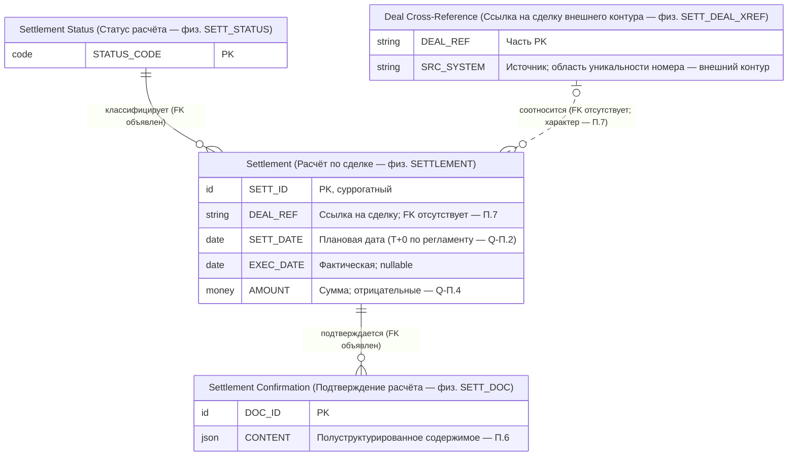

# Приложение П. Пример восстановления AS-IS

**Версия:** 0.8-в11 (Р-039 — полный пример, одна итерация: П.0–П.14, включая испытание PR-009/PR-010; подготовительная часть 0.6-в4 поглощена полной редакцией — ревизии по истории Git). Статус — **методический пример** (рабочий документ): сквозной пример применения специального порядка восстановления AS-IS (регламент 0.2, раздел 4; разделы 9.x Правил — якоря) к фрагменту «расчёты по сделкам». Новых обязательств не вводит (Правила 3.10); синтетическая подготовка не выдаётся за практический AS-IS-пилот (ПВ-09, Р-020). Включение материалов примера ГК — после ПВ-06.

Соотношение с примером Н (Н.0): Н — TO-BE-проектирование того же домена «Расчёты» и соседних; П — восстановление действующего бэк-офисного контура. Фрагменты намеренно независимы: П демонстрирует ход «реализация → модель», обратный ходу Н; пересечение понятий не означает их тождества (Правила 2.8, [[Правила#^CDM-021|CDM-021]]).

## П.0. Рамка примера, паспорт и допущения

### П.0.1. Паспорт фрагмента (мини-форма по Г.2/Л.1; методический)

| Поле | Значение |
|---|---|
| Идентификатор модели | `MD-SETL-01` (пространство имён методических примеров) |
| Назначение | Методическая демонстрация специального порядка AS-IS (регламент 4.1–4.11); не операционная модель |
| Уровень и вид | ЛМД (отправной этап восстановления — регламент 4.4) + фрагмент КМД (4.3); профиль — системная реляционная (унаследованная структура) |
| Режим и состояние | **AS-IS** (3.2); смешанный режим не используется; предложения TO-BE — отдельно (П.11) |
| Домен | «Расчёты» (бэк-офисный расчётный контур) |
| Охват | Расчёты по сделкам за период: инициация, исполнение, подтверждение |
| Исключения | Торговый контур (сделки — внешний линк); клиринг; позиции; таргетирование нетто |
| Версия и статус | 0.8-в11; черновик методического примера |
| Ответственные | Владелец бизнес-семантики и технический эксперт — методические роли (организационные назначения — ПВ-01) |
| Хранилище | Репозиторий проекта; авторитетное хранилище организации — 11.1 (неприменимо до ПВ-01) |

### П.0.2. Допущения примера

1. Источники синтетические; «подтверждено» означает подтверждённость синтетическим источником с фиксированной версией/датой (5.8), не корпоративным актом.
2. AS-IS документируется «как есть»: устранение недостатков, приведение к целевой архитектуре и унификация понятий не выполняются (регламент 1); изменения — отдельные задачи TO-BE (П.11).
3. Проверочные случаи изолированы в тестовых копиях с собственным пространством имён (12.2); в примере случаев нет — правило зафиксировано.
4. Неизвестность предметного факта при корректной фиксации — не невыполнение требования к документированию (3.10, [[Правила#^GEN-002|GEN-002]]).

### П.0.3. Реестр вопросов примера (форма Л.2; ведётся в примере)

| ID | Формулировка | Категория | Статус (5.8) | Влияние |
|---|---|---|---|---|
| Q-П.1 | Дубли (номер сделки, дата расчёта) во внебиржевом контуре: правило допускает или дефект практики? | расхождение правил и практики | не установлено | ограничивающее |
| Q-П.2 | Срок расчётов: регламент — T+0; фактическая практика — часть инструментов T+1 (наблюдение) | конфликтующая трактовка | противоречие источников | ограничивающее |
| Q-П.3 | Бизнес-смысл признака «анонимная сделка» в таблице расчётов | пробел документации | предположение | не влияющее |
| Q-П.4 | Отрицательные суммы расчётов: возвраты или дефект загрузки | пробел документации | не установлено | не влияющее |
| Q-П.5 | Архив подтверждений за один месяц периода недоступен | ограничение обследования | подтверждено (само ограничение) | ограничивающее |
| Q-П.6 | Бизнес-смысл кода `SETT_TYPE` (перечень значений не документирован) | пробел документации | не установлено | ограничивающее |

## П.1. План обследования (регламент 4.1, T-048; форма — прил. Л.7)

| Элемент плана | Значение |
|---|---|
| Системы и структуры | Бэк-офисная система расчётов (СУБД, схема `SETT`); регламент расчётов (документ); выгрузка подтверждений (JSON); интервью |
| Период данных | 12 месяцев (один месяц архива недоступен — Q-П.5) |
| Глубина рекурсии | Один уровень: ссылки на торговый контур фиксируются как внешние линки (LDM-025), не обследуются |
| Эксперты | Расчётный эксперт (семантика), администратор БД (структура) |
| Порядок работ | Инвентаризация (4.2) → восстановление ЛМД как отправной этап (4.4) → фрагмент КМД (4.3) → документы (4.5) → характер связей и статусы (4.6) → профилирование (4.7) → экспертная сессия (4.9) → приёмка этапов (4.11) |
| Согласование охвата | С владельцем систем и семантики (методические роли); критерии достаточности этапа — 4.11 |
| Ресурсы и доступы | С учётом ИОД (5.4): данные расчётов размечаются по минимальному объёму И.4 |

## П.2. Реестр источников обследования (регламент 4.2, T-049)

| Источник | Тип | Версия/дата | Состояние | Способ верификации |
|---|---|---|---|---|
| Схема БД `SETT` (бэк-офис) | Технический | DDL 2026-06 | Актуален | Сверка с производственной схемой (администратор БД) |
| Регламент расчётов | Документ | Ред. 2025-11 | **Устарел** (фактическая практика расходится — Q-П.2) | Сверка с наблюдениями (4.7) |
| Интервью с расчётным экспертом | Экспертный | 2026-10-10 | Актуален (мнение) | Экспертная сессия (4.9) |
| Выгрузка расчётов за период | Профилирование | 12 мес | **Частично применим** (месяц отсутствует — Q-П.5) | Профилирование (4.7) |
| Выгрузка подтверждений (JSON) | Полуструктурированный | Текущий формат | Актуален (формат) | Разбор полей (4.5) |
| Архив подтверждений (сканы) | Документ-скан | 2024+ | **Недоступен** (частично) | Ограничение обследования (Q-П.5) |

Приоритет по виду утверждения (4.2): структура реализации подтверждена схемой БД; бизнес-смысл и нормативные ограничения — регламентом и владельцем семантики; фактическое поведение — наблюдениями (4.7). Источник существования структуры (схема) ≠ источник бизнес-смысла (регламент/эксперт) — учитывается раздельно (8.1). Противоречия не устраняются автоматическим выбором одного источника (4.2) — обе стороны регистрируются (П.9).

## П.3. Этап 1 «Инвентаризация» (регламент 4.11)

Результат этапа: паспорт (П.0.1), реестр источников с состояниями (П.2), предварительный перечень сущностей из схемы: `SETTLEMENT` (расчёты), `SETT_STATUS` (статусы), `SETT_DOC` (подтверждения-документы), `SETT_DEAL_XREF` (ссылки на сделки внешнего контура). Без определений, кардинальностей и смыслов — результат «инвентаризация», не «модель» (4.11; таблица этапов — П.12).

## П.4. Восстановление ЛМД фрагмента (регламент 4.4 — отправной этап)

Реконструкция из физических структур; физические имена сохранены как сведение ([[Правила#^LDM-002|LDM-002]], Д.1 п. 6 — унаследованные имена с пометкой); логические наименования присвоены при восстановлении. Маркировка источника и статуса семантики — LDM-039: «подтверждено (структура)» — по схеме БД; смысл — только при подтверждении регламентом/экспертом.

| Сущность (физ. имя) | Логическое наименование | Ключи (по схеме) | Атрибуты (существенные) | Статус семантики (LDM-039) |
|---|---|---|---|---|
| `SETTLEMENT` | Расчёт по сделке | PK `SETT_ID` (суррогатный); уникальность не объявлена | `DEAL_REF` (ссылка на сделку), `SETT_DATE` (плановая), `EXEC_DATE` (фактическая, nullable), `AMOUNT`, `CURRENCY`, `SETT_TYPE` (смысл — Q-П.6), `ANON_FLAG` (смысл — Q-П.3) | Определение — подтверждено (регламент, ред. 2025-11); `SETT_TYPE`, `ANON_FLAG` — не установлено/предположение |
| `SETT_STATUS` | Статус расчёта (справочник) | PK `STATUS_CODE` | `STATUS_NAME` | Коды — подтверждено (схема); бизнес-смысл переходов — предположение (интервью) |
| `SETT_DOC` | Подтверждение расчёта (документ) | PK `DOC_ID` | `SETT_ID` (ссылка), `DOC_DATE`, `CONTENT` (JSON), `SCHEMA_VER` | Подтверждено (схема + формат выгрузки) |
| `SETT_DEAL_XREF` | Ссылка на сделку внешнего контура | PK (`DEAL_REF`, `SRC_SYSTEM`) | `EXTERNAL_DEAL_NO`, `LOAD_TS` | Подтверждено (схема); межсистемный линк — LDM-025 |

Ограничения схемы: PK объявлены; CHECK/UNIQUE отсутствуют (не реализовано — зафиксировано явно, 4.4); NOT NULL — на `DEAL_REF`, `SETT_DATE`, `AMOUNT`. Восстановленная диаграмма фрагмента (двуязычные подписи — как в примере Н):

Соответствия КМД↔ЛМД строятся по мере восстановления КМД ([[Правила#^LDM-003|LDM-003]]: отсутствие КМД не блокирует) — П.5.

## П.5. Восстановление фрагмента КМД (регламент 4.3)

Понятия из структур, регламента и интервью; рабочие определения с фиксацией в реестре вопросов; предположения маркированы ([[Регламент AS-IS#^CDM-043|CDM-043]]).

| Понятие | Рабочее определение (экземпляр) | Статус (CDM-043) | Основание/дата | Соответствие ЛМД |
|---|---|---|---|---|
| Расчёт по сделке | Бизнес-факт исполнения обязательств по заключённой сделке: перевод денежных средств и учёт поставки; ≠ сделка (заключение) | Подтверждено | Регламент, ред. 2025-11, п. 2 | `SETTLEMENT` — 1:1 |
| Сделка (внешнее понятие) | Заключённая сделка торгового контура; за границами охвата, ссылка | Предположение | Интервью 2026-10-10 | Линк `SETT_DEAL_XREF` / `DEAL_REF` (LDM-025) |
| Статус расчёта | Состояние ЖЦ: инициализирован → исполнен/отклонён; смысл переходов | Частично (переходы — предположение) | Схема + интервью | `SETT_STATUS` — 1:1 |
| Подтверждение расчёта | Документ-извещение об исполнении расчёта | Подтверждено | Формат выгрузки 2026-06 | `SETT_DOC` — 1:1 |
| Расчётный день | Плановая дата исполнения по режиму (T+0 — см. Q-П.2) | Противоречие источников | Регламент против наблюдений — П.9 | `SETT_DATE` — характеристика |

Утверждённого глоссария нет — не блокирует восстановление ([[Правила#^CDM-007|CDM-007]]); термины предложены к включению (8.2) — зафиксировано.

## П.6. Документы и полуструктурированные источники (регламент 4.5)

| Источник | Решение | Извлечённая семантика / фиксация |
|---|---|---|
| Регламент расчётов | Документ-источник (не моделируемый объект) | Основание правил и определений; состояние «устарел» — П.2 |
| Выгрузка подтверждений (JSON) | Извлекается частично | Реквизиты (`DOC_DATE`, `SCHEMA_VER`, ссылка на расчёт) — в модель (`SETT_DOC`); вложенные блоки реквизитов контрагентов — **«чёрный ящик»** с метаданными (T-052): состав полей вариативен, семантика не документирована |
| Архив сканов | Недоступен (частично) | Ограничение обследования — Q-П.5; неполная выборка учтена в 4.7 |

Полуструктурированное содержимое `CONTENT` ([[Правила#^LDM-044|LDM-044]]): варианты структуры по `SCHEMA_VER`; отсутствующее поле ≠ null (семантика зафиксирована); обратная совместимость версий не подтверждена — предположение.

## П.7. Характер связей, подтверждённость и механизмы контроля (регламент 4.6; CDM-043, LDM-039; 8.9)

| Связь | Характер | Механизм (8.9) | Состояние обследования | Известные нарушения |
|---|---|---|---|---|
| `SETT_STATUS` → `SETTLEMENT` | Бизнес-отношение (классификация) | Декларированный FK (схема) | Контроль СУБД — установлен (объявлен); фактическая проверка всех строк — не обследовано | Не наблюдались |
| `SETT_DOC` → `SETTLEMENT` | Бизнес-отношение (подтверждение) | Декларированный FK (схема) | То же | Не наблюдались |
| `SETTLEMENT` → сделка (`DEAL_REF`) | Кандидат в бизнес-отношение | **FK отсутствует** (установлено); контроль приложения — **не обследован** (отдельное поле, 4.6) | Частично | Расчёты без сопоставленной сделки — наблюдение (неполная выборка, 4.7) |

«Отсутствует» (механизм) ≠ «не установлен» (статус обследования) — поля раздельные (4.6). Наличие объявленного FK не доказывает фактическую проверку всех данных. Строка матрицы реализации ([[С Матрица реализации ограничений|прил. С]], AS-IS-стиль — соответствует С.3):

| Правило | Преобразование | Механизм | Состояние | Компонент | Проверка | Ограничение |
|---|---|---|---|---|---|---|
| «Каждый расчёт относится к заключённой сделке» | Не представлено в схеме (FK отсутствует) | Контроль приложения | Частично реализовано | Бэк-офис расчётов | Свидетельство сверки выборки | Расчёты без сделки — наблюдение; контроль загрузки не обследован |

Добавление механизмов контроля в действующую систему для завершения документирования не требуется ([[Правила#^LDM-019|LDM-019]]).

## П.8. Профилирование данных и границы доказательности (регламент 4.7)

| Наблюдение | Выборка/период | Результат |
|---|---|---|
| Дубли `(DEAL_REF, SETT_DATE)` | 12 мес, 11/12 месяцев (Q-П.5) | Встречаются только во внебиржевом контуре; наблюдаемая уникальность в биржевом контуре **не объявлена правилом** (LDM-013) → Q-П.1 |
| `EXEC_DATE` < `SETT_DATE` | Та же | Единичные случаи; фактическое поведение — не правило; зафиксировано как наблюдение |
| Отрицательные `AMOUNT` | Та же | Смысл неизвестен (возвраты?) — Q-П.4 |

Границы доказательности: наблюдение — вспомогательное свидетельство на заявленных выборке/периоде/полноте (4.7); свидетельство наблюдения не доказывает правило (2.8).

## П.9. Документирование неизвестного и противоречий (регламент 4.8)

| Факт неизвестного/противоречия | Категория (4.8) | Фиксация |
|---|---|---|
| Q-П.2: срок расчётов | Конфликтная трактовка | **Обе трактовки** со статусом «противоречие источников»: (а) T+0 — регламент, ред. 2025-11, действует с 2025-11; (б) T+1 по части инструментов — наблюдение с 2026-03, контекст: внебиржевой контур. В модель внесено действующее правило (а) с контекстом; отклонение — запись категории «расхождение правил и практики» (GEN-002); периоды действия различны — правила разных периодов не обязательно противоречат (5.7), вопрос направлен владельцу семантики |
| Q-П.3: «анонимная сделка» | Пробел документации | Предположение (интервью): расчёт без раскрытия клиента; правдоподобное дополнение не маскирует неизвестность |
| Q-П.4: отрицательные суммы | Пробел документации | Не установлено |
| Q-П.6: `SETT_TYPE` | Пробел документации | Не установлено; перечень значений не перенесён в модель без расшифровки (Р.7) |
| Q-П.5: недоступный архив | Ограничение обследования | Подтверждено (само ограничение); учтено в границах 4.7 |

«Не установлено» — результат обследования, не дефект документирования (3.10, регламент 5).

## П.10. Поэтапное уточнение и экспертная проверка (регламент 4.9)

Цикл «фиксация → экспертная сессия → уточнение статусов → расширение охвата». Сессия (состав — план П.1): рассмотрены Q-П.2, Q-П.3, Q-П.6. Изменения статусов по правилам 5.8 (основание, источник, дата; история сохраняется):

| Утверждение | Было | Стало | Основание |
|---|---|---|---|
| Определение «Расчёт по сделке» | Предположение | Подтверждено | Экспертная сессия 2026-10-10 + регламент |
| Переходы статусов расчёта | Предположение | Предположение (частично подтверждено: инициализация/исполнение) | Сессия; отклонение — осталось предположением |
| Q-П.2 (T+0/T+1) | Не установлено | Противоречие источников | Появление второго источника (наблюдение 4.7) — статус изменён с фиксацией истории |

Расширение охвата не потребовалось (замеченные зависимости за границами — сделки торгового контура — зарегистрированы для оценки влияния 8.11, не стали обязательством этапа, 4.11).

## П.11. Отделение предложений TO-BE (регламент 4.10)

| Предложение | Категория (4.8) | Затронутые элементы |
|---|---|---|
| Перевод внебиржевого контура на T+1 | Предложение развития | `SETT_DATE` (правило расчётного дня); связано с Q-П.2 |
| Декларирование уникальности `(DEAL_REF, SETT_DATE)` после разрешения Q-П.1 | Предложение развития | Ограничения `SETTLEMENT` |

Предложения оформлены записями реестра вопросов и **не внесены** в AS-IS-модель (3.4, [[Правила#^GEN-001|GEN-001]]); изменение бизнес-ключей не происходит — указаний на мутацию тестовых копий нет (4.10).

## П.12. Поэтапная приёмка (регламент 4.11; Правила 10.5)

| Этап | Результат | Допустимые пробелы | Оценка |
|---|---|---|---|
| Инвентаризация | Паспорт, реестр источников с состояниями, перечень сущностей | Без определений и кардинальностей — не блокирует цели этапа | Допустимо |
| Восстановление фрагмента | ЛМД (П.4) + фрагмент КМД (П.5) со статусами; реестр вопросов | Неподтверждённые смыслы `SETT_TYPE`/`ANON_FLAG` при явной маркировке — не блокирует | Допустимо |
| Уточнение семантики | Экспертная сессия; статусы уточнены (П.10) | Q-П.2 остаётся противоречием — принят ответственным в пределах этапа (цель этапа — фиксация, не разрешение) | Допустимо (решение уполномоченного — методическая роль) |

Регистрация пробела — необходимое, но не достаточное условие допустимости (4.11); непокрытия обязательной части охвата нет — недопустимых пробелов нет. Несопоставленные элементы: вложенные блоки подтверждений («чёрный ящик», П.6) — с причиной и границей ответственности (8.10).

## П.13. Испытание PR-009 и PR-010 (по карточкам Ж.11)

**[[Ж Контрольные листы и процедуры приёмки#^PR-009|PR-009]] «Экспертная валидация AS-IS-фрагмента».** Вход: фрагмент (П.4–П.5), статусы подтверждения (П.5, П.10). Шаги: экспертная сессия по предположениям и противоречиям (П.10); уточнение статусов по 5.8; расширение охвата (не потребовалось). Критерий: [[Регламент AS-IS#^CDM-043|CDM-043]], [[Регламент AS-IS#^LDM-039|LDM-039]]; регламент 4.9. **Результат: `verified`** — все предположения рассмотрены, противоречие Q-П.2 документировано с контекстом и периодами; свидетельство — П.10 (карточки утверждений по Г.5 ведутся для существенных: определение расчёта, правило T+0).

**[[Ж Контрольные листы и процедуры приёмки#^PR-010|PR-010]] «Приёмка этапа AS-IS».** Вход: результаты этапа 3 (П.12), реестр вопросов (П.0.3), 10.5/10.9. Шаги: сверка результатов с целями этапа; классификация пробелов (допустимый пробел — T-050); решение уполномоченного лица (методическая роль); протокол. Критерий: 10.5, 10.9–10.11; регламент 4.11. **Результат: `verified`** — этап 3 принят с замечаниями (открытые Q-П.2/Q-П.6 — классифицированы, риски приняты); решение не подменено автоматикой (10.11); свидетельство — П.12 и настоящий пункт.

## П.14. Покрытие норм специального порядка примером

| Пункт | Где иллюстрируется |
|---|---|
| Регламент 4.1 (план обследования, T-048) | П.1 |
| Регламент 4.2 (реестр источников, T-049; приоритеты по виду утверждения) | П.2 |
| Регламент 4.3 (восстановление КМД; отсутствие КМД не блокирует) | П.5 |
| Регламент 4.4 (восстановление ЛМД из структур; нереализованные ограничения) | П.4 |
| Регламент 4.5 (документы; «чёрный ящик» T-052) | П.6 |
| Регламент 4.6 (CDM-043, LDM-039; характер связей; «отсутствует» ≠ «не установлен») | П.5, П.7 |
| Регламент 4.7 (профилирование; наблюдение ≠ правило) | П.8 |
| Регламент 4.8 (неизвестное и противоречия; «не установлено» — результат) | П.9 |
| Регламент 4.9 (цикл уточнения; смена статусов с историей) | П.10 |
| Регламент 4.10 (отделение TO-BE, GEN-001) | П.11 |
| Регламент 4.11 (результаты этапов; допустимость пробелов; 8.10) | П.3, П.12 |
| Правила 10.5/10.9–10.11 (приёмка этапа, протокол) | П.12, П.13 |
| Правила 5.7–5.8 (виды/статусы утверждений, история смены) | П.5, П.9, П.10 |
| Правила 12.2 (изоляция проверочных случаев) | П.0.2 п. 3 |

---

*Конец [[П Пример восстановления AS-IS|приложения П]]. Методический пример: новых обязательств не вводит (3.10); не является практическим AS-IS-пилотом (ПВ-09). Испытание PR-009/PR-010 отражено в статусах [[Ж Контрольные листы и процедуры приёмки|прил. Ж]]; после ПВ-06 — вопрос о включении материалов примера ГК.*
